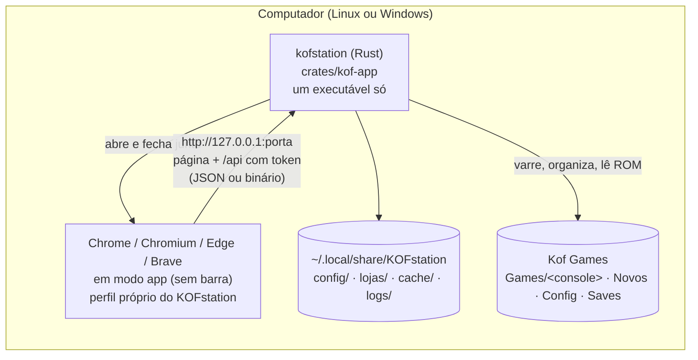
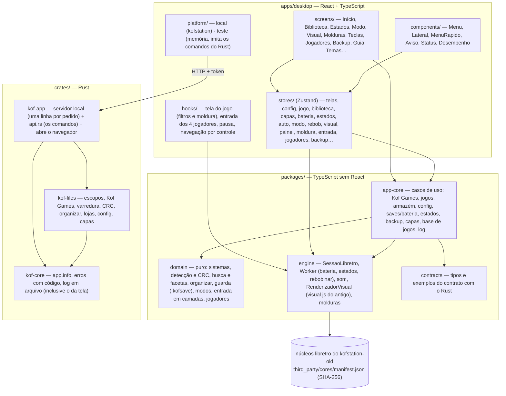
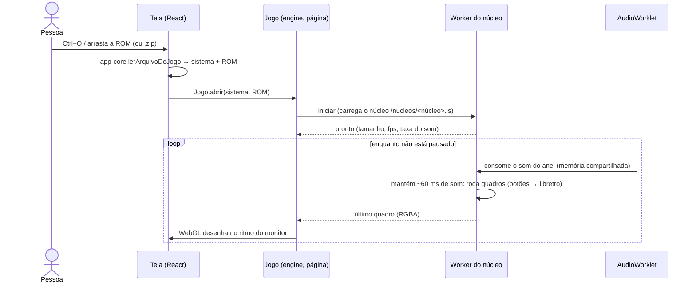

# KOFstation

The best emulator ever, and I'm not kidding.

Central de jogos retrô para **Linux e Windows** (e Android, mais pra frente): biblioteca, temas, filtros de imagem,
jukebox, saves, rebobinar, o celular como controle. Os emuladores são núcleos **libretro** consagrados; o KOFstation é a
camada de experiência em volta deles.

> **Este repositório é a arquitetura nova, em construção.** O app que funciona hoje, completo, está em
> [Marcelao98/kofstation-old](https://github.com/Marcelao98/kofstation-old) e continua sendo o produto até a troca.
> A migração anda em etapas com paridade total: nada do antigo pode se perder ([docs/PARIDADE.md](docs/PARIDADE.md)).

**Onde estamos (02/11/2026):** etapas **M3 a M8 feitas**, aprovadas pelo Marcelo em 02/11 — biblioteca e pasta Kof Games,
configurações em arquivo e backup `.kofsave` (abre nos dois apps), saves, estados, salvar automático, modos de jogo,
rebobinar, painel de imagem (os mesmos pixels do antigo nas 42 predefinições), molduras, paletas, controles por console e
por jogo e jogadores 2 a 4. Roda SNES, NES, Game Boy/Color, GBA, Mega Drive, Master System e Game Gear. Detalhe de cada etapa: [docs/ROADMAP.md](docs/ROADMAP.md). O que aconteceu em cada sessão:
[docs/JORNAL.md](docs/JORNAL.md).

---

## A arquitetura hoje

### Visão geral: um executável, um navegador, um motor



O `kofstation` leva **o app web inteiro e os núcleos dentro dele**. Ao abrir, ele sobe um servidor só em `127.0.0.1`
(porta aleatória, token aleatório, conferência de origem, cabeçalhos COOP/COEP) e abre o navegador da pessoa em modo
app. Fechou a janela, ele fecha. Por que assim e não Tauri/Electron: [docs/SPIKE_D2.md](docs/SPIKE_D2.md) e a decisão
D2 em [docs/DECISIONS.md](docs/DECISIONS.md).

### Camadas (quem pode falar com quem)



Regras conferidas por lint (`eslint.config.js`): `domain` não importa nada do projeto; `engine` não usa React;
`screens/` e `components/` não falam com a `engine` nem com o backend direto. Detalhes:
[docs/ARCHITECTURE.md](docs/ARCHITECTURE.md) e [docs/FRONTEND.md](docs/FRONTEND.md).

### Como um jogo roda



O **som dita o ritmo** (decisão D22): o núcleo roda num Web Worker e o AudioWorklet consome no relógio da placa de som.
Medido: 60 fps e nenhuma falta de som, também com a CPU limitada a 4×. O adaptador do núcleo (`SessaoLibretro`) dá
**a mesma imagem e o mesmo som que o adaptador do app antigo**, quadro a quadro (`packages/engine/test/paridade.test.ts`).

### O que já existe e o que falta

| Parte | Estado |
|---|---|
| Casca: menus, barra lateral, Início, Guia, 126 temas, showcase, Voltar, atalhos, navegação por controle | ✅ M1 |
| Jogo: núcleo no Worker, som, imagem com escala/proporção, teclado e controle, pausa, turbo, volume, menu rápido, painel F3, abrir arquivo/.zip/arrastar | ✅ M2 |
| Biblioteca (busca, facetas, base de jogos, capas, sofá) e pasta Kof Games (organizar com plano) | ✅ M3 |
| Configurações em arquivo (camadas geral → console → jogo) e backup `.kofsave` (abre nos dois apps) | ✅ M4 |
| Save de bateria, estados (abrem nos dois apps), salvar automático, Continuar, modos de jogo | ✅ M5 |
| Rebobinar (no Worker, igual ao antigo) | ✅ M6 |
| Painel de imagem (os mesmos pixels do antigo), passadas, molduras, paletas | ✅ M7 |
| Controles e teclas por console/jogo, analógico no teclado, jogadores 2–4 | ✅ M8 |
| Jukebox e música, estatísticas, patches, caçador de bugs | ⬜ M9–M10 |
| PS1, N64, Neo Geo, PS2 | ⬜ M11–M12 |
| Rede e celular, pacotes e atualização, Android | ⬜ M13–M15 |

---

## Rodar

Só testar (sem compilar nada), instalando em `~/Programas/Kof Games/KOFstation` (a pasta de cima vira a Kof Games):

```bash
mkdir -p ~/Programas/"Kof Games"/KOFstation && curl -fL -o ~/Programas/"Kof Games"/KOFstation/kofstation https://raw.githubusercontent.com/Marcelao98/KOFstation/teste-binarios/kofstation && chmod +x ~/Programas/"Kof Games"/KOFstation/kofstation && ~/Programas/"Kof Games"/KOFstation/kofstation
```

Pelo código (precisa de Node 22+, Rust pelo rustup e um navegador Chromium; detalhes em
[docs/INSTALAR.md](docs/INSTALAR.md)):

```bash
sh rodar.sh
```

Desenvolvimento:

| Comando | O que faz |
|---|---|
| `pnpm install` | dependências (versões travadas no `pnpm-lock.yaml`) |
| `pnpm nucleos` | baixa os núcleos do kofstation-old e confere o SHA-256 |
| `pnpm dev` | o app no navegador, com o backend de teste (sem Rust) |
| `pnpm check` | formato, lint, tipos e testes do TypeScript |
| `pnpm check:rust` | formato, clippy e testes do Rust |
| `pnpm e2e` | testes de fluxo no Chromium (Playwright) |
| `pnpm build && cargo build --release -p kof-app` | gera o executável `target/release/kofstation` |

O CI (GitHub Actions) roda tudo isso no Linux e no Windows a cada envio.

## Documentação

Mapa completo em [docs/README.md](docs/README.md). Pra quem chega agora: este README → [docs/JORNAL.md](docs/JORNAL.md)
(a última entrada) → [docs/ROADMAP.md](docs/ROADMAP.md). Agentes de IA: [AGENTS.md](AGENTS.md).

## Licença

GPL-3.0 ([LICENSE](LICENSE)). Terceiros, inclusive os núcleos que só podem ser usados sem fins comerciais:
[THIRD_PARTY.md](THIRD_PARTY.md). Nenhuma ROM, BIOS ou jogo é distribuído, nem indicado onde baixar.
