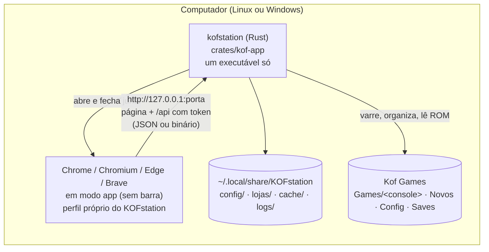
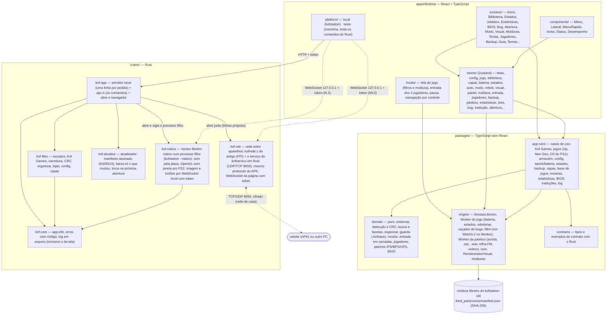
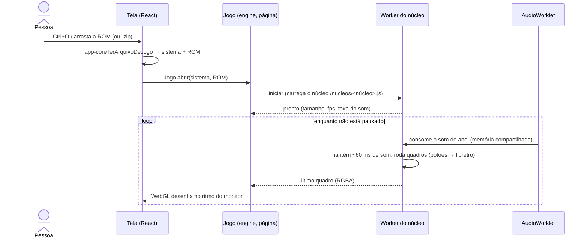

# KOFstation

The best emulator ever, and I'm not kidding.

Central de jogos retrô para **Linux e Windows** (e Android, mais pra frente): biblioteca, temas, filtros de imagem,
jukebox, saves, rebobinar, o celular como controle. Os emuladores são núcleos **libretro** consagrados; o KOFstation é a
camada de experiência em volta deles.

> **Este repositório é a arquitetura nova, em construção.** O app que funciona hoje, completo, está em
> [Marcelao98/kofstation-old](https://github.com/Marcelao98/kofstation-old) e continua sendo o produto até a troca.
> A migração anda em etapas com paridade total: nada do antigo pode se perder ([docs/PARIDADE.md](docs/PARIDADE.md)).

**Onde estamos:** o retrato pra ler em 5 minutos está em [docs/SITUACAO.md](docs/SITUACAO.md). Resumo (03/11/2026): M11b feito até o N.8 (PS1 nativo padrão, jukebox do SNES com Ondas/Notas, N64
desenhando), esperando o Marcelo testar; o PS2 nativo (N.9) é o próximo. Antes: M3 a M8 aprovados pelo Marcelo; **M9 a M11 feitos**, esperando ele testar — jukebox
(F7, ondas, notas, .spc, .wav, trilha do KOFstation, música do Início), abertura da 1ª vez, estatísticas, espaço usado,
traduções (IPS/BPS/UPS), caçador de bugs (F9) e a tela de BIOS. Roda SNES, NES, Game Boy/Color, GBA, Mega Drive, Master
System, Game Gear, **Neo Geo, PlayStation e Nintendo 64**. Detalhe de cada etapa: [docs/ROADMAP.md](docs/ROADMAP.md). O que aconteceu em cada sessão:
[docs/JORNAL.md](docs/JORNAL.md).

---

## A arquitetura hoje

### Visão geral: um executável, um navegador, um motor



O `kofstation` leva **o app web inteiro e os núcleos dentro dele**. Ao abrir, ele sobe um servidor só em `127.0.0.1`
(porta aleatória, token aleatório, conferência de origem, cabeçalhos COOP/COEP) e abre o navegador da pessoa em modo
app. Fechou a janela, ele fecha. Por que assim e não Tauri/Electron: [docs/SPIKE_D2.md](docs/SPIKE_D2.md) e a decisão
D2 em [docs/DECISIONS.md](docs/DECISIONS.md).

### Camadas (quem pode falar com quem)



Regras conferidas por lint (`eslint.config.js`): `domain` não importa nada do projeto; `engine` não usa React;
`screens/` e `components/` não falam com a `engine` nem com o backend direto. Detalhes:
[docs/ARCHITECTURE.md](docs/ARCHITECTURE.md) e [docs/FRONTEND.md](docs/FRONTEND.md).

### Como um jogo roda



O **som dita o ritmo** (decisão D22): o núcleo roda num Web Worker e o AudioWorklet consome no relógio da placa de som.
Medido: 60 fps e nenhuma falta de som, também com a CPU limitada a 4×. O adaptador do núcleo (`SessaoLibretro`) dá
**a mesma imagem e o mesmo som que o adaptador do app antigo**, quadro a quadro (`packages/engine/test/paridade.test.ts`).

### O que já existe e o que falta

| Parte | Estado |
|---|---|
| Casca: menus, barra lateral, Início, Guia, 126 temas, showcase, Voltar, atalhos, navegação por controle | ✅ M1 |
| Jogo: núcleo no Worker, som, imagem com escala/proporção, teclado e controle, pausa, turbo, volume, menu rápido, painel F3, abrir arquivo/.zip/arrastar | ✅ M2 |
| Biblioteca (busca, facetas, base de jogos, capas, sofá) e pasta Kof Games (organizar com plano) | ✅ M3 |
| Configurações em arquivo (camadas geral → console → jogo) e backup `.kofsave` (abre nos dois apps) | ✅ M4 |
| Save de bateria, estados (abrem nos dois apps), salvar automático, Continuar, modos de jogo | ✅ M5 |
| Rebobinar (no Worker, igual ao antigo) | ✅ M6 |
| Painel de imagem (os mesmos pixels do antigo), passadas, molduras, paletas | ✅ M7 |
| Controles e teclas por console/jogo, analógico no teclado, jogadores 2–4 | ✅ M8 |
| Jukebox e música (trilha FM, violino, .spc, .wav), abertura, música do Início | ⏸ M9 (falta o Marcelo testar) |
| Estatísticas, espaço usado, traduções, caçador de bugs (F9) e replay | ⏸ M10 |
| BIOS, GBA com BIOS, Neo Geo, PS1, N64 (núcleo do SNES: Snes9x; o Kof quando a Mel liberar) | ⏸ M11 |
| PS1 nativo (PCSX-ReARMed com recompilador, processo à parte, som pela placa, imagem pela página), jukebox do SNES com Ondas/Notas, N64 conferido | ⏸ M11b (N.1–N.8; falta o Marcelo testar) |
| PS2 nativo (LRPS2 do antigo, OpenGL sem janela no processo do jogo, DVD lido do disco) | ⏸ M12/N.9 (falta o Marcelo jogar) |
| Atualizador assinado (liga com a chave), pacote do Linux (`--instalar`), instalador do Windows, lado a lado com o antigo | ⏸ M15 (falta a chave e o Marcelo instalar) |
| Rede entre aparelhos (📡 Aparelhos, QR e código, pareia com o APK atual), celular como controle (rede e servidor do APK), 🖥 Jogar no PC (WebRTC), Levar pro celular | ⏸ M13 (falta o Marcelo testar com o celular) |
| Android (o APK servindo o app novo) | ⬜ M14 |

---

## Rodar

Só testar (sem compilar nada): a pasta `KOFstation` (o executável, `nucleos/`, `nativo/` e `versao.txt`, igual ao app
antigo) vai pra `~/Programas/Kof Games/` (a pasta de cima vira a Kof Games):

```bash
mkdir -p ~/Programas/"Kof Games" && curl -fL https://raw.githubusercontent.com/Marcelao98/KOFstation/teste-binarios/KOFstation-linux.tar.gz | tar -xz -C ~/Programas/"Kof Games" && ~/Programas/"Kof Games"/KOFstation/kofstation
```

No Windows: `KOFstation-windows.zip` da mesma branch, descompactado dentro da pasta Kof Games.

Pelo código (precisa de Node 22+, Rust pelo rustup e um navegador Chromium; detalhes em
[docs/INSTALAR.md](docs/INSTALAR.md)):

```bash
sh rodar.sh
```

Desenvolvimento:

| Comando | O que faz |
|---|---|
| `pnpm install` | dependências (versões travadas no `pnpm-lock.yaml`) |
| `pnpm nucleos` | baixa os núcleos do kofstation-old e confere o SHA-256 |
| `pnpm dev` | o app no navegador, com o backend de teste (sem Rust) |
| `pnpm check` | formato, lint, tipos e testes do TypeScript |
| `pnpm check:rust` | formato, clippy e testes do Rust |
| `pnpm e2e` | testes de fluxo no Chromium (Playwright) |
| `pnpm build && cargo build --release -p kof-app` | gera o executável `target/release/kofstation` |

O CI (GitHub Actions) roda tudo isso no Linux e no Windows a cada envio.

## Documentação

Mapa completo em [docs/README.md](docs/README.md). Pra quem chega agora: este README → [docs/JORNAL.md](docs/JORNAL.md)
(a última entrada) → [docs/ROADMAP.md](docs/ROADMAP.md). Agentes de IA: [AGENTS.md](AGENTS.md).

## Licença

GPL-3.0 ([LICENSE](LICENSE)). Terceiros, inclusive os núcleos que só podem ser usados sem fins comerciais:
[THIRD_PARTY.md](THIRD_PARTY.md). Nenhuma ROM, BIOS ou jogo é distribuído, nem indicado onde baixar.
