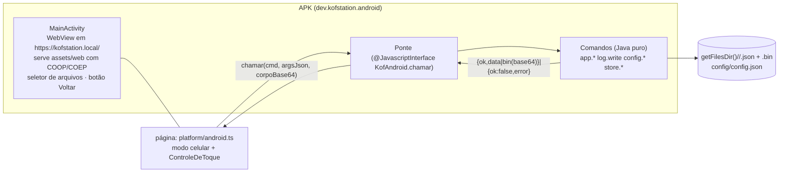

# Casca do Android (M14)

O app novo no celular é **a mesma página** (`apps/desktop/dist`) dentro de uma WebView, sem o Rust: a casca Java
(`android/`) faz o papel do `kof-app`. Não precisa de Gradle nem do SDK completo: `android/construir-apk.sh` usa as
ferramentas do Ubuntu (aapt, dalvik-exchange, apksigner, zipalign, android-23.jar) como o antigo.

## O que existe

| Parte | Onde | Estado |
|---|---|---|
| Adaptador `Backend` do Android | `apps/desktop/src/platform/android.ts` (+ teste) | ✅ escolhido sozinho quando existe `window.KofAndroid` |
| Modo celular, controle de toque, 6 modelos, Voltar | `app/celular.ts`, `components/ControleDeToque.tsx`, `styles/celular.css` | ✅ testado no navegador (`e2e/celular.spec.ts`) |
| Comandos da casca | `android/src/dev/kofstation/android/Comandos.java` | ✅ app.*, log.write, config.*, store.* (mesmos nomes de arquivo do Rust), nativo.disponivel (vazio), library.root.get (sem pasta). Teste de JVM: `android/testar.sh` |
| Ponte e WebView | `Ponte.java`, `MainActivity.java` | compilam contra o `android.jar` e o APK assina e verifica; **só se prova instalando** (T-CELULAR) |
| APK | `android/construir-apk.sh` → `target/KOFstation-novo.apk` | ✅ monta (8,5 MB), chave de teste `android/kofstation-teste.keystore` |
| Pasta de ROMs (SAF) e biblioteca (M14.3) | — | ⬜ `library.scan/organize/import`, `file.*` ainda devolvem `UNSUPPORTED` ("M14.3"). Hoje o jogo abre pelo seletor de arquivos e a cópia fica na loja `roms` |
| PS1 e N64 nativos (M14.4) | — | ⬜ precisa do Android NDK (as `.so` do `kofnativo.c` do antigo); `nativo.disponivel` devolve `[]`, então PS1/N64 caem no WebAssembly |
| Atualizador do APK (M14.5) | — | ⬜ `app.atualizacao` diz "desligado" |
| Rede entre aparelhos no celular (`Rede.java`, `ControleServidor.java` do antigo) | — | ⬜ o `Backend` não tem `rede()` no Android |

## Por que a página não muda

O contrato (`docs/API_CONTRACTS.md`) é o mesmo: comando com nome e argumentos, resposta `data` ou erro com código. A ponte só
troca o transporte (HTTP local no PC, `KofAndroid.chamar` no celular). Bytes viajam em base64 (saves e estados são
pequenos; CD grande é o M14.4, que lê direto do disco sem passar pela página).

## Instalar um APK de teste

Pelo adb (`adb install -r KOFstation-novo.apk`) ou copiando o arquivo pro celular e abrindo (liga "instalar de fontes
desconhecidas" pro app que abriu). O `applicationId` (`dev.kofstation.android`) é diferente do APK antigo (`dev.kofnes.android`):
os dois convivem, cada um com os seus dados.

## Próximos passos (na ordem)

1. **Instalar e olhar** (T-CELULAR no SITUACAO): abre? joga? o toque responde? salva?
2. **M14.3**: `library.root.set` por `ACTION_OPEN_DOCUMENT_TREE` (a `Pasta.java` do antigo já faz a parte do SAF), `library.scan`,
   `file.read/stat/zip.*` sobre `DocumentFile`, e o que `kof-files` faz em Rust (organizar, CRC, importar) em Java, com testes
   de JVM como o `ComandosTeste`.
3. **M14.4**: Android NDK no ambiente, compilar `kofnativo.c` (PS1 e N64) e ligar `nativo.*` à `Ps1Jogo.java`/`N64Jogo.java`.
4. **M14.5**: publicar o APK junto das versões (o `versao.yml` já monta o pacote do PC) e um `Atualizador.java` que confere a
   assinatura do manifesto (Ed25519 só existe no Android 13+: usar uma biblioteca ou assinar o APK e confiar na instalação).
