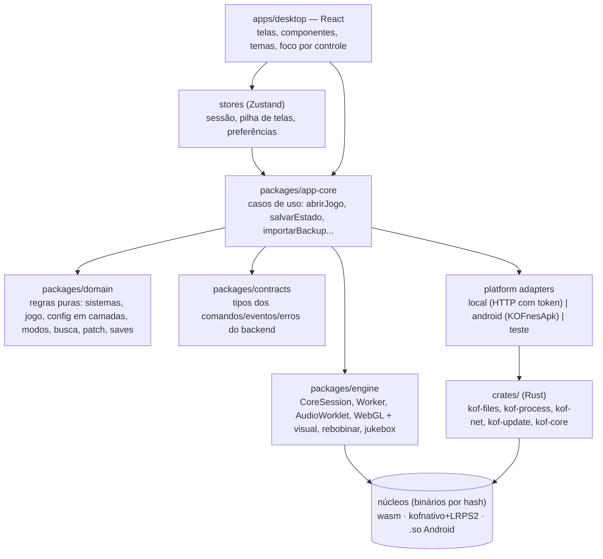
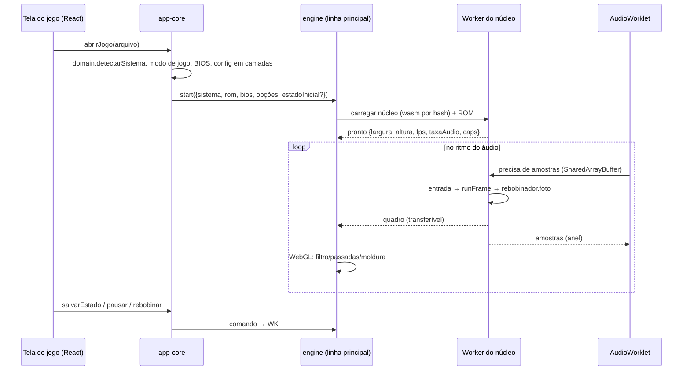

# Arquitetura do KOFstation (novo)

> Estado: **aprovada** (31/10/2026). A casca é a opção B (D2: Rust local + Chromium); o que já está construído aparece
> com diagramas no [README](../README.md#a-arquitetura-hoje), e o histórico no [JORNAL](JORNAL.md). Decisões em [DECISIONS.md](DECISIONS.md), contratos em
> [API_CONTRACTS.md](API_CONTRACTS.md), análise do sistema antigo em [auditoria/](auditoria/).

## 1. Ideia em uma frase

O KOFstation é uma **camada de experiência** em volta de emuladores que já existem: a interface (React) mostra e
organiza; o TypeScript sem React roda o jogo (núcleos libretro em WebAssembly, vídeo, som, rebobinar); o Rust cuida de
tudo que é do sistema operacional (arquivos, processos, rede, atualização). Nenhum emulador é reescrito.

## 2. Camadas



**Regra de dependência:** só para baixo. `domain` não importa nada do projeto. `engine` não importa React nem
stores. Telas não importam `engine` nem `platform` diretamente: passam pelos casos de uso. Isso é conferido por regra
de lint (`import/no-restricted-paths` ou equivalente) na F3.

| Camada | Pode | Não pode |
|---|---|---|
| domain | tipos, regras, cálculo, formatos de arquivo (`.kofsave`, IPS/BPS/UPS, `.spc`) | DOM, rede, arquivo, tempo real |
| engine | Worker, WebGL, Web Audio, carregar núcleo wasm, serializar estado | tela React, decidir regra de produto |
| app-core | orquestrar domain + engine + backend, emitir eventos pras stores | tocar no DOM |
| apps/desktop | mostrar, capturar gesto, chamar caso de uso | regra de negócio, chamar Rust direto |
| crates (Rust) | arquivos dentro do escopo, processos conhecidos, rede, atualização, logs | executar comando arbitrário, ler fora do escopo |

## 3. Estrutura de pastas

```
kofstation/
├── apps/desktop/src/{app,screens,components,stores,platform,styles}
├── packages/{domain,app-core,engine,contracts}/src
├── crates/{kof-core,kof-files,kof-process,kof-net,kof-update}
├── crates/kof-app/                    (a casca: servidor local + abre o navegador; D2)
├── third_party/cores/manifest.json   (núcleos por hash; binários fora do git)
├── tests/e2e/                         (Playwright)
├── tools/                             (Python: base de jogos, trilha FM, geradores de ROM de teste)
└── docs/
```

## 4. O jogo rodando (engine)



Estados de uma sessão: `idle → loading → running ⇄ paused → stopping → idle`, e `error {causa}` a partir de qualquer
um. Sidecar nativo (PS2): `absent → starting → ready → running → crashed (religa até N) → stopped`.

Contrato central: `CoreSession` (rascunho em [auditoria/PLANO_DETALHADO.md §3](auditoria/PLANO_DETALHADO.md#3-arquitetura-alvo-resumo-do-que-vai-ser-construído)).
Adaptadores: `WasmLibretroCore` (mesmos `nucleos/*.js` e `ponte.cpp` do antigo), `NativePcCore` (kofnativo via Rust),
`NativeAndroidCore` (`KOFnesApk`), `KofCore` (opcional, depende da Mel).

## 5. Comunicação com o backend

- O app-core fala com uma **porta** `Backend` (interface TS). Cada plataforma tem um adaptador: `local` (WebSocket em 127.0.0.1 com token aleatório gerado na abertura e conferência de `Origin`),
  `android` (ponte `KOFnesApk`), `test` (em memória, pros testes).
- Mensagens: `{id, cmd, args}` → `{id, ok: true, data}` ou `{id, ok: false, error: {code, message, details}}`; eventos
  `{event, data}`. Tudo descrito em [API_CONTRACTS.md](API_CONTRACTS.md).
- Dados grandes (pedaços de disco, quadros do PS2) vão em binário, nunca em JSON/base64.

## 6. Erros e logs

- Rust: `thiserror` com variantes específicas por crate, convertidas pro formato do contrato com um `code` estável.
- TS: `switch` exaustivo nos códigos (o compilador acusa código novo não tratado); a tela mostra a mensagem em
  português do código; o detalhe vai pro log.
- Proibido `catch` vazio sem comentário explicando por que o erro pode ser ignorado.
- Logs: `tracing` no Rust (arquivo rotativo na pasta de dados do app), e os logs do front vão pro mesmo arquivo por um
  comando `log.write` com nível. O painel de desempenho (F3 no teclado) continua existindo e lê métricas da engine.

## 7. Configurações

- Um esquema só (`domain/config`): para cada chave, tipo, padrão, **camadas permitidas** (geral → console → jogo) e se
  entra no backup. A resolução de camadas é genérica (`resolver(chave, {sistema, jogo})`), usada por teclas, botões,
  visual, moldura, modo de jogo, núcleo do SNES...
- Persistência em arquivo pelo Rust (`Kof Games/Config/*.json`, com `versao` do esquema e migração).
- Volume e mudo são do aparelho e **nunca** vão no backup (lição do Perfil antigo).

## 8. Dados do usuário

| Dado | Onde | Formato |
|---|---|---|
| Jogos | `Kof Games/Games/<sistema>/` (+ `Novos/`) | os arquivos do usuário |
| BIOS | `Kof Games/Config/bios/` | arquivos do usuário |
| Saves de bateria, savestates, automático | `Kof Games/Saves/<sistema>/<jogo>/` | compatível com o antigo (KofGuarda, gzip) |
| Configurações, estatísticas, biblioteca, músicas da jukebox | `Kof Games/Config/` | JSON versionado |
| Identidade da rede | pasta de dados do app (fora da Kof Games) | igual ao antigo (`identidade.bin`) |
| Cache (capas, base de jogos) | armazenamento da WebView | descartável |

Entrada vinda do app antigo: **importar `.kofsave`** (e exportar no mesmo formato).

## 9. Testes

| Nível | Ferramenta | O quê |
|---|---|---|
| Unidade | Vitest (Node) | domain, app-core com backend `test`, formatos de arquivo |
| Engine | Vitest + núcleos wasm reais | rodar N quadros de ROM gerada e comparar hash da imagem/som |
| Componentes | Testing Library | telas sem engine |
| Contratos | fixtures JSON + Vitest + `cargo test` | o mesmo exemplo passa dos dois lados |
| Backend | `cargo test` (+ `tempfile`) | Kof Games, saves, supervisão de processo, rede |
| Fluxos | Playwright Test | equivalentes aos testes do antigo (lista no PARIDADE.md) |
| Paridade | script comparando com o app antigo | mesmos pixels/som/arquivos |

ROMs de teste: só geradas pelos próprios testes ou livres; nunca no git.

## 10. Preparado para o futuro, sem construir antes

Android (adaptador `android` já previsto), outros SOs (crates sem Tauri), novos núcleos (novo adaptador ou só nova
entrada no manifesto), novos controles (serviço de entrada único), temas (tokens CSS), atualização (D12). Nada disso é
implementado antes da hora.
