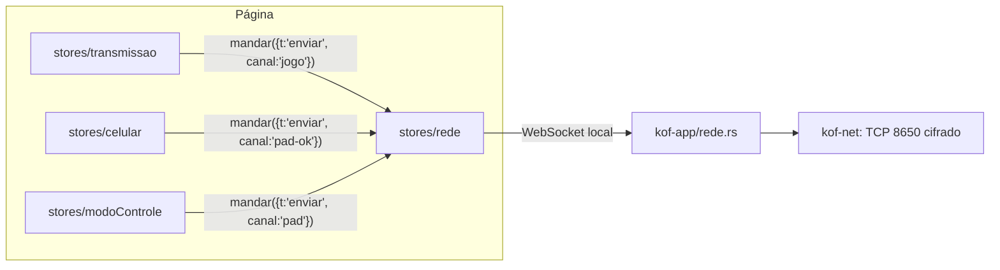
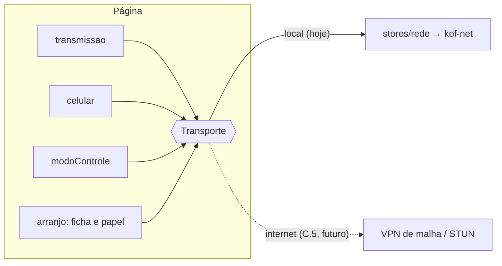
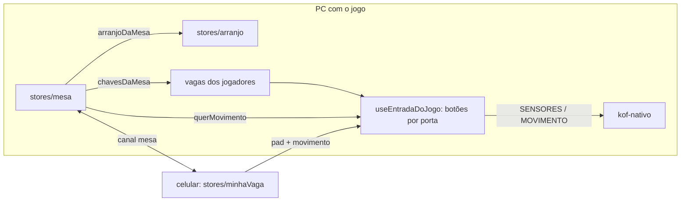

# Conectividade: aparelhos com papéis (fase C, tarefa N)

> Pedido (21/11): "configurar aparelhos, no máximo 3, cada um com uma função: tela, núcleo e teclado/controle. Na rede
> local. Fácil. No menu lateral, tipo Switch."

## Os três papéis

| Papel | O que faz | Quem pode |
|---|---|---|
| 🧠 **Núcleo** | roda o emulador (o jogo e o estado moram aqui) | o aparelho com o jogo aberto (PS2, Wii e GameCube só no PC) |
| 📺 **Tela** | mostra a imagem e toca o som | qualquer aparelho pareado (PC, notebook, celular) |
| 🎮 **Controle** | manda os botões (teclado, controle físico ou toque) | qualquer aparelho pareado, um ou vários |

Um **arranjo** = `{ nucleo, tela, controles[] }`, com **até 6 aparelhos distintos** (eram 3 na tarefa N; a tarefa M
abriu pra núcleo + tela + 4 jogadores). As regras (máximo, quem está na
rede, quem roda o console, o que fazer quando um cai) são funções puras em `packages/domain/src/arranjo.ts`, testadas.

Arranjos prontos (botões grandes no 📡 do menu lateral, um toque troca com o jogo rodando):

| | Arranjo | Núcleo | Tela | Controle |
|---|---|---|---|---|
| 🖥 | PC sozinho | PC | PC | PC |
| 📺 | PC + celular de controle | PC | PC (na TV) | celular |
| 📱 | Portátil | PC | celular | celular |
| 🖥📺📱 | Três aparelhos | PC | outro PC/notebook (ou celular) | um celular |
| 📱 | Celular sozinho | o APK (não precisa de rede) | | |

## Antes (até 20/11)

Cada store montava o pedido do serviço local na mão: trocar o caminho (internet, C.5) mexeria em todos.

## Depois (N.1)

`Transporte` (`packages/app-core/src/transporte.ts`): `enviar(para, canal, dados)` e `ouvir(canal, f)`. O de hoje é o
`transporteLocal` (o serviço `kof-net`); os testes usam o `transporteFalso`. Quem usa um canal pega `transporte()` do
`stores/rede` e não sabe por onde a mensagem passa.

## Os canais

| Canal | De → para | O quê | Desde |
|---|---|---|---|
| `pad` | controle → núcleo | `"botões,eixos"` | antigo |
| `pad-ok` | núcleo → controle | `{jogador, sis, nome}` | antigo |
| `jogo` | os dois lados | Jogar no PC: `pedir`, oferta/resposta do WebRTC, `levar` (vire a tela), `acao`, `fim` | antigo |
| `ficha` | todos | a ficha do aparelho (N.2): `{tipo, sistema, cpus, memoriaGb, tela, controles, consoles}` | 21/11 |
| `papel` | núcleo → aparelho | `{t:'papel', tela, controle}`: vire controle do núcleo, ou largue o papel | 21/11 |
| `mesa` | núcleo → aparelho | a mesa vista de lá (`VistaDaMesa`: as 4 vagas com nome e tipo, a vaga dele, se é a tela, se é Nunchuk), a cada mudança e a cada 3 s; `{t:'mesa', aberta:false}` ao fechar o jogo; `ping`/`pong` (atraso); `recentrar` | 22/11 |
| `mesa` | aparelho → núcleo | `entrar` (tipo e vaga opcionais), `sair`, `tela` (trazer a imagem pra cá), `calibrado` (o celular passou pelo assistente do Wiimote), `pong` | 22/11 |

O `pad` ganhou, no 3º campo (o movimento do celular-Wiimote, W.6), mais dois números: a sequência e a hora do celular
(M.3). O PC descarta o repetido, o fora de ordem e o que chegou mais de 120 ms depois do mais rápido; PC velho lê os 8
primeiros e ignora o resto.

**Compatível com o APK antigo:** canais novos são ignorados por quem não conhece (o protocolo de fio do `kof-net` leva
qualquer nome de canal). Aparelho que não manda ficha aparece como "ficha desconhecida". A tela usa o `levar` que o APK
já entende; só o "vire controle" precisa do app novo no celular.

## Como a troca acontece (com o jogo rodando)

- **Tela vai pra outro aparelho:** o núcleo manda `levar` no canal `jogo`; o aparelho entra no modo controle pedindo a
  imagem (`pedir`), e o núcleo transmite por WebRTC (vídeo da imagem crua, som do jogo, botões pelo canal de dados).
- **Tela volta:** o núcleo para a transmissão e manda `papel {tela:false}`; o aparelho sai do modo controle.
- **Controle:** `papel {controle:true}` → o aparelho entra no modo controle pela rede (canal `pad`) apontando pro núcleo.
- **Um aparelho cai** (`lista` sem ele online): `semQuemCaiu` volta a imagem pro núcleo e tira o controle que saiu,
  com aviso. O jogo não para em nenhum momento: o estado está no núcleo.
- **Lembrar (N.5):** o arranjo usado fica guardado por jogo, por console e o último (`arranjo.jogo.<id>`,
  `arranjo.<sistema>`, `arranjo`); ao abrir o jogo, volta pra ele se os aparelhos estão na rede.

## A Mesa (tarefa M, 22/11)

> "Controlar dispositivos como uma rede, fácil de configurar: core, tela e o resto controles (que podem ser Wiimotes);
> bom pra multiplayer; e um modo de calibração pro Wiimote, sem ligar automático."

**Mesa** = `{ nucleo, tela, jogadores: [J1..J4] }`, cada jogador = `{ aparelho, tipo, nunchuk?, semCalibrar? }` ou
livre (`packages/domain/src/mesa.ts`, puro e testado). Tipos: ⌨ teclado, 🎮 controle, 👆 toque, 📳 Wiimote,
📳🥢 Wiimote + Nunchuk, 🟪 GameCube; quais valem depende do console e do aparelho (`tiposDoConsole`: Wiimote só no Wii;
no celular, toque e Wiimote; GameCube no GameCube e no Wii).

- **A tela 🎲 Mesa** (menu rápido ☰, menu Arquivo, e o botão no 📡) e o **painel compacto** no 📡 do menu lateral e no
  🎲 do modo controle do celular: cartões dos aparelhos (ficha, na rede ou não, atraso), 🧠 Núcleo e 📺 Tela (tocar troca
  o aparelho da imagem), J1..J4 (tocar no aparelho passa pro próximo, tocar no tipo troca o tipo; o Nunchuk em outro
  celular na Mesa inteira). Em qualquer aparelho: **📺 Trazer a imagem pra cá** e **🎮 Entrar como jogador**.
- **A mesa manda no arranjo:** `trocarMesa` valida (`validarMesa`) e aplica pelo arranjo da tarefa N (a imagem e os
  papéis); os arranjos prontos e os chips continuam e a mesa acompanha (`mesaDoArranjo`).
- **Botões na porta certa:** a vaga da mesa entra nas `vagas` dos jogadores (`Vagas.mesa`) e vale antes da escolha da
  tela 🎮 Jogadores; ninguém mais pega a vaga de quem caiu. O Nunchuk em outro celular soma com o Wiimote (o mesmo
  jogador).
- **Cair e voltar:** a vaga fica **reservada** (cinza, "esperando"); quando o aparelho volta pra `lista`, ele recebe o
  papel de controle de novo e cai na mesma vaga. O jogo nunca para.
- **Atraso:** o núcleo manda `ping` a cada 3 s pra quem está na mesa; o atraso aparece no cartão e na vaga, e o pior no
  F3 (junto com a variação do movimento de cada Wiimote).
- **Lembrar:** as vagas ficam por jogo, por console e a última (`mesa.jogo.<id>`, `mesa.<sistema>`, `mesa`), como o
  arranjo; ao abrir o jogo, voltam (quem não está na rede fica esperando).

### O Wiimote: nada liga sozinho (M.4)

Até a W.6, o 1º movimento do celular ligava os sensores da porta e ficavam até fechar o jogo. Agora:

1. O celular só lê e manda os sensores quando **a vaga dele é Wiimote** (não Nunchuk) **e** ele está **calibrado** (ou a
   vaga está com "usar sem calibrar"). Sem isso, a vaga funciona com os botões e a Mesa mostra "⚠ sem calibrar".
2. O PC só passa o movimento pro jogo nas mesmas condições (`querMovimento`) e **liga e desliga os sensores de cada
   porta** com a mensagem nova `SENSORES` (11) do `kof-nativo`. O celular saiu (5 s sem mandar nada) ou trocou de tipo:
   a porta desliga, e o teclado volta a inclinar e chacoalhar.
3. **O assistente** (🎯 no modo controle do celular, ou na Mesa dele): 1) "Aqui é o meio"; 2) dois cantos opostos (os
   arcos da mira); 3) zona morta e suavização com a mira de teste; 4) chacoalhar 3× (o ganho, pra celular fraco
   chacoalhar como um Wiimote); 5) mão e posição; 6) acertar um alvo; salvar. As contas em
   `packages/domain/src/calibracao.ts`. Guardada no celular (`wiimote.calibracao`); o PC guarda quem disse que está
   calibrado (`wiimote.calibrados`). **⊕** no modo controle recentra a mira sem abrir o assistente; a Mesa do PC tem o
   mesmo botão por vaga.

## Testes

- `packages/domain/src/arranjo.test.ts`: o modelo (máximo de 3, quem roda o console, quem caiu, chips, ficha).
- `packages/app-core/src/transporte.test.ts`: o transporte local em cima dos pedidos do serviço e o falso.
- `packages/domain/src/mesa.test.ts`: o modelo da mesa (vagas, tipos por console, Nunchuk, reservada, o canal `mesa`).
- `packages/domain/src/calibracao.test.ts`: a calibração com movimentos gravados e a ordem do movimento (M.3).
- `apps/desktop/e2e/mesa.spec.ts`: PC + quatro "celulares": cada um entra pela Mesa, os botões chegam na porta certa,
  a Mesa cheia recusa o quinto, o atraso aparece, um cai e volta pra mesma vaga, e um celular traz a imagem pra ele.
- `crates/kof-nativo` (`protocolo.rs`): a mensagem `SENSORES` liga e desliga por porta.
- `apps/desktop/e2e/rede-papeis.spec.ts`: três páginas de verdade (PC, notebook, celular) ligadas por um "cabo" de
  teste: fichas chegando, o 📡 do menu lateral, Três aparelhos (imagem no notebook, botões do celular chegando no PC),
  PC sozinho de volta, e a tela caindo no meio.
