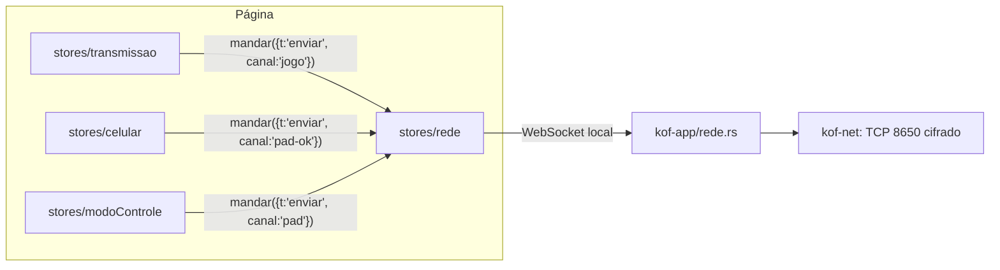
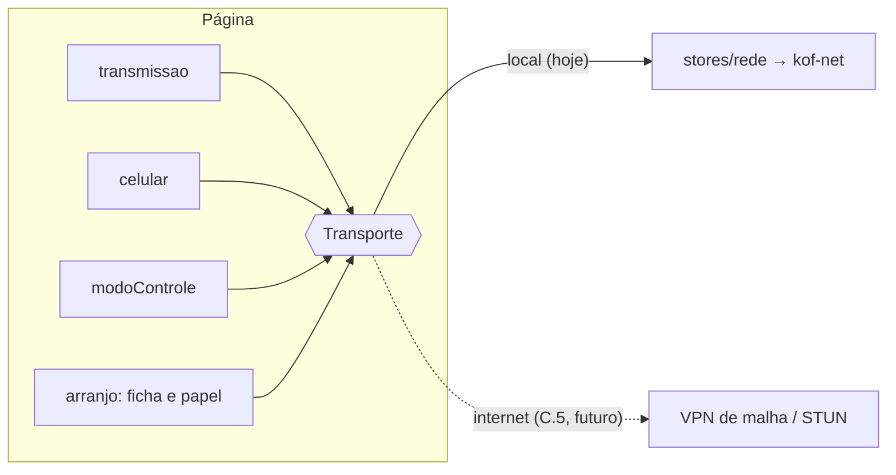

# Conectividade: aparelhos com papéis (fase C, tarefa N)

> Pedido (21/11): "configurar aparelhos, no máximo 3, cada um com uma função: tela, núcleo e teclado/controle. Na rede
> local. Fácil. No menu lateral, tipo Switch."

## Os três papéis

| Papel | O que faz | Quem pode |
|---|---|---|
| 🧠 **Núcleo** | roda o emulador (o jogo e o estado moram aqui) | o aparelho com o jogo aberto (PS2, Wii e GameCube só no PC) |
| 📺 **Tela** | mostra a imagem e toca o som | qualquer aparelho pareado (PC, notebook, celular) |
| 🎮 **Controle** | manda os botões (teclado, controle físico ou toque) | qualquer aparelho pareado, um ou vários |

Um **arranjo** = `{ nucleo, tela, controles[] }`, com **até 3 aparelhos distintos**. As regras (máximo, quem está na
rede, quem roda o console, o que fazer quando um cai) são funções puras em `packages/domain/src/arranjo.ts`, testadas.

Arranjos prontos (botões grandes no 📡 do menu lateral, um toque troca com o jogo rodando):

| | Arranjo | Núcleo | Tela | Controle |
|---|---|---|---|---|
| 🖥 | PC sozinho | PC | PC | PC |
| 📺 | PC + celular de controle | PC | PC (na TV) | celular |
| 📱 | Portátil | PC | celular | celular |
| 🖥📺📱 | Três aparelhos | PC | outro PC/notebook (ou celular) | um celular |
| 📱 | Celular sozinho | o APK (não precisa de rede) | | |

## Antes (até 20/11)

Cada store montava o pedido do serviço local na mão: trocar o caminho (internet, C.5) mexeria em todos.

## Depois (N.1)

`Transporte` (`packages/app-core/src/transporte.ts`): `enviar(para, canal, dados)` e `ouvir(canal, f)`. O de hoje é o
`transporteLocal` (o serviço `kof-net`); os testes usam o `transporteFalso`. Quem usa um canal pega `transporte()` do
`stores/rede` e não sabe por onde a mensagem passa.

## Os canais

| Canal | De → para | O quê | Desde |
|---|---|---|---|
| `pad` | controle → núcleo | `"botões,eixos"` | antigo |
| `pad-ok` | núcleo → controle | `{jogador, sis, nome}` | antigo |
| `jogo` | os dois lados | Jogar no PC: `pedir`, oferta/resposta do WebRTC, `levar` (vire a tela), `acao`, `fim` | antigo |
| `ficha` | todos | a ficha do aparelho (N.2): `{tipo, sistema, cpus, memoriaGb, tela, controles, consoles}` | 21/11 |
| `papel` | núcleo → aparelho | `{t:'papel', tela, controle}`: vire controle do núcleo, ou largue o papel | 21/11 |

**Compatível com o APK antigo:** canais novos são ignorados por quem não conhece (o protocolo de fio do `kof-net` leva
qualquer nome de canal). Aparelho que não manda ficha aparece como "ficha desconhecida". A tela usa o `levar` que o APK
já entende; só o "vire controle" precisa do app novo no celular.

## Como a troca acontece (com o jogo rodando)

- **Tela vai pra outro aparelho:** o núcleo manda `levar` no canal `jogo`; o aparelho entra no modo controle pedindo a
  imagem (`pedir`), e o núcleo transmite por WebRTC (vídeo da imagem crua, som do jogo, botões pelo canal de dados).
- **Tela volta:** o núcleo para a transmissão e manda `papel {tela:false}`; o aparelho sai do modo controle.
- **Controle:** `papel {controle:true}` → o aparelho entra no modo controle pela rede (canal `pad`) apontando pro núcleo.
- **Um aparelho cai** (`lista` sem ele online): `semQuemCaiu` volta a imagem pro núcleo e tira o controle que saiu,
  com aviso. O jogo não para em nenhum momento: o estado está no núcleo.
- **Lembrar (N.5):** o arranjo usado fica guardado por jogo, por console e o último (`arranjo.jogo.<id>`,
  `arranjo.<sistema>`, `arranjo`); ao abrir o jogo, volta pra ele se os aparelhos estão na rede.

## Testes

- `packages/domain/src/arranjo.test.ts`: o modelo (máximo de 3, quem roda o console, quem caiu, chips, ficha).
- `packages/app-core/src/transporte.test.ts`: o transporte local em cima dos pedidos do serviço e o falso.
- `apps/desktop/e2e/rede-papeis.spec.ts`: três páginas de verdade (PC, notebook, celular) ligadas por um "cabo" de
  teste: fichas chegando, o 📡 do menu lateral, Três aparelhos (imagem no notebook, botões do celular chegando no PC),
  PC sozinho de volta, e a tela caindo no meio.
