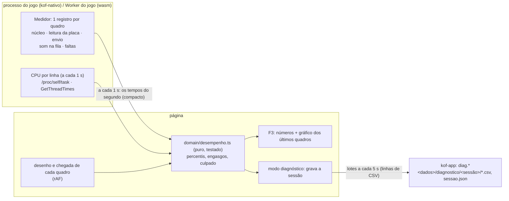

# Desempenho, diagnóstico e opções de emulação (M16)

> Etapa pedida pelo Marcelo em 08/11, **no meio da migração**, depois do primeiro teste do PS2 ("rodou relativamente
> bem, umas engasgadas aqui e ali"): "não basta rodar, tem que rodar bem". Sem medir cada quadro, otimizar é chute.
> Vale pra **todos** os emuladores (WebAssembly e nativos); quem nasce depois já nasce medido.

## O que já existe e por que não basta

O F3 mostra **médias por segundo** (fps, ms do núcleo, leitura da placa, imagem pra página, som na fila). Engasgo é um
quadro que demora demais: um segundo com 59 quadros de 10 ms e 1 de 80 ms aparece como "~11 ms, 60 fps". Precisa de
cada quadro, de em que etapa ele travou, e de um registro que o Marcelo grava jogando e me manda.

## O que os emuladores maduros fazem (pesquisado em 08/11)

- **PCSX2** (`pcsx2/PerformanceMetrics.cpp`): histórico circular de 150 tempos de quadro; mín/média/máx a cada 0,5 s;
  % de CPU de cada linha (EE, GS, VU1) pelo delta do tempo de CPU da linha ÷ tempo de relógio; fps suavizado (média
  de 16, zera se pular mais de 20%); `StartSavingMetrics(s)`/`DumpSavedMetrics()` gravam média e desvio no log.
- **DuckStation** (`src/core/performance_counters.cpp`): igual em essência, a cada 1 s, CPU da linha do núcleo e da
  de vídeo, tempo de GPU opcional; nada em arquivo.
- **Nenhum dos dois** calcula percentis nem guarda cada engasgo com o momento: é o que a gente faz a mais.

## Arquitetura

### 1. Medidor quadro a quadro (M16.1)
- **Onde mede:** no processo nativo (`kof-nativo/src/medidor.rs`) e no Worker do WebAssembly (`engine`), o mesmo
  formato: por quadro, `{t, nucleo, leitura, envio, somFila, faltas}` em microssegundos. A página soma o dela:
  quando o quadro chegou e quanto levou pra desenhar.
- **Como guarda:** histórico circular de 600 quadros (10 s a 60 fps). A cada 1 s, manda os tempos daquele segundo
  num bloco binário pequeno (~60 × 6 números) junto do aviso `desempenho` (campo novo e opcional: o contrato antigo
  continua valendo).
- **CPU por linha:** a cada 1 s, como o PCSX2 (delta do tempo de CPU da linha ÷ relógio), agrupado pelo nome da linha
  (no PS2: EE, GS, VU…). Linux: `/proc/self/task/*/stat`; Windows: `GetThreadTimes`. Mostra se o gargalo é um
  núcleo do processador no talo.
- **Estatística (pura, em `domain/desempenho.ts`, com teste):** mín/média/máx, **p50/p95/p99**, fps suavizado (como o
  PCSX2), e **engasgo** = quadro acima de 1,5× o tempo de um quadro (16,7 ms a 60 Hz) **ou** falta de som. Cada
  engasgo leva o **culpado**: a etapa que mais passou do normal dela (núcleo, leitura, envio, página ou som).

### 2. F3 melhor (M16.2)
- Os números de hoje + p99 + engasgos por minuto + pior quadro + CPU por linha.
- **Gráfico** dos últimos 600 quadros (barras empilhadas por etapa, linha no tempo de um quadro), como o do PCSX2.

### 3. Modo diagnóstico (M16.3)
- Liga em **Ajuda → 🩺 Modo diagnóstico** (fica ligado até desligar; um selo 🩺 na barra de baixo avisa).
- **Grava, por jogo aberto,** uma pasta `<dados>/diagnostico/AAAA-MM-DD_HHMM_<jogo>/`, escrita aos pedaços durante o
  jogo (nada trava), com arquivos simples, cada um com uma função (formato decidido com o Marcelo em 08/11):

  | Arquivo | O que tem | Por que nesse formato |
  |---|---|---|
  | `resumo.txt` | média, p99, engasgos/min, culpado mais comum, quanto tempo jogou | ler direto |
  | `sessao.json` | máquina (processador, núcleos, memória, sistema, **placa de vídeo e driver**: `GL_RENDERER`/`GL_VERSION` do núcleo nativo e o renderizador do WebGL), jogo (sistema, nome, tamanho do disco), núcleo e versão, **as opções de emulação usadas** | dado aninhado; as opções mudam de núcleo pra núcleo |
  | `quadros.csv` | uma linha por quadro: `t_ms,nucleo_ms,leitura_ms,envio_ms,pagina_ms,som_fila_ms,faltas` | a tabela grande; abre em planilha e no pandas |
  | `segundos.csv` | uma linha por segundo: `t_s,fps,p50_ms,p95_ms,p99_ms,max_ms,engasgos,cpu_<linha>_pct…` | visão geral, fácil de plotar |
  | `engasgos.csv` | `t_ms,duracao_ms,culpado,nucleo_ms,leitura_ms,envio_ms,pagina_ms,som_fila_ms` | filtrar e achar padrão (lugar, efeito) |
  | `log.txt` | as linhas do processo nativo / do núcleo | texto |

  CSV com cabeçalho, vírgula entre colunas e **ponto** no decimal (o LibreOffice em português pergunta ao importar; o
  Google Sheets abre direto). **Parquet não:** seria menor e tipado, mas pede biblioteca pesada no Rust e não abre
  em planilha; o tamanho não pede (1 h a 60 fps ≈ 216 mil linhas ≈ 10 MB de CSV, ~2 MB zipado).
- Ao fechar o jogo: o `resumo.txt` e um aviso com ele.
- **Exportar relatório** (na mesma tela): um `.zip` com as pastas das sessões escolhidas e os logs do dia, pra mandar.
  Também entra no pacote do 🐞 Reportar bug (F9) quando o modo está ligado.
- Rust: comandos com nome e escopo, nada de caminho solto: `diag.maquina`, `diag.abrir {jogo, sistema, …}` →
  `{sessao}`, `diag.anotar {sessao, arquivo: quadros|segundos|engasgos}` + linhas, `diag.fechar {sessao, resumo}`,
  `diag.exportar {sessoes}` → binário (zip). Limite de tamanho por
  sessão (ex.: 20 MB) e apaga as de mais de 30 dias.

### 4. Opções de emulação por console (M16.4)
- **Catálogo curado por sistema** (`domain/opcoes-nucleo.ts`, dados puros): a chave do núcleo, o nome e a dica em
  português, os valores com nome, o padrão, **se vale na hora** (o núcleo relê pelo `GET_VARIABLE_UPDATE`) ou só
  reabrindo o jogo, e o valor em cada **perfil**: ⚡ Rápido, ⚖ Equilibrado, 🎯 Fiel.
  - PS2: resolução interna, "EE cycle skip"/"cycle rate", MTVU, filtro de textura, mipmap, pré-carregar texturas,
    cache de shaders, ritmo (som × vsync).
  - PS1: recompilador, frameskip, resolução (PCSX-ReARMed Neon), dithering.
  - N64 (quando nativo): resolução, plugin. Os do WebAssembly entram com o que já existe.
- **Avançado:** todas as opções que o núcleo declara (`SET_VARIABLES`), como ele chama, pra quem quiser.
- **Camadas** que já existem (D19/M4): geral → console → jogo. Shadow of the Colossus pode ter o dele.
- **Tela:** a aba "⚙ Opções de emulação" (a dos modos de jogo, M5) ganha a seção do console do jogo aberto;
  mudar com o jogo aberto aplica na hora (`Comando::Variavel` já existe no nativo) ou avisa "vale ao reabrir".
- O diagnóstico grava as opções, então antes × depois de uma opção vira número.

### 5. Otimizar com os dados (M16.5)
Com o relatório do Marcelo nos jogos pesados (Shadow of the Colossus, Zone of the Enders 2, Gran Turismo 4): atacar o
culpado que aparecer. Suspeitas do PS2, em ordem: shader montado na primeira vez (cache já existe; dá pra aquecer),
CPU do PS2 (EE cycle skip/rate por jogo), buffer de som (alvo de ms por console), ritmo dos quadros, leitura da placa.

## Regras
- Medir custa pouco: nada de alocação por quadro (histórico fixo), envio 1×/s, gravação em lotes.
- Sem modo diagnóstico ligado, nada vai pro disco além do log de sempre.
- Nada de ROM, BIOS, caminho completo ou dado pessoal no relatório; o nome do jogo sim (é o que ajuda).
