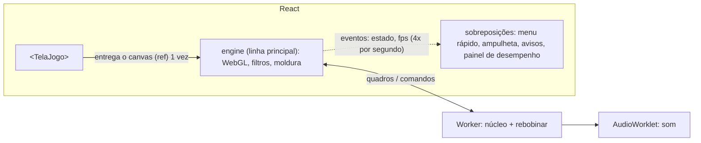

# Como o front é feito

> Complementa o [ARCHITECTURE.md](ARCHITECTURE.md). Decisões novas daqui: D17–D20 no [DECISIONS.md](DECISIONS.md).

## 1. Ferramentas (e só elas)

| O quê | Pra quê | Por que essa |
|---|---|---|
| **Vite** | servidor de desenvolvimento e build | módulos ES, Worker e `.wasm` como arquivo, sem configuração pesada |
| **React 19 + TypeScript (strict)** | telas | pedido do plano; o `strict` pega erro antes de rodar |
| **Zustand** | estado das telas (pilha de telas, sessão, preferências) | pequeno, funciona fora dos componentes |
| **CSS puro + CSS Modules** (já vêm no Vite) | estilo | os 126 temas já são CSS com variáveis: **reaproveitados como estão** |
| **Vitest + Testing Library** | testes de componente e de regra | mesmo pipeline do Vite |
| **Playwright** | testes de fluxo (como os do antigo) | os testes antigos já são Playwright |

**Não entra:** Tailwind, biblioteca de componentes (MUI, Chakra...), React Router (por enquanto), biblioteca de
animação, de formulário ou de lista virtual. Todas mudariam o visual ou resolvem problema que não temos. Se uma etapa
precisar, a dependência é justificada no DECISIONS antes.

## 2. Fidelidade visual: o app novo nasce com a cara do antigo (D17)

O jeito mais barato e seguro de ter **o mesmo visual** é não redesenhar nada no começo:

1. O `estilo.css` do antigo (tokens `--fundo`, `--painel`, `--texto`, `--destaque`... + os 126 blocos `[data-tema]`)
   vem **inteiro** pra `apps/desktop/src/styles/`. O tema continua sendo `<html data-tema="cafe">`.
2. Os componentes React geram **os mesmos ids e classes** do `pagina.html` (`#home`, `#biblioteca`, `.grande`,
   `.foco-pad`...). Assim as regras de CSS existentes valem sem mexer.
3. Só depois, com a paridade verificada por prints, o CSS de cada tela pode ir aos poucos pra CSS Modules. Os tokens de
   tema ficam globais pra sempre (são o sistema de design).

Verificação: em cada tela, print do antigo e do novo no mesmo tamanho e tema, comparados lado a lado (e por diferença de
pixels quando a tela é estática).

## 3. Organização das pastas do app

```
apps/desktop/src/
├── main.tsx                 # liga tudo: escolhe o adaptador de plataforma e monta <App/>
├── app/
│   ├── App.tsx              # aplica o tema, desenha a pilha de telas, os avisos e os atalhos globais
│   ├── telas.ts             # lista das telas (id → componente), igual às do antigo
│   └── atalhos.ts           # F1–F11, Esc, M, Home... (tabela; ver PARIDADE.md)
├── screens/                 # uma pasta por tela: Inicio/, Biblioteca/, Jogo/, Estados/, Jukebox/, Temas/, ...
│   └── Inicio/{Inicio.tsx, Inicio.test.tsx, partes...}
├── components/              # peças reaproveitadas: Botao, Lista (janela de itens), Ficha, MenuRapido, Aviso, Foco
├── stores/                  # Zustand: telas.ts (pilha), sessao.ts (jogo aberto), prefs.ts (lê/grava via app-core)
├── platform/                # tauri.ts | local.ts | android.ts | teste.ts — implementam a porta Backend
├── hooks/                   # useTela, useFoco, useAtalho, useEngineStatus (assina eventos da engine)
└── styles/                  # estilo.css do antigo (temas) + base
```

Regras (conferidas pelo ESLint):
- `screens/` e `components/` **não importam** `packages/engine` nem `platform/`. Elas chamam o `app-core` (casos de
  uso) e leem as stores.
- Nenhuma regra de negócio em componente: "pode salvar estado neste modo?" é pergunta pro `domain`.

## 4. Telas e navegação

- **Pilha de telas** (`stores/telas.ts`): `abrir(id)`, `voltar()`, `fecharTudo()`, `topo`. Substitui o
  `MutationObserver` do antigo. O `App` desenha só as telas da pilha, a de cima por cima.
- **Pausa:** o caso de uso escuta a pilha: tela aberta por cima do jogo = jogo pausado; pilha vazia = volta (igual ao
  antigo).
- **Voltar:** botão Voltar, botão direito, Esc, Alt+←, BrowserBack e B do controle chamam o mesmo `voltar()`.
- **Atalhos globais:** uma tabela (`app/atalhos.ts`) com a tecla, a ação e em que situação vale (no jogo, fora, com
  tela aberta). Mesmas teclas do antigo, listadas no PARIDADE.md.

## 5. Navegação por controle (foco espacial) (D19)

- Componente/hook `useFoco`: todo elemento clicável de uma tela se registra como "focável".
- O direcional (controle, celular ou setas fora do jogo) escolhe o focável mais perto naquela direção, como o
  `moverPad` do antigo; segurar repete; A clica; ◀▶ mudam select/range; B volta; Start = Início.
- Feito em casa (≈150 linhas) em vez de biblioteca: o comportamento precisa ser idêntico ao antigo, e é pouco código.

## 6. A tela do jogo (onde o React NÃO entra)



- O React desenha a moldura da tela e as sobreposições; **o canvas é da engine**. O React não re-renderiza a cada
  quadro (seria lento).
- A engine avisa o React só do que muda devagar (estado da sessão, números do painel 4x por segundo, ampulheta).
- Teclado e controle durante o jogo vão direto pra engine (serviço de entrada), sem passar por estado do React.

## 7. Listas grandes (biblioteca com milhares de jogos) (D20)

- Lista "em janela": só desenha os itens visíveis + uma folga, medindo a altura da linha. Feita em casa (≈100 linhas),
  porque o antigo já resolve com lotes de 150 e o comportamento (foco, teclado, ficha) é específico.
- Se não ficar fluida com 3.000 itens na CPU limitada a 4x, aí avaliamos `@tanstack/react-virtual` (registrado no
  DECISIONS).

## 8. Textos

- Português do Brasil, com os mesmos textos do antigo. Mensagens de erro numa tabela por código
  (`app-core/erros.ts`: `ROOT_MISSING` → "A pasta Kof Games não foi encontrada..."). Sem biblioteca de tradução por
  enquanto; a tabela já deixa isso fácil no futuro.

## 9. Plataformas

- Um build só do front. `main.tsx` escolhe o adaptador: Tauri ou local (PC, decidido no spike), `android` (M14) ou
  `teste` (backend em memória: abre no navegador comum, sem Rust; é o que os testes e o `pnpm dev` usam).
- O celular (M14) ganha `class="celular"` no `<html>` e o CSS do celular do antigo (`android.css`), igual hoje.

## 10. Testes do front

| O quê | Como |
|---|---|
| Regras de tela (pilha, atalhos, foco) | Vitest |
| Cada tela | Testing Library com o backend `teste` e a engine falsa |
| Visual | print do antigo × novo (Playwright) por tela e tema |
| Fluxos | Playwright com `pnpm preview` + backend `teste`; depois com a casca de verdade |
| Contraste dos temas | o `contraste.cjs` do antigo vira teste do Vitest |

## 11. Como você acompanha

A partir da F3.4 você roda no teu Linux:

```bash
pnpm install
```

```bash
pnpm dev
```

e abre o endereço que aparecer no navegador (com o backend de teste, sem precisar do Rust). Em cada checkpoint eu também
mando print ou vídeo curto do que mudou, antigo × novo.
