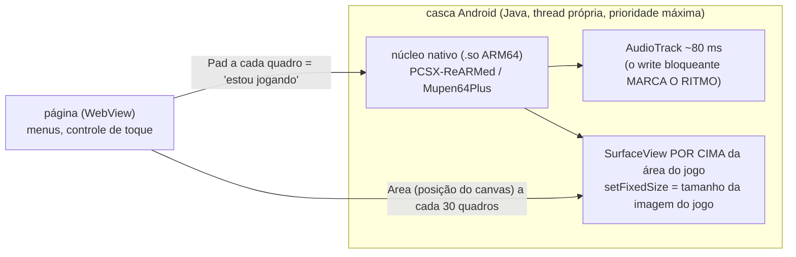

# Como o PS1 e o N64 nativos rodam lisos no celular (e como levar isso pro PS2)

> Escrito em 14/11 a pedido do Marcelo, depois do "o PS1/N64 trava no APK novo; no antigo estava liso". As regras abaixo
> são as que o **antigo** (kofstation-old) já seguia desde 24/10 (`CLAUDE.md` dele: "PS1 nativo engasgava no celular...") e
> que o novo passou a seguir igual. A ideia é a mesma pra qualquer núcleo nativo, inclusive o PS2 do PC.

## A arquitetura (igual no antigo e no novo)

- **O núcleo roda fora da página** (`Ps1Jogo.java`/`N64Jogo.java`), numa thread com `Thread.MAX_PRIORITY`. A imagem nunca passa pela
  página: vai direto pra uma `SurfaceView` posta exatamente em cima do `<canvas id="tela">`.
- **Quem dá o ritmo é o som**: `AudioTrack.write` bloqueia até caber (buffer de ~80 ms); sem som, `sleep(16)`. Nada de relógio da
  página ditando quadro.
- **A página só manda os botões** (`ps1Pad`/`n64Pad`) a cada quadro. Isso também é o sinal de vida: **250 ms sem sinal = o Java
  pausa a emulação e esconde a tela** (menu aberto, tela por cima, app em segundo plano).

## As otimizações (o que travava e o que resolveu)

| # | O que travava | A regra | No antigo | No novo |
|---|---|---|---|---|
| 1 | A página copiava o estado inteiro (~4 MB, base64 pela ponte) a cada 10 s pro **caçador de bugs** e travava > 250 ms → o Java pausava | **Nativo não tem caçador de bugs** | `app.js` 1721: `marcoBug = cacador && snes && !snes.nativo ? ...` | `JogoNativoAndroid.cacador()` não faz nada |
| 2 | **Salvar automático** a cada 30 s com estado de 4–16 MB pela ponte | **Nativo: no mínimo a cada 2 min** | `app.js` 2774: `snes.nativo ? Math.max(120, autoSeg()) : autoSeg()` | `autoSegundos(escolhido, nativo)` em `app-core/estados.ts` (teste contra o `app.js` do antigo) |
| 3 | A página **redesenhava por baixo** da tela nativa (WebGL, e o chiado/fita dos filtros animados a cada quadro), disputando a placa de vídeo | **Com o nativo rodando, a página não desenha nada**; só pausado | `app.js` 1145 (`pintar` só com `!snes \|\| pausado`) e 1178 (`desenhar` só se `!snes.nativo`) | `hooks/useTelaDoJogo.ts`: `if (j?.android && !j.parado) return` (14/11) |
| 4 | Ampliar a imagem no `Canvas` do Java era feito **na CPU** a cada quadro, disputando com o emulador | **A superfície tem o tamanho da imagem do jogo e quem amplia é o Android, na placa de vídeo** | `Ps1Jogo.desenhar` + `getHolder().setFixedSize(W, H)` | o mesmo arquivo (Java idêntico) |
| 5 | O som do PCSX no mesmo fio da emulação | **SPU em thread própria** (`pcsx_rearmed_spu_thread`) | `libkofps1.so` | a mesma `.so` (vem do APK do antigo) |
| 6 | O estado passava duas vezes por base64 dentro de JSON pela ponte síncrona | **Estado grande em pedaços (384 KB) e leitura por URL sem base64** | (o antigo usava IndexedDB) | `platform/android.ts` (`store.put.parte`, `/kofdados/...`) |
| 7 | Cabeçalhos de isolamento (COOP/COEP) que o WebView nem usa | **Servir a página sem eles, como o antigo** | `MainActivity.servir` sem cabeçalhos | `MainActivity.servir` sem cabeçalhos (14/11) |
| 0 | **O zip com a ISO nem abria** no APK novo (e travava antes disso): o novo decidia "nativo ou não" só pela extensão, então um `.zip` com o CD caía no WebAssembly, que tenta carregar o CD inteiro dentro da página | **Decidir ANTES de ler o arquivo, como o antigo: `.z64/.n64/.v64` = N64; `.cue/.chd/.pbp/.iso/.img/.exe` = PS1; `.bin` pelo começo (`cdPs1`); `.zip` pelo diretório do fim do arquivo (`.cue/.chd/.pbp/.iso`, ou `.bin/.img` > 16 MB = PS1; `.z64` dentro = N64)**. O CD nunca passa pela página: o Java extrai o zip e copia (`Ps1Jogo.trazer`) | `android.js` `consoleNativo` (515) + `app.js` `itensDoZip`/`cdDoZip` (1875/1904) | `platform/android-nativo.ts` `consoleNativoDoApk`/`nomesDoZip`; a Biblioteca lê só a cabeça (`nativo.disponivel` = os da casca) |
| 8 | Depois de abrir, o antigo reinicia o núcleo | **`Reiniciar` uma vez depois do "pronto"** | `app.js` 2475 `s.reset()` | `JogoNativoAndroid.abrir` |

## Como medir (antes × depois, antigo × novo)

`tools/paridade-abrir.mjs` manda os **mesmos arquivos** (gerados por `tools/paridade/arquivos.py`) pra página do APK antigo e pra do
novo, com a mesma casca falsa, e compara a decisão (qual núcleo nativo abriu, com que nome) e quantos bytes a página leu. Roda no CI.
Em 14/11 ele achou as 4 diferenças do item 0 (todas com zip) e depois da correção deu "TUDO IGUAL".

`tools/paridade-casca.mjs` roda a página do APK antigo e a do novo com a **mesma casca falsa** (`KOFnesApk`) e mede: chamadas à
casca por nome (Pad/Area/Volume...), o maior buraco entre dois sinais (acima de 250 ms o Java pausaria), tarefas longas, tempo de
script. Com `CPU=6` (CPU 6× mais lenta, ~celular) o antigo e o novo ficaram iguais (maior buraco ~100 ms, nenhum acima de 250 ms).
A emulação em si (Java e `.so`) só se mede no aparelho.

## Pra levar pro PS2 (o mesmo raciocínio no PC)

O PS2 do PC já tem a forma certa (núcleo no processo `kof-nativo`, som pela placa marcando o ritmo). A lista de conferência:

1. **Nada pesado na página enquanto o núcleo roda**: sem caçador de bugs, salvar automático no mínimo a cada 2 min, nenhuma cópia
   de estado inteiro "de vez em quando".
2. **A página não trabalha à toa**: se a imagem vier por uma janela própria (o "modo janela" do antigo), a página não desenha nada
   por baixo; se vier pela página, desenhar só o quadro novo (sem filtro animado repintando sem necessidade).
3. **Ampliar na placa de vídeo, não na CPU** (o equivalente ao `setFixedSize`).
4. **O som marca o ritmo**, num fio com prioridade alta; o resto (envio de quadros, medição) fora desse laço.
5. **Medir antes de mudar** (F3, 🩺 diagnóstico, `tools/paridade-casca.mjs` pro lado da página).
