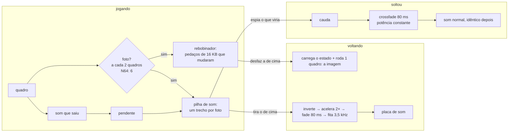

# Rebobinar (fase R): como funciona, os números e o que não ficou

Segurar Backspace (ou Select+Y) volta no tempo em preto e branco. Desde a fase R (18/11/2026) **a música volta junto**,
de trás pra frente, com efeito de fita, e ao soltar continua de onde parou. Vale em todo console que rebobina: os da
página (NES, SNES, GB/GBC, GBA, Mega Drive, Master System, Game Gear, Neo Geo, N64 e o PS1 em WebAssembly) e o **PS1
nativo**. O PS2 não rebobina (fica pra depois).

## Onde está

| Parte | Página (wasm) | Nativo (PS1) |
|---|---|---|
| As contas do som | `packages/domain/src/som-rebobinar.ts` | `crates/kof-nativo/src/rebobinar.rs` (`mod som`) |
| Vetores de teste (os dois conferem) | `packages/contracts/fixtures/som-rebobinar.json` (gerado por `tools/som-rebobinar-fixture.mjs`) | `tests/som_rebobinar.rs` |
| Fotos do estado | `packages/engine/src/rebobinador.ts` | `Rebobinador` em `rebobinar.rs` |
| O som guardado e tocado | `packages/engine/src/som-rebob.ts` | `SomDoRebobinar` em `rebobinar.rs` |
| Regras (limite, recarga, segura/solta) | `rb` no `worker.ts` | `Voltar` em `rebobinar.rs`, laço em `filho.rs` |
| Protocolo | mensagem `rebob-config` (com `som`) | comandos `rebobinar`/`voltar`, aviso `rebob` (`protocolo.rs`, `contracts/src/nativo.ts`) |

A opção fica nas Opções gerais: **Som ao rebobinar: 📼 fita (ao contrário) / 🔇 mudo** (chave `somRebob`, padrão 📼).

O ritmo: cada foto vale `fotoCada` quadros e a imagem volta a 2×; cada foto que volta toca o som dela invertido e
acelerado 2×, então imagem e som ficam juntos e o tom sobe uma oitava (a "fita") sem conta extra.

## Números (18/11/2026)

| O quê | Valor | Como |
|---|---|---|
| PS1 nativo: foto (salvar + comparar) | ~1,1 ms (0,6 + 0,5), estado de 4,3 MB | `cargo test --release -p kof-nativo --test pcsx -- --nocapture`, EXE de teste |
| PS1 nativo: memória | até 96 MB de fotos | `REBOB_BYTES` em `filho.rs` |
| N64 (Worker): foto a cada 2 quadros | 13–24 ms cada (pico 36) | e2e `rebob-n64.spec.ts` (headless, GL por software) |
| N64 (Worker): foto a cada 6 quadros | ~12 ms cada (pico 15), ~2 ms por quadro na média | idem, `fotoMs` da medição |

**Falta medir num jogo de verdade** (não há jogo de PS1/N64 na máquina de teste): quanto cada foto guarda num jogo
que mexe na VRAM e no som (o EXE de teste quase não muda) e, com isso, quantos segundos cabem nos 96 MB (PS1) e nos
64 MB (N64). O `fotoMs` (média e maior do último segundo) vai na medição do F3 dos consoles da página.

## Tentado e não ficou

- **N64 com foto a cada 2 quadros:** 13–24 ms por foto (salvar 16 MB e comparar), quase um quadro inteiro de 2 em 2.
  Ficou uma a cada 6 (`fotoCada: 6`, `rebobMb: 64` em `nucleos.ts`); o pico de ~12 ms numa foto o anel de som (60 ms)
  absorve.
- **Carregar o estado do PCSX com o reset de antes** (o `carregar_estado`, feito pro estado que chega de fora): voltar
  60 vezes por segundo com reset + 1 quadro seria caro e desnecessário com o jogo já rodando; o rebobinar usa
  `voltar_estado` (só o `unserialize`). O teste confere que 2 quadros depois de voltar o estado é o da foto seguinte.
- **Fade de entrada depois do filtro** (a ordem do `trechoPraTras` do domain): pela conta, a saída começaria em zero
  logo depois do último som normal (um degrau). Não foi ouvido, foi evitado: o fade vai antes da fita, e a memória do
  filtro começa no último som que saiu (a fita suaviza a emenda).
