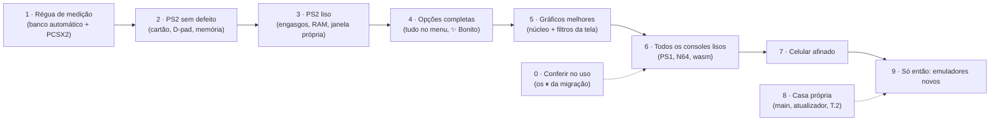

# Roadmap do KOFstation (passo a passo, com entregável e checkpoint em cada passo)

> Estado: ⬜ não começou · 🟨 em andamento · ⏸ esperando o Marcelo · ✅ pronto.
> Cada passo tem um **entregável** (o que existe quando ele acaba) e termina num **checkpoint**: paro, mostro e espero
> o "segue" (ou ele aprova vários de uma vez). A coluna **Tarefa** diz quem faz (ver "Divisão de tarefas").

## A migração está completa ✅ (17/11/2026)

O KOFstation novo substituiu o antigo (`kofstation-old`): **todos os consoles** (NES, SNES, Game Boy/Color/Advance,
Mega Drive, Master System, Game Gear, Neo Geo, PS1, N64 e PS2), biblioteca, saves e estados, rebobinar, filtros e
molduras, controles, jukebox, estatísticas, rede entre aparelhos, o celular como controle e "jogar no PC", pacotes de
Linux e Windows com atualizador, e o APK do celular com PS1/N64 nativos. Tudo em React + TypeScript + Rust, em camadas,
com testes e CI no Linux e no Windows. O Marcelo decidiu (D38) que **o novo é o produto**; o antigo virou arquivo (o
repositório fica: o novo ainda baixa de lá os núcleos e as `.so` do celular). O roadmap da migração, etapa por etapa,
está guardado em [ROADMAP-MIGRACAO.md](ROADMAP-MIGRACAO.md).

## A regra de agora: melhorar o que temos antes de crescer

**Nenhum emulador novo antes de os que já temos estarem lisos, sem defeito e bonitos.** Cada melhoria é medida (antes
× depois, com número) e documentada; o que não melhora o número sai. O PS2 vem primeiro porque é o mais pesado e o que
o Marcelo mais sente; o mesmo método depois passa por todos os consoles.



A fase 0 corre em paralelo (é o Marcelo usando no dia a dia). A fase 8 pode andar a qualquer momento: só depende de
decisões dele.

## Como cada passo é feito

1. **Medir antes** com a régua (fase 1): o número que o passo quer mudar e os que ele não pode piorar.
2. **Uma mudança por vez**, na camada certa (`domain` puro, `engine` sem React, telas pelo `app-core`, Rust com comandos
   com nome), com teste junto.
3. **Medir depois**, nas mesmas condições, 3 rodadas. Ficou melhor que a variação entre rodadas? Fica. Senão, sai.
4. **Anotar** no diário da fase (`docs/PS2-LISO.md` pro PS2; um por console quando chegar a vez) e no JORNAL.
5. `pnpm check`, `pnpm check:rust`, `pnpm e2e` quando tocar em tela/jogo; CI verde no Linux e no Windows.
6. **Checkpoint**: print/números pro Marcelo; ele joga quando é coisa que só o olho dele confirma.

Quem faz: o que precisa de placa de vídeo, BIOS e jogos de verdade roda **no PC do Marcelo** (Claude Code local, tarefas
em [agentes/](agentes/LEIA-ME.md)); revisão, junção e o que não precisa de jogo de verdade, na nuvem. **Nunca** nome
de jogo, ROM, BIOS ou caminho pessoal no repositório (os jogos de teste são "jogo pesado A/B/C").

---

## Divisão de tarefas

> Como na migração: um agente **orquestrador** (na nuvem: este roadmap, as decisões, revisar e juntar as branches,
> JORNAL/SITUACAO, os pacotes da `teste-binarios`) e agentes com **uma tarefa cada**, descrita em
> `docs/agentes/<letra>-<nome>.md`. Regras pra quem faz tarefa: [agentes/LEIA-ME.md](agentes/LEIA-ME.md).
> **Local** = Claude Code no PC do Marcelo (placa de vídeo, BIOS, jogos de verdade). **Nuvem** = sem jogo de verdade.

| Tarefa | O quê | Onde | Branch | Depende de | Fases | Estado |
|---|---|---|---|---|---|---|
| **F** | [Jogo pesado A liso hoje](agentes/F-ps2-liso-hoje.md): experimentos curtos que apontam o culpado dos engasgos + cartão de memória | local | `agente-d/ps2-liso` | — | 2, 3 (atalho) | ✅ junta em 18/11 (`d2b1d8d`): "liso liso" |
| **D** | [PS2 liso como o PCSX2](agentes/D-ps2-liso.md): régua de medição, tabela de diferenças, um passo por vez | local | `agente-d/ps2-liso` | F | 1, 3 | sem pressa (o PS2 já está liso pro Marcelo) |
| **E** | [Cartão, opções completas e gráficos](agentes/E-ps2-cartao-e-opcoes.md) | local | `agente-d/ps2-liso` | F (parte 1), D (perfis) | 2, 4, 5 | partes 1–2 feitas na F; parte 3 (gráficos) adiada |
| **G** | Todos os consoles lisos (o método das fases 1–3 no PS1, N64 e WebAssembly) | local + nuvem | a definir | D | 6 | a escrever |
| **H** | Celular afinado | local (aparelho) | a definir | 0.2 | 7 | a escrever |
| **O** | Orquestrador: revisar e juntar, pacotes, docs, fase 8 | nuvem | `claude/busy-ritchie-wrvk8h` | — | 0, 8 | contínua |

Arquivos quentes (uma tarefa por vez): `crates/kof-nativo/src/{nucleo,filho,canal}.rs`, `packages/engine/src/nativo.ts`,
`apps/desktop/src/stores/jogo.ts`, `packages/contracts/*`. F, D e E mexem neles: por isso rodam **em sequência, na mesma
branch**, não em paralelo.

---

> **18/11 (Marcelo):** "pra mim está bem otimizado, de verdade; meu PC não é o melhor, não preciso me preocupar com
> melhorar mais gráficos". O PS2 roda liso no jogo pesado A. **O que sobra das fases 1, 3, 4 e 5 fica sem pressa**
> (anotado, não esquecido): só volta se ele sentir engasgo, quiser o jogo pesado B, ou trocar de PC. O foco passa pra
> fase 0 (conferir no uso), 8 (casa própria) e, quando ele quiser, 6 e 7.

## Fase 0 · Conferir no uso (os ⏸ que sobraram da migração)

O passo a passo de cada um está em "Pra você testar" do [SITUACAO.md](SITUACAO.md). Bug achado aqui entra como passo
na fase que cuida do assunto (ou na hora, se for grave).

| # | Passo | Entregável | Checkpoint | Tarefa | Estado |
|---|---|---|---|---|---|
| 0.1 | Rede, atalhos no Início e no ☰, "jogar no PC" | atalhos (feito 16/11) | ele usa e opina | O | ⏸ |
| 0.2 | APK: PS1/N64 nativos, pasta de ROMs, controle por console, atualizador | APK da `teste-binarios` | ele usa no celular | O | ⏸ |
| 0.3 | Neo Geo, N64, jukebox, estatísticas, tradução, caçador de bugs | pacote atual | ele usa | O | ⏸ |
| 0.4 | Instalar no Windows | `KOFstation-instalar.exe` | alguém com Windows instala e abre | O | ⏸ |

## Fase 1 · A régua de medição

| # | Passo | Entregável | Checkpoint | Tarefa | Estado |
|---|---|---|---|---|---|
| 1.1 | Banco automático | `tools/medir-ps2.mjs`: abre o jogo, carrega um estado, aperta uma sequência fixa e imprime fps, p50/p95/p99, engasgos/min, quadros repetidos, CPU por linha, buracos de som | 3 rodadas iguais dão números próximos | D | ✅ 17/11 (`--teclas --mexer --sonda-leve --perfil --opcao --fechar-janela`; falta o vídeo e os buracos de som) |
| 1.2 | Memória × engasgos | memória por processo (jogo, Chromium, `kofstation`), livre/swap e o momento de cada engasgo, no mesmo gráfico | gráfico do jogo pesado A | F → D | ⬜ |
| 1.3 | O que o olho vê | vídeo da janela + contagem de quadros repetidos | o número bate com o que ele sente | D | ⬜ |
| 1.4 | A régua | tabela PCSX2 · antigo · novo no mesmo trecho, em `docs/PS2-LISO.md` | ele vê a tabela | D | ⬜ |

## Fase 2 · PS2 sem defeito

| # | Passo | Entregável | Checkpoint | Tarefa | Estado |
|---|---|---|---|---|---|
| 2.1 | Cartão de memória | o jogo salva no cartão, fecha, reabre e carrega; teste automático em `kof-nativo/tests` | ele salva no jogo pesado A | F (E parte 1) | ✅ 17/11 (o app fecha o jogo antes de sair; teste `ps2_de_verdade`) |
| 2.2 | O "pra baixo" no menu de salvar | D-pad e analógico corretos no PS2 | o menu desce com teclado e controle | F (E parte 1) | ✅ 17/11 (o direcional é T F G H; controles ficam como estão, decisão do Marcelo) |
| 2.3 | Jogo pesado B sem erro de memória | o motivo achado (log do sistema) e corrigido | ele joga 10 min | D | ⬜ |

## Fase 3 · PS2 liso

| # | Passo | Entregável | Checkpoint | Tarefa | Estado |
|---|---|---|---|---|---|
| 3.1 | Os engasgos esporádicos | cada suspeito (salvar automático, bateria a cada 1 s, lixo de quadros, shader na 1ª vez, swap) medido e corrigido ou descartado | números antes × depois | **F** | ✅ 17/11 (F5/F8 de ~2,2 s → ~0,6 s; o Marcelo jogou liso) |
| 3.2 | Menos RAM | filas menores, quadro no tamanho da tela, estado e bateria pelo Rust, Chromium enxuto | memória total antes × depois | F → D | ⬜ próximo: o "A" (quadro reduzido na placa + YUV 4:2:0) e o estado salvo sem passar pela página |
| 3.3 | Diferenças do PCSX2 | tabela "PCSX2 × nós" com o custo de cada diferença | tabela no diário | D | ⬜ |
| 3.4 | Janela própria pro PS2 | o jogo desenha direto na placa (opção experimental primeiro), X11 e Wayland, F3/menu/print funcionando | desenho aprovado antes; p99 igual ao PCSX2 | F/D | ⬜ |
| 3.5 | Ritmo e linhas | laço pelo relógio, MTVU, prioridade, se a medição pedir | número antes × depois | D | ⬜ |
| 3.6 | **Liso como o PCSX2** | os dois jogos pesados, 10 min cada, sem engasgo | ⏸ ele joga e concorda | F/D | ⬜ |

## Fase 4 · Opções completas

| # | Passo | Entregável | Checkpoint | Tarefa | Estado |
|---|---|---|---|---|---|
| 4.1 | Lista do núcleo | comando que leva tudo o que o núcleo declara até a tela (Rust → contrato → `app-core`) | teste Rust + unit | E | ✅ PS2 (82, do cabeçalho) · 🟨 PS1 (gerador pronto, falta rodar) |
| 4.2 | **Toda opção no menu** | grupos como no PCSX2 (Gráficos, Emulação, Som, Cartão, Correções, Sistema), Avançado, ⚠ nas perigosas, ⚡/↻ conferidos, "voltar ao perfil" | print com PS2 e PS1 | E | ✅ PS2 (tela própria ⚙ Opções de emulação) · 🟨 PS1 |
| 4.3 | Perfil ✨ Bonito | o 4º perfil + os valores de todos os perfis decididos com a régua | tabela no diário | E | 🟨 existe; engasga no jogo pesado A: a 2x sozinha roda bem, medir o anisotrópico 8x e o MTVU |
| 4.4 | Renderer do PS2 | OpenGL/Vulkan escolhível | medido antes de virar padrão | E | ⬜ |
| 4.5 | Tela larga e 60 fps | desligados por padrão, botão por jogo | um jogo com tela larga | E | ⬜ |
| 4.6 | Os outros consoles | o mesmo menu com o que cada núcleo declarar | print de cada um | E/G | ⬜ |

## Fase 5 · Gráficos melhores (adiada pelo Marcelo, 18/11)

| # | Passo | Entregável | Checkpoint | Tarefa | Estado |
|---|---|---|---|---|---|
| 5.1 | PS2 no núcleo | correções de resolução alta, nitidez (CAS), FXAA, ajuste de cor, texturas HD se houver | print antes × depois + custo em fps | E | ⬜ |
| 5.2 | Filtros da tela (F4) | nitidez, ampliação estilo FSR/xBR, bloom melhor, pra todos os consoles | teste de pixels + print | E | ⬜ |
| 5.3 | ✨ Bonito revisto | o perfil com o que entrou | ⏸ ele aprova o visual | E | ⬜ |

## Fase 6 · Todos os consoles lisos

| # | Passo | Entregável | Checkpoint | Tarefa | Estado |
|---|---|---|---|---|---|
| 6.1 | PS1 nativo no PC | engasgos, memória e latência medidos e corrigidos | números + ele joga | G | ⬜ |
| 6.2 | N64 | idem | idem | G | ⬜ |
| 6.3 | WebAssembly (SNES, Mega Drive, GBA, Neo Geo…) | ritmo, abertura, memória da página | números | G | ⬜ |
| 6.4 | Latência de entrada | do botão à tela, comparada com o RetroArch | tabela | G | ⬜ |
| 6.5 | Abertura | tempo até jogar (app e biblioteca grande) | número antes × depois | G | ⬜ |

## Fase 7 · Celular afinado

| # | Passo | Entregável | Checkpoint | Tarefa | Estado |
|---|---|---|---|---|---|
| 7.1 | Medir no aparelho | abertura, PS1/N64, bateria, temperatura | números do celular dele | H | ⬜ |
| 7.2 | O que a fase 0 apontar | correções | ele usa | H | ⬜ |
| 7.3 | APK sem o APK antigo | as `.so` das Releases do repositório novo | APK monta no CI sem o antigo | H | ⬜ |

## Fase 8 · Casa própria (decisões do Marcelo; anda a qualquer momento)

| # | Passo | Entregável | Checkpoint | Tarefa | Estado |
|---|---|---|---|---|---|
| 8.1 | Juntar na `main` | PR da branch de trabalho | ele pede e aprova | O | ⬜ |
| 8.2 | Chave do atualizador | cada envio na `main` vira versão e o app se atualiza sozinho | ⏸ ele cria a chave ("Pra você fazer" no SITUACAO) | O | ⏸ |
| 8.3 | Releases próprias | núcleos e `.so` no repositório novo; o novo para de baixar do antigo | CI sem o antigo | O | ⬜ |
| 8.4 | T.2 | a última versão do antigo avisa e leva pro novo | ele decide quando | O | ⬜ |

## Fase 9 · Só depois de tudo acima: emuladores novos

Nada decidido; cada um entra pelo mesmo caminho (manifesto com SHA-256, Linux e Windows, testes, régua):

- **PS1 com gráfico melhor** no PC (Beetle PSX HW ou SwanStation), mantendo o PCSX-ReARMed no celular ("depois", 17/11).
- Outros consoles que o Marcelo quiser (ex.: PSP, GameCube/Wii, Saturn, DS): ele escolhe a ordem.
- **Ideia do Marcelo pro Wii (17/11): o celular como Wiimote.** O giroscópio/acelerômetro do celular vira o movimento e
  a mira (ponteiro na tela), o toque vira os botões, pela rede pareada que já existe (o mesmo caminho do "celular como
  controle"). É a parte mais trabalhosa do Wii; entra junto com ele, nunca antes das fases 1–8.

---

## Onde parou (17/11, fim da tarefa F)

O Marcelo joga o jogo pesado A liso, com resolução maior, e **não quer mais otimização agora** ("rodando de boa, não
precisa otimizar tanto"). Tudo o que foi feito e o que falta está em [NUCLEO-NATIVO-PESADO.md](NUCLEO-NATIVO-PESADO.md)
(guia pro próximo núcleo pesado, ex.: GameCube/Wii) e o diário em [PS2-LISO.md](PS2-LISO.md). Fica anotado, sem
pressa, nesta ordem: ✨ Bonito peça por peça (4.3) → o "A" e o estado fora da página (3.2) → jogo pesado B (2.3) →
opções do PS1 e dos outros (4.1/4.6) → 4.4/4.5 → fase 5 → janela própria (3.4, desenho aprovado antes).

## Instrução pro Claude Code local (tarefa F, já feita)

Na pasta do repositório, no PC do Marcelo:

```bash
git fetch origin && git checkout claude/busy-ritchie-wrvk8h && git pull && git checkout -B agente-d/ps2-liso
```

E no Claude Code:

> Leia `AGENTS.md`, `docs/agentes/LEIA-ME.md`, a seção "Regras desta tarefa" de `docs/agentes/D-ps2-liso.md` e
> `docs/agentes/F-ps2-liso-hoje.md`, e faça a tarefa F (estamos na branch `agente-d/ps2-liso`). Objetivo: eu jogar o
> jogo pesado A liso hoje e conseguir salvar no cartão. BIOS: (caminho). Jogo pesado A: (caminho). Estado no trecho que
> engasga: (caminho). Estado no menu de salvar: (caminho, se tiver). Nunca escreva nome de jogo no repositório. Me
> mostre os números a cada achado e me chame pra jogar quando achar que melhorou. Antes de fazer a janela própria, me
> mostre o desenho.
