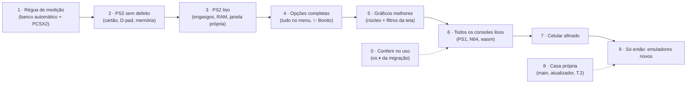

# Roadmap do KOFstation

> Estado: ⬜ não começou · 🟨 em andamento · ⏸ esperando o Marcelo · ✅ pronto.

## A migração está completa ✅ (17/11/2026)

O KOFstation novo substituiu o antigo (`kofstation-old`): **todos os consoles** (NES, SNES, Game Boy/Color/Advance,
Mega Drive, Master System, Game Gear, Neo Geo, PS1, N64 e PS2), biblioteca, saves e estados, rebobinar, filtros e
molduras, controles, jukebox, estatísticas, rede entre aparelhos, o celular como controle e "jogar no PC", pacotes de
Linux e Windows com atualizador, e o APK do celular com PS1/N64 nativos. Tudo em React + TypeScript + Rust, em camadas,
com testes e CI no Linux e no Windows. O Marcelo decidiu (D38) que **o novo é o produto**; o antigo virou arquivo (o
repositório fica: o novo ainda baixa de lá os núcleos e as `.so` do celular). O roadmap da migração, etapa por etapa,
está guardado em [ROADMAP-MIGRACAO.md](ROADMAP-MIGRACAO.md).

## A regra de agora: melhorar o que temos antes de crescer

**Nenhum emulador novo antes de os que já temos estarem lisos, sem defeito e bonitos.** Cada melhoria é medida (antes
× depois, com número) e documentada; o que não melhora o número sai. O PS2 vem primeiro porque é o mais pesado e o que
o Marcelo mais sente; o mesmo método depois passa por todos os consoles.

A fase 0 corre em paralelo (é o Marcelo usando no dia a dia). A fase 8 pode andar a qualquer momento: só depende de
decisões dele.

## Como cada passo é feito

1. **Medir antes** com a régua (fase 1): o número que o passo quer mudar e os que ele não pode piorar.
2. **Uma mudança por vez**, na camada certa (`domain` puro, `engine` sem React, telas pelo `app-core`, Rust com comandos
   com nome), com teste junto.
3. **Medir depois**, nas mesmas condições, 3 rodadas. Ficou melhor que a variação entre rodadas? Fica. Senão, sai.
4. **Anotar** no diário da fase (`docs/PS2-LISO.md` pro PS2; um por console quando chegar a vez) e no JORNAL.
5. `pnpm check`, `pnpm check:rust`, `pnpm e2e` quando tocar em tela/jogo; CI verde no Linux e no Windows.
6. **Checkpoint**: print/números pro Marcelo; ele joga quando é coisa que só o olho dele confirma.

Quem faz: o que precisa de placa de vídeo, BIOS e jogos de verdade roda **no PC do Marcelo** (Claude Code local, tarefas
em [agentes/](agentes/LEIA-ME.md)); revisão, junção e o que não precisa de jogo de verdade, na nuvem. **Nunca** nome
de jogo, ROM, BIOS ou caminho pessoal no repositório (os jogos de teste são "jogo pesado A/B/C").

---

## Fase 0 · Conferir no uso (os ⏸ que sobraram da migração)

O passo a passo de cada um está em "Pra você testar" do [SITUACAO.md](SITUACAO.md). Bug achado aqui entra como passo
na fase que cuida daquele assunto (ou na hora, se for grave).

| # | O quê | Estado |
|---|---|---|
| 0.1 | Rede e celular como controle (atalhos novos no Início e no ☰), "jogar no PC" | ⏸ funcionou no teste de 16/11; falta a opinião dos atalhos |
| 0.2 | APK no celular: PS1/N64 nativos, pasta de ROMs, controle por console, atualizador | ⏸ "mais ou menos certo" (14/11) |
| 0.3 | Neo Geo, N64, jukebox, estatísticas, tradução, caçador de bugs | ⏸ |
| 0.4 | Instalar no Windows | ⏸ (precisa de alguém com Windows) |

## Fase 1 · A régua de medição (tarefa [D](agentes/D-ps2-liso.md), fases 0, 0b e 1)

| # | O quê | Checkpoint | Estado |
|---|---|---|---|
| 1.1 | Banco automático: abre o jogo, carrega um estado, aperta uma sequência fixa e grava fps, p50/p95/p99, engasgos/min, quadros repetidos, CPU por linha, buracos de som | 3 rodadas iguais dão números próximos | ⬜ |
| 1.2 | Memória por processo (jogo, cada processo do Chromium, `kofstation`), memória livre/swap e o momento de cada engasgo, cruzados | gráfico memória × engasgos do jogo pesado A | ⬜ |
| 1.3 | Vídeo da janela + contagem de quadros repetidos (o que o olho vê) | o número bate com o que o Marcelo sente | ⬜ |
| 1.4 | A régua: o PCSX2 de verdade e o KOFstation antigo no mesmo trecho, na mesma máquina | tabela PCSX2 · antigo · novo em `docs/PS2-LISO.md` | ⬜ |

## Fase 2 · PS2 sem defeito (tarefa [E](agentes/E-ps2-cartao-e-opcoes.md), parte 1)

| # | O quê | Checkpoint | Estado |
|---|---|---|---|
| 2.1 | Cartão de memória: o jogo salva, fecha, reabre e carrega | teste automático + o Marcelo salva no jogo pesado A | ⬜ |
| 2.2 | O "pra baixo" no menu de salvar (D-pad × analógico no PS2) | o menu desce com teclado e com controle | ⬜ |
| 2.3 | Jogo pesado B não morre por memória | abre e joga 10 min | ⬜ |

## Fase 3 · PS2 liso (tarefa D, fases 2 e 3)

| # | O quê | Checkpoint | Estado |
|---|---|---|---|
| 3.1 | Tabela "o que o PCSX2 faz × o que nós fazemos", com o custo medido de cada diferença | tabela no diário | ⬜ |
| 3.2 | Os engasgos esporádicos, suspeito por suspeito: lixo de quadros na página, salvar automático pela página, bateria copiada a cada 1 s, shader na 1ª vez, swap | cada um: medido, corrigido ou descartado | ⬜ |
| 3.3 | Menos RAM: filas menores, quadro no tamanho da tela, estado e bateria pelo Rust, Chromium enxuto | memória total antes × depois | ⬜ |
| 3.4 | **Janela própria** pro PS2 (o jogo desenha direto na placa, como o PCSX2): desenho mostrado ao Marcelo antes | p99 e engasgos iguais ao PCSX2, X11 e Wayland | ⬜ |
| 3.5 | Ritmo e linhas (laço pelo relógio com o som se ajustando, MTVU, prioridade das linhas), se a medição pedir | número antes × depois | ⬜ |
| 3.6 | **"Tão liso quanto o PCSX2"**: os dois jogos pesados, 10 min cada, sem engasgo, e o Marcelo concorda | ⏸ o Marcelo joga | ⬜ |

## Fase 4 · Opções completas (tarefa E, parte 2)

| # | O quê | Checkpoint | Estado |
|---|---|---|---|
| 4.1 | Comando que lista tudo o que o núcleo declara (Rust → contrato → `app-core` → tela) | teste Rust + unit | ⬜ |
| 4.2 | **Toda opção no menu**: grupos como no PCSX2 (Gráficos, Emulação, Som, Cartão, Correções, Sistema), Avançado com o resto, ⚠ nas perigosas, ⚡/↻ conferidos, "voltar ao perfil" | print da tela com PS2 e PS1 | ⬜ |
| 4.3 | Perfil **✨ Bonito** (além de ⚡ ⚖ 🎯) e os valores de todos os perfis decididos com a régua | tabela de perfis no diário | ⬜ |
| 4.4 | Renderer do PS2 escolhível (OpenGL/Vulkan) | medido antes de virar padrão | ⬜ |
| 4.5 | Remendos de tela larga e 60 fps: desligados por padrão, botão por jogo | um jogo com tela larga funcionando | ⬜ |
| 4.6 | Os outros consoles com o mesmo menu (o que cada núcleo declarar) | print de cada um | ⬜ |

## Fase 5 · Gráficos melhores (tarefa E, parte 3)

| # | O quê | Checkpoint | Estado |
|---|---|---|---|
| 5.1 | PS2 no núcleo: correções de resolução alta, nitidez (CAS), FXAA, ajuste de cor, texturas HD se houver | antes × depois em print, custo em fps | ⬜ |
| 5.2 | Filtros da tela (F4, todos os consoles): nitidez, ampliação mais esperta (estilo FSR/xBR), bloom melhor | teste de pixels + print | ⬜ |
| 5.3 | ✨ Bonito revisto com o que entrou | o Marcelo aprova o visual | ⬜ |

## Fase 6 · Todos os consoles lisos

O mesmo método das fases 1–3 em cada um, com o banco automático (ROM de teste gerada pelo teste quando der; jogo de
verdade no PC do Marcelo quando precisar).

| # | O quê | Estado |
|---|---|---|
| 6.1 | PS1 nativo no PC (PCSX-ReARMed): engasgos, memória, latência | ⬜ |
| 6.2 | N64 | ⬜ |
| 6.3 | Os WebAssembly (SNES, Mega Drive, GBA, Neo Geo…): ritmo, abertura, memória da página | ⬜ |
| 6.4 | Latência de entrada (do botão à tela) medida e comparada com o RetroArch | ⬜ |
| 6.5 | Abertura do app e da biblioteca grande (tempo até jogar) | ⬜ |

## Fase 7 · Celular afinado

| # | O quê | Estado |
|---|---|---|
| 7.1 | Medir no aparelho: abertura, PS1/N64 nativos, bateria, temperatura | ⬜ |
| 7.2 | O que a fase 0 (0.1, 0.2) apontar | ⬜ |
| 7.3 | O APK sem depender do APK antigo (as `.so` vindo das Releases do repositório novo) | ⬜ |

## Fase 8 · Casa própria (decisões do Marcelo; anda a qualquer momento)

| # | O quê | Estado |
|---|---|---|
| 8.1 | Juntar a branch de trabalho na `main` (PR quando ele pedir) | ⬜ |
| 8.2 | Chave do atualizador (só ele: `docs/SITUACAO.md`, "Pra você fazer") → cada envio na `main` vira versão e o app se atualiza sozinho | ⏸ |
| 8.3 | Núcleos e `.so` nas Releases do repositório novo (o novo para de baixar do antigo) | ⬜ |
| 8.4 | **T.2**: a última versão do antigo avisa e leva pro novo | ⬜ ele decide quando |

## Fase 9 · Só depois de tudo acima: emuladores novos

Candidatos (nada decidido; cada um entra pelo mesmo caminho: manifesto com SHA-256, Linux e Windows, testes, régua):

- **PS1 com gráfico melhor** no PC (Beetle PSX HW ou SwanStation: resolução alta, PGXP, cor de 24 bits), mantendo o
  PCSX-ReARMed no celular. Já combinado como "depois" (17/11).
- Outros consoles que o Marcelo quiser (ex.: PSP, GameCube/Wii, Saturn, DS) — ele escolhe a ordem.
