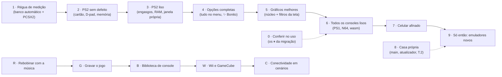

# Roadmap do KOFstation (passo a passo, com entregável e checkpoint em cada passo)

> Estado: ⬜ não começou · 🟨 em andamento · ⏸ esperando o Marcelo · ✅ pronto.
> Cada passo tem um **entregável** (o que existe quando ele acaba) e termina num **checkpoint**: paro, mostro e espero
> o "segue" (ou ele aprova vários de uma vez). A coluna **Tarefa** diz quem faz (ver "Divisão de tarefas").

## A migração está completa ✅ (17/11/2026)

O KOFstation novo substituiu o antigo (`kofstation-old`): **todos os consoles** (NES, SNES, Game Boy/Color/Advance,
Mega Drive, Master System, Game Gear, Neo Geo, PS1, N64 e PS2), biblioteca, saves e estados, rebobinar, filtros e
molduras, controles, jukebox, estatísticas, rede entre aparelhos, o celular como controle e "jogar no PC", pacotes de
Linux e Windows com atualizador, e o APK do celular com PS1/N64 nativos. Tudo em React + TypeScript + Rust, em camadas,
com testes e CI no Linux e no Windows. O Marcelo decidiu (D38) que **o novo é o produto**; o antigo virou arquivo (o
repositório fica: o novo ainda baixa de lá os núcleos e as `.so` do celular). O roadmap da migração, etapa por etapa,
está guardado em [ROADMAP-MIGRACAO.md](ROADMAP-MIGRACAO.md).

## A regra de agora: melhorar o que temos antes de crescer

**Nenhum emulador novo antes de os que já temos estarem lisos, sem defeito e bonitos.** Cada melhoria é medida (antes
× depois, com número) e documentada; o que não melhora o número sai. O PS2 vem primeiro porque é o mais pesado e o que
o Marcelo mais sente; o mesmo método depois passa por todos os consoles.

As fases com letra (R, G, B, C) são as **funcionalidades novas** pedidas depois da migração (ver "Próximas
funcionalidades" no fim); as numeradas são as de refinar o que já existia.

A fase 0 corre em paralelo (é o Marcelo usando no dia a dia). A fase 8 pode andar a qualquer momento: só depende de
decisões dele.

## Como cada passo é feito

1. **Medir antes** com a régua (fase 1): o número que o passo quer mudar e os que ele não pode piorar.
2. **Uma mudança por vez**, na camada certa (`domain` puro, `engine` sem React, telas pelo `app-core`, Rust com comandos
   com nome), com teste junto.
3. **Medir depois**, nas mesmas condições, 3 rodadas. Ficou melhor que a variação entre rodadas? Fica. Senão, sai.
4. **Anotar** no diário da fase (`docs/PS2-LISO.md` pro PS2; um por console quando chegar a vez) e no JORNAL.
5. `pnpm check`, `pnpm check:rust`, `pnpm e2e` quando tocar em tela/jogo; CI verde no Linux e no Windows.
6. **Checkpoint**: print/números pro Marcelo; ele joga quando é coisa que só o olho dele confirma.

Quem faz: o que precisa de placa de vídeo, BIOS e jogos de verdade roda **no PC do Marcelo** (Claude Code local, tarefas
em [agentes/](agentes/LEIA-ME.md)); revisão, junção e o que não precisa de jogo de verdade, na nuvem. **Nunca** nome
de jogo, ROM, BIOS ou caminho pessoal no repositório (os jogos de teste são "jogo pesado A/B/C").

---

## Divisão de tarefas

> **Agora (22/11): tarefa M** (Mesa de aparelhos, multijogador, Wiimote calibrado). N → P → W feitas (21–22/11).
> O roteiro pro Claude local está em [agentes/PROXIMO.md](agentes/PROXIMO.md).

> Como na migração: um agente **orquestrador** (na nuvem: este roadmap, as decisões, revisar e juntar as branches,
> JORNAL/SITUACAO, os pacotes da `teste-binarios`) e agentes com **uma tarefa cada**, descrita em
> `docs/agentes/<letra>-<nome>.md`. Regras pra quem faz tarefa: [agentes/LEIA-ME.md](agentes/LEIA-ME.md).
> **Local** = Claude Code no PC do Marcelo (placa de vídeo, BIOS, jogos de verdade). **Nuvem** = sem jogo de verdade.

| Tarefa | O quê | Onde | Branch | Depende de | Fases | Estado |
|---|---|---|---|---|---|---|
| **F** | [Jogo pesado A liso hoje](agentes/F-ps2-liso-hoje.md): experimentos curtos que apontam o culpado dos engasgos + cartão de memória | local | `agente-d/ps2-liso` | — | 2, 3 (atalho) | ✅ junta em 18/11 (`d2b1d8d`): "liso liso" |
| **D** | [PS2 liso como o PCSX2](agentes/D-ps2-liso.md): régua de medição, tabela de diferenças, um passo por vez | local | `agente-d/ps2-liso` | F | 1, 3 | sem pressa (o PS2 já está liso pro Marcelo) |
| **E** | [Cartão, opções completas e gráficos](agentes/E-ps2-cartao-e-opcoes.md) | local | `agente-d/ps2-liso` | F (parte 1), D (perfis) | 2, 4, 5 | partes 1–2 feitas na F; parte 3 (gráficos) adiada |
| **R** | [Rebobinar no PS1 e N64 com a música voltando junto](agentes/R-rebobinar.md) (fase R inteira) | local | `agente-r/rebobinar` | — | R | ✅ feita 18/11 (o PS1 nativo desligado 19/11, religado 21/11 pela tarefa P); ⏸ ele ouve |
| **—** | Fases G (gravar), B (biblioteca) e o resto das fases 2–6 do PS2, feitas direto pelo Claude local sem arquivo de tarefa | local | `gravar` | — | G, B, 2–6 | ✅/⏸ ver cada fase |
| **N** | [Rede com papéis (Núcleo, Tela, Controle), até 3 aparelhos, menu lateral tipo Switch](agentes/N-rede-papeis.md) | local | `agente-n/rede` | — | C (C.1–C.4) | **1ª** (21/11, obrigatória) |
| **P** | [Rebobinar no PS1 liso](agentes/P-rebobinar-ps1-liso.md) | local | `agente-p/rebob-ps1` | N | R | **2ª** (21/11, obrigatória) |
| **W** | [Wii e GameCube com o núcleo do RetroArch](agentes/W-wii-gamecube.md) | local | `agente-w/wii` | P | W | **3ª** |
| **M** | [Mesa de aparelhos: multijogador até 4, Wiimote com calibração](agentes/M-mesa-de-aparelhos.md) | local | `agente-m/mesa` | N, W | C, W.7–W.9 | **agora** (22/11) |
| **L** | Todos os consoles lisos (o método das fases 1–3 no PS1, N64 e WebAssembly) | local + nuvem | a definir | D | 6 | a escrever (a 6.3 já andou) |
| **H** | Celular afinado | local (aparelho) | a definir | 0.2 | 7 | a escrever |
| **O** | Orquestrador: revisar e juntar, pacotes, docs, fase 8 | nuvem | `claude/busy-ritchie-wrvk8h` | — | 0, 8 | contínua |

Arquivos quentes (uma tarefa por vez): `crates/kof-nativo/src/{nucleo,filho,canal}.rs`, `packages/engine/src/nativo.ts`,
`apps/desktop/src/stores/jogo.ts`, `packages/contracts/*`. F, D, E, R e as fases G/B mexeram neles: por isso rodaram **em
sequência**, não em paralelo.

---

> **18/11 (Marcelo):** "pra mim está bem otimizado, de verdade; meu PC não é o melhor, não preciso me preocupar com
> melhorar mais gráficos". O PS2 roda liso no jogo pesado A. **O que sobra das fases 1, 3, 4 e 5 fica sem pressa**
> (anotado, não esquecido): só volta se ele sentir engasgo, quiser o jogo pesado B, ou trocar de PC. O foco passa pra
> fase 0 (conferir no uso), 8 (casa própria) e, quando ele quiser, 6 e 7.

> **18/11 (Marcelo):** "já testei tudo, exceto o Windows; pode juntar tudo". A branch de trabalho vai pra `main` (8.1)
> e o próximo passo é **funcionalidade nova** (ver "Próximas funcionalidades" no fim), com a regra de sempre: medir, uma
> coisa por vez, sem quebrar o que já roda liso.

## Fase 0 · Conferir no uso (os ⏸ que sobraram da migração)

O passo a passo de cada um está em "Pra você testar" do [SITUACAO.md](SITUACAO.md). Bug achado aqui entra como passo
na fase que cuida do assunto (ou na hora, se for grave).

| # | Passo | Entregável | Checkpoint | Tarefa | Estado |
|---|---|---|---|---|---|
| 0.1 | Rede, atalhos no Início e no ☰, "jogar no PC" | atalhos (feito 16/11) | ele usa e opina | O | ✅ testado pelo Marcelo (18/11) |
| 0.2 | APK: PS1/N64 nativos, pasta de ROMs, controle por console, atualizador | APK da `teste-binarios` | ele usa no celular | O | ✅ testado pelo Marcelo (18/11) |
| 0.3 | Neo Geo, N64, jukebox, estatísticas, tradução, caçador de bugs | pacote atual | ele usa | O | ✅ testado pelo Marcelo (18/11) |
| 0.4 | Instalar no Windows | `KOFstation-instalar.exe` | alguém com Windows instala e abre | O | ⏸ ele vai pedir pra alguém com Windows |

## Fase 1 · A régua de medição

| # | Passo | Entregável | Checkpoint | Tarefa | Estado |
|---|---|---|---|---|---|
| 1.1 | Banco automático | `tools/medir-ps2.mjs`: abre o jogo, carrega um estado, aperta uma sequência fixa e imprime fps, p50/p95/p99, engasgos/min, quadros repetidos, CPU por linha, buracos de som | 3 rodadas iguais dão números próximos | D | ✅ 17/11 (`--teclas --mexer --sonda-leve --perfil --opcao --fechar-janela`; falta o vídeo e os buracos de som) |
| 1.2 | Memória × engasgos | memória por processo (jogo, Chromium, `kofstation`), livre/swap e o momento de cada engasgo, no mesmo gráfico | gráfico do jogo pesado A | D | 🟨 19/11: a série existe (`medir-ps2.mjs --memoria` e `--sem-cdp`: renderer, JS, GPU, principal, Chrome todo e jogo no tempo); falta juntar com os engasgos num gráfico |
| 1.3 | O que o olho vê | vídeo da janela + contagem de quadros repetidos | o número bate com o que ele sente | D | ⬜ |
| 1.4 | A régua | tabela PCSX2 · antigo · novo no mesmo trecho, em `docs/PS2-LISO.md` | ele vê a tabela | D | ⏸ precisa do PCSX2 instalado nesta máquina (não está; instalar programa no sistema dele fica pra ele decidir) |

## Fase 2 · PS2 sem defeito

| # | Passo | Entregável | Checkpoint | Tarefa | Estado |
|---|---|---|---|---|---|
| 2.1 | Cartão de memória | o jogo salva no cartão, fecha, reabre e carrega; teste automático em `kof-nativo/tests` | ele salva no jogo pesado A | F (E parte 1) | ✅ 17/11 (o app fecha o jogo antes de sair; teste `ps2_de_verdade`) |
| 2.2 | O "pra baixo" no menu de salvar | D-pad e analógico corretos no PS2 | o menu desce com teclado e controle | F (E parte 1) | ✅ 17/11 (o direcional é T F G H; controles ficam como estão, decisão do Marcelo) |
| 2.3 | Jogo pesado B sem erro de memória | o motivo achado (log do sistema) e corrigido | ele joga 10 min | D | ✅ 19/11: reproduzido (OOM do kernel matou o Chrome do app em ~10 min); causa: a fila de quadros da página só cortava no requestAnimationFrame, que o Chrome para com a janela escondida/coberta (renderer 290 → 4.787 MB em 3 min); agora corta ao entrar (232–309 MB estável em 5 min); ⏸ ele joga 10 min |

## Fase 3 · PS2 liso

| # | Passo | Entregável | Checkpoint | Tarefa | Estado |
|---|---|---|---|---|---|
| 3.1 | Os engasgos esporádicos | cada suspeito (salvar automático, bateria a cada 1 s, lixo de quadros, shader na 1ª vez, swap) medido e corrigido ou descartado | números antes × depois | **F** | ✅ 17/11 (F5/F8 de ~2,2 s → ~0,6 s; o Marcelo jogou liso) |
| 3.2 | Menos RAM | filas menores, quadro no tamanho da tela, estado e bateria pelo Rust, Chromium enxuto | memória total antes × depois | F → D | 🟨 19/11: ✅ Chrome enxuto (`104b0fe`, Chrome inteiro 1.850–1.980 → 1.653–1.724 MB); ✅ estado pelo Rust (o processo monta o pacote da loja numa linha separada; F5 750→300 ms, F8 680→290 ms, Chrome com F5 1,9–2,0 GB → 1,45 GB). Falta: o quadro menor na placa (a página ainda recebe 1,1 MB por quadro) |
| 3.3 | Diferenças do PCSX2 | tabela "PCSX2 × nós" com o custo de cada diferença | tabela no diário | D | ⏸ idem 1.4 (PCSX2) |
| 3.4 | Janela própria pro PS2 | o jogo desenha direto na placa (opção experimental primeiro), X11 e Wayland, F3/menu/print funcionando | desenho aprovado antes; p99 igual ao PCSX2 | F/D | ❌ descartada 19/11: não dá pra ficar igual (menu, F3, avisos, ⏺ e molduras animadas são página; Wayland não posiciona janela), e ele só queria se ficasse igual |
| 3.5 | Ritmo e linhas | laço pelo relógio, MTVU, prioridade, se a medição pedir | número antes × depois | D | ✅ 19/11 não precisou: a medição não pede (jogo A 60 fps, p99 24,5 ms, 0 faltas de som; jogo B 59,9 fps, 4,5 engasgos/min); o MTVU não muda nada no Bonito (4.3) |
| 3.6 | **Liso como o PCSX2** | os dois jogos pesados, 10 min cada, sem engasgo | ⏸ ele joga e concorda | F/D | 🟨 jogo A: "liso liso liso" pra ele (18–19/11); ⏸ falta o jogo B 10 min (2.3) |

## Fase 4 · Opções completas

| # | Passo | Entregável | Checkpoint | Tarefa | Estado |
|---|---|---|---|---|---|
| 4.1 | Lista do núcleo | comando que leva tudo o que o núcleo declara até a tela (Rust → contrato → `app-core`) | teste Rust + unit | E | ✅ PS2 (82, do cabeçalho) · ✅ PS1 (53, do PCSX rodando: `opcoes-ps1-declaradas.ts`, 19/11) |
| 4.2 | **Toda opção no menu** | grupos como no PCSX2 (Gráficos, Emulação, Som, Cartão, Correções, Sistema), Avançado, ⚠ nas perigosas, ⚡/↻ conferidos, "voltar ao perfil" | print com PS2 e PS1 | E | ✅ PS2 (tela própria ⚙ Opções de emulação) · ✅ PS1 (19/11: as 36 que faltavam no Avançado, em português e no grupo certo; BIOS e cartão 1 fixos pelo app) |
| 4.3 | Perfil ✨ Bonito | o 4º perfil + os valores de todos os perfis decididos com a régua | tabela no diário | E | ✅ 19/11: medido peça por peça no jogo pesado A (PS2-LISO.md); o culpado era a transparência Alta junto da 2x: no Bonito vira Básica (133 → 39–60 engasgos/min, 60 fps, 0 falta de som); ⏸ ele joga no Bonito |
| 4.4 | Renderer do PS2 | OpenGL/Vulkan escolhível | medido antes de virar padrão | E | ⬜ |
| 4.5 | Tela larga e 60 fps | desligados por padrão, botão por jogo | um jogo com tela larga | E | ✅ 19/11: "Aviso de tela larga" (e as melhorias do jogo) por jogo no ⚙ Opções de emulação, desligados por padrão; a tela agora segue a proporção que o núcleo diz quando ela é larga (antes forçava 4:3) e o aviso `geometria` do nativo chega na página; jogo pesado A em 16:9 conferido por print |
| 4.6 | Os outros consoles | o mesmo menu com o que cada núcleo declarar | print de cada um | E/L | 🟨 o curado já existe (N64 12, SNES 5, GB 6, NES 5, Mega Drive 5, GBA 6); faltam as declaradas (65/43/17/47/62/17): o `opcoes-wasm.mjs` acha as descrições, mas na tabela errada (SNES em turco) ou vazias; sem o texto original não dá pra traduzir com segurança (19/11) |

## Fase 5 · Gráficos melhores (adiada pelo Marcelo, 18/11)

| # | Passo | Entregável | Checkpoint | Tarefa | Estado |
|---|---|---|---|---|---|
| 5.1 | PS2 no núcleo | correções de resolução alta, nitidez (CAS), FXAA, ajuste de cor, texturas HD se houver | print antes × depois + custo em fps | E | ❌ 19/11: o LRPS2 não declara CAS, FXAA nem cor (só resolução e anisotrópico, que já estão no menu) e o núcleo é o já compilado do antigo, sem modificar (D36); vai pelos filtros da tela (5.2) |
| 5.2 | Filtros da tela (F4) | nitidez, ampliação estilo FSR/xBR, bloom melhor, pra todos os consoles | teste de pixels + print | E | ⬜ |
| 5.3 | ✨ Bonito revisto | o perfil com o que entrou | ⏸ ele aprova o visual | E | ⬜ |

## Fase 6 · Todos os consoles lisos

| # | Passo | Entregável | Checkpoint | Tarefa | Estado |
|---|---|---|---|---|---|
| 6.1 | PS1 nativo no PC | engasgos, memória e latência medidos e corrigidos | números + ele joga | L | ⬜ |
| 6.2 | N64 | idem | idem | L | ⬜ |
| 6.3 | WebAssembly (SNES, Mega Drive, GBA, Neo Geo…) | ritmo, abertura, memória da página | números | L | 🟨 ritmo ✅ 19/11 (`medir-ritmo.mjs`, 3×20 s: ~3.580 novos/min, 16–19 repetidos, 0–6 pulados, p50/p95/p99 16,67 ms); falta abertura e memória |
| 6.4 | Latência de entrada | do botão à tela, comparada com o RetroArch | tabela | L | ⬜ |
| 6.5 | Abertura | tempo até jogar (app e biblioteca grande) | número antes × depois | L | ⬜ |

## Fase 7 · Celular afinado

| # | Passo | Entregável | Checkpoint | Tarefa | Estado |
|---|---|---|---|---|---|
| 7.1 | Medir no aparelho | abertura, PS1/N64, bateria, temperatura | números do celular dele | H | ⬜ |
| 7.2 | O que a fase 0 apontar | correções | ele usa | H | ⬜ |
| 7.3 | APK sem o APK antigo | as `.so` das Releases do repositório novo | APK monta no CI sem o antigo | H | ⬜ |

## Fase 8 · Casa própria (decisões do Marcelo; anda a qualquer momento)

| # | Passo | Entregável | Checkpoint | Tarefa | Estado |
|---|---|---|---|---|---|
| 8.1 | Juntar na `main` | PR da branch de trabalho | ele pede e aprova | O | ✅ PR Marcelao98/KOFstation#3 (18/11) |
| 8.2 | Chave do atualizador | cada envio na `main` vira versão e o app se atualiza sozinho | ⏸ ele cria a chave ("Pra você fazer" no SITUACAO) | O | ⏸ |
| 8.3 | Releases próprias | núcleos e `.so` no repositório novo; o novo para de baixar do antigo | CI sem o antigo | O | ⬜ |
| 8.4 | T.2 | a última versão do antigo avisa e leva pro novo | ele decide quando | O | ⬜ |

## Fase 9 · Só depois de tudo acima: emuladores novos

Nada decidido; cada um entra pelo mesmo caminho (manifesto com SHA-256, Linux e Windows, testes, régua):

- **PS1 com gráfico melhor** no PC (Beetle PSX HW ou SwanStation), mantendo o PCSX-ReARMed no celular ("depois", 17/11).
- Outros consoles que o Marcelo quiser (ex.: PSP, GameCube/Wii, Saturn, DS): ele escolhe a ordem.
- **Ideia do Marcelo pro Wii (17/11): o celular como Wiimote.** O giroscópio/acelerômetro do celular vira o movimento e
  a mira (ponteiro na tela), o toque vira os botões, pela rede pareada que já existe (o mesmo caminho do "celular como
  controle"). É a parte mais trabalhosa do Wii; entra junto com ele, nunca antes das fases 1–8.

---

## Onde parou (19/11)

O PS2 está "liso liso liso" pra ele no jogo pesado A; feitas as fases R (rebobinar com a música), G.1–G.2 (gravar) e
B.1–B.4 (biblioteca com cara de console), e da parte do PS2: 2.3 (erro de memória do jogo B), 3.2 (menos RAM), 4.3
(✨ Bonito), 4.5 (tela larga) e as opções do PS1. **Tudo isso está na branch `gravar`, ainda não na `main`.** O que
espera ele está no "Pra você testar" do [SITUACAO.md](SITUACAO.md). O plano de 21/11: **N** (rede com papéis, menu lateral
tipo Switch) → **P** (rebobinar no PS1 liso) → **W** (Wii e GameCube), ver [agentes/PROXIMO.md](agentes/PROXIMO.md). O guia do que o PS2 ensinou: [NUCLEO-NATIVO-PESADO.md](NUCLEO-NATIVO-PESADO.md); o
diário: [PS2-LISO.md](PS2-LISO.md); o rebobinar: [REBOBINAR.md](REBOBINAR.md).

## Próximas funcionalidades (a escolher com o Marcelo, 18/11)

A migração acabou e o que temos está liso: agora pode crescer. Cada item vira uma fase com entregável e checkpoint
quando ele escolher. Emulador novo continua sendo a fase 9 (ele escolhe a ordem).

Escolhidas em 18–19/11 (R, G e B feitas; W preparada; C a fazer):

### Fase R · Rebobinar no PS1 e no N64, com a música voltando junto (decidido 18/11)

Decidido: **a música volta invertida ao rebobinar, com efeito de transição**; **o N64 entra junto com o PS1**. O som
vale pra **todo console que rebobina** (o anel grava o som que saiu, seja qual for o chip): NES, SNES, Game Boy/Color,
GBA, Mega Drive, Master System, Game Gear, Neo Geo, e o PS1/N64 quando ganharem rebobinar. Só o PS2 fica de fora (não
rebobina). O que já existe por aí: o RetroArch inverte o som do quadro que roda depois de cada estado carregado
(`audio/audio_driver.c`, `state_manager_frame_is_reversed`), sem transição, e com buraco entre as fotos; o Mesen
(NES) toca imagem e som ao contrário desde a 0.9; o BizHawk não faz e o som fica bagunçado (issue
TASEmulators/BizHawk#3201). O nosso: o som **que realmente saiu**, contínuo, com fade, efeito de fita e crossfade ao
soltar.

| # | Passo | Entregável | Checkpoint | Tarefa | Estado |
|---|---|---|---|---|---|
| R.1 | Contas do som | funções puras no `domain` (inverter por quadro, curva de fade, crossfade, filtro de "fita"), vetores de teste em fixture | testes amostra a amostra | local | ✅ `82020f3` |
| R.2 | Som ao rebobinar nos consoles da página | anel com os últimos segundos de som no `worker.ts`, tocado ao contrário em sincronia com a imagem (2× como a imagem), fade ao começar, crossfade ao soltar; opção "Som ao rebobinar: 📼 fita / 🔇 mudo" | e2e: sai som rebobinando; ao soltar, o som é idêntico ao de quem carregou aquele estado; ⏸ ele ouve no SNES | local | ✅ `4ccf8c8`; ⏸ ele ouve |
| R.3 | Rebobinar no PS1 nativo (desligado 19/11 a 21/11; o PS2 nunca deveria ter ligado: ver JORNAL 19/11) | `kof-nativo/src/rebobinar.rs` (o algoritmo do `rebobinador.ts` em Rust, dentro do processo do jogo; o estado nunca passa pela página), comando liga/segura/solta | teste Rust (voltar N quadros e rodar de novo dá a mesma imagem) + medido com × sem gravar | local | ✅ `85ebed7` (foto ~1,1 ms); **religado 21/11** (tarefa P, medido liso); ⏸ ele rebobina no trecho que tinha tranco |
| R.4 | Rebobinar no N64 | o mesmo, com o estado de ~16 MB (fotos mais espaçadas se a medição pedir) | idem | local | ✅ no Worker (no PC o N64 é wasm): foto a cada 6 quadros, ~12 ms cada; ⏸ ele joga |
| R.5 | Som ao rebobinar no PS1/N64 | o anel e as contas do R.1 no `rebobinar.rs` (mesmos vetores de teste) | ⏸ ele ouve no PS1 e no N64 | local | ✅ junto com o R.3 (PS1 religado 21/11; N64: o do Worker); ⏸ ele ouve no PS1 e no N64 |

### Fase G · Gravar o jogo (pedido 18/11)

Decidido com o Marcelo (18/11): grava **como ele vê** (moldura + tela com o filtro do F4, não o jogo puro) e o modo
**liga/desliga** vem primeiro. O vídeo é montado na página (o canvas do `RenderizadorVisual` + o desenho da moldura,
num canvas próprio, a cada quadro do monitor), gravado pelo `MediaRecorder` do navegador (MP4 H.264+AAC quando dá,
senão WebM) e vai em pedaços de 1 s direto pro disco, em `<Kof Games>/Gravações/` (não fica inteiro na memória).

| # | Passo | Entregável | Checkpoint | Tarefa | Estado |
|---|---|---|---|---|---|
| G.1 | Gravar liga/desliga | F10, menu rápido e menu Emulação; selo ⏺ com o relógio (clicar para); `domain/gravacao.ts` (formato, nome, tamanho até 1080p), `engine/gravador.ts`, `app-core/gravacao.ts` (pedaços em ordem), `gravacao.parte`/`gravacao.fim` no Rust (`kof-files/gravacoes.rs`); som dos consoles da página (antes do volume: grava cheio mesmo no mudo); jogo fechou = salva | e2e `gravar.spec.ts` (vídeo abre, 1080p, com som; sem pasta = erro e para); ⏸ ele grava um jogo e assiste | local | ✅ `2635305`; aprovado por ele (18/11, gravou e funcionou) |
| G.2 | Som do PS1/PS2 nativos na gravação | comando `somPraPagina` e mensagem `SOM` no protocolo nativo (fixture dos dois lados); o `filho.rs` manda uma cópia do que toca na placa (antes do volume) só enquanto grava; `JogoNativo.somPraGravar()` toca num AudioContext na taxa do núcleo ligado só ao gravador | `pnpm check`, `check:rust` (contrato), e2e `gravar.spec.ts`; ⏸ ele grava um jogo de PS1 e um de PS2 | local | ✅ testada 19/11 (`b0eb032`: `processo.rs` recebe o `SOM` de verdade, e2e da G.1 em dia); ⏸ ele grava um jogo de PS1 e um de PS2 |
| G.3 | "Salvar os últimos 30 s" | o app guarda sempre o último trecho (memória limitada) e um atalho salva o que já passou | medir o custo de gravar sempre (F3) antes de ligar por padrão | local | ⬜ (opcional, ele escolhe) |

Em aberto: o custo de gravar num jogo pesado (montar 1080p a cada quadro + codificar) não foi medido num jogo de
verdade; medir com o F3 no G.1 (com × sem gravar) quando ele liberar a máquina. A moldura animada sai parada no vídeo.

### Fase B · Biblioteca com cara de console (19/11; fonte da sinopse escolhida pelo Claude, D39)

| # | Passo | Entregável | Checkpoint | Tarefa | Estado |
|---|---|---|---|---|---|
| B.1 | Obra × versões | `domain/obras.ts` (rótulos No-Intro/GoodTools → "EUA · Rev 1 · Tradução PT-BR", peso: tradução PT > Brasil > EUA > Mundo > Europa > Japão; beta, hack e cópia ruim no fim); uma linha por obra com "N versões"; "qual versão?" ao jogar (↑↓ Enter Esc), a escolha lembrada (`versao.<obra>`); zip com várias ROMs de cartucho = uma versão por ROM (`file.zip.read` só dela; reabrir abre a mesma) | unit + e2e `biblioteca-obras.spec.ts`; ⏸ ele vê a biblioteca dele | local | ✅ `e72f7c3`; aprovado (19/11) |
| B.2 | Catálogo | "📖 Catálogo" mostra em cinza os jogos da base (libretro-database, ~19 mil) que ele não tem, com ano/gênero/empresa na busca e nas facetas; sem Jogar, **sem link nem dica de onde baixar** | unit + e2e | local | ✅ `70a8ba3`; aprovado (19/11) |
| B.3 | Ficha com sinopse e nota | `jogo.sobre` no Rust (Wikidata + Wikipédia pt/en, cache, D39); a ficha mostra a nota (média 0–100 das críticas do Wikidata), a sinopse e a fonte com o link do artigo; "sem internet" e "sem artigo" avisados | unit Rust/TS, teste pela internet (ignorado no CI) e e2e com resposta falsa | local | ✅ `7935438`; aprovado (19/11) |
| B.4 | Capas no catálogo e por obra | a capa oficial (libretro-thumbnails) também pros jogos do catálogo (as regiões USA, World, USA+Europe, Europe, Japan tentadas primeiro) e, dos que ele tem, pela região da versão principal | unit | local | ✅ 19/11 |

### Fase W · Wii e GameCube (Dolphin), decidido 19/11

O Marcelo achou que o refino terminou ("não tem muito mais o que refinar") e escolheu o **Dolphin** como primeiro
emulador novo (adianta a fase 9), com o **GameCube junto**. Primeiro jogo de teste: um de Wii com ponteiro e
"chacoalhar" ("jogo de teste Wii A"). Tarefa pro Claude local: [W-wii-gamecube.md](agentes/W-wii-gamecube.md). O
celular como Wiimote vem depois (W.6). Switch: **fora do repositório** (risco jurídico pra um projeto público; se um
dia, só como projeto particular dele).

| # | Passo | Entregável | Checkpoint | Estado |
|---|---|---|---|---|
| W.1 | Núcleo no manifesto, rodando sem janela | `dolphin_libretro` **pronto, do buildbot do libretro** (o do RetroArch), Linux e Windows, copiado pra uma Release nossa (D40), SHA-256 no manifesto, teste `dolphin.rs`, `SET_HW_RENDER` conferido com o `gl.rs`, tamanho do estado medido | teste Rust + números | ✅ 21/11 (dolphin-emu 2609.0.168+0863ee3700; estado 85 MB) |
| W.2 | GameCube e Wii no app | sistemas `gc`/`wii`, extensões, biblioteca, `Kof Games/Games/{gamecube,wii}`, disco lido pelo processo do jogo | unit + e2e com casca falsa | ✅ 21/11 |
| W.3 | Saves que não se perdem | cartão do GameCube e NAND do Wii gravados ao fechar o app | teste "o arquivo mudou depois de fechar" | 🟡 21/11: Sys e pasta dos saves prontos; falta o teste "mudou depois de fechar" com um save do jogo |
| W.4 | Controles | GameCube como o console; Wii com o ponteiro no mouse e o chacoalhar num botão, Nunchuk; combinado com ele antes | ⏸ ele aprova o mapeamento | ⏸ 21/11: a proposta da tarefa feita (modo automático); ele aprova |
| W.5 | Opções e medição | tudo o que o núcleo declara no menu, em português, 4 perfis; `medir-ps2.mjs --sistema`; `docs/WII-LISO.md` | ⏸ ele joga o jogo A 10 min liso | ✅ medido liso 21/11 (59,9 fps, p99 25 ms, 27–46 engasgos/min, 0 faltas); ⏸ ele joga 10 min |
| W.6 | Celular como Wiimote: prova | sensores do libretro no `kof-nativo` (não DSU), mira por giroscópio ou inclinação, chacoalhar pelo acelerômetro, pela rede pareada | ⏸ ele joga apontando o celular | 🟨 22/11: jogado no jogo A (funciona; mira e Nunchuk corrigidos, ⏸ APK novo) |
| W.7 | Wiimote: integração | movimento com sequência e hora, Nunchuk em outro celular, desligar sensores quando o celular sai | testes | ⬜ → tarefa M (M.3) |
| W.8 | Wiimote: experiência | tela do Wiimote/Nunchuk, recentrar, calibrar, estado, atraso e bateria | ⏸ prints | ⬜ → tarefa M (M.4: calibração) |
| W.9 | Wiimote: vários e confiável | 4 celulares, religar, atraso e variação medidos | números | ⬜ → tarefa M (M.2/M.3) |
| W.10 | Wiimote: jogos | jogos de teste Wii A–E, MotionPlus | ⏸ ele joga | ⬜ |

### Fase M · Mesa de aparelhos (pedido 22/11)

"Melhorar o networking: ver os dispositivos, setar controle, trazer pra tela fácil; controlar dispositivos como uma
rede, fácil de configurar; core, tela e o resto controles (que podem ser Wiimotes); bom pra multiplayer; e um modo de
calibração pro Wiimote, sem ligar automático." Tarefa: [M-mesa-de-aparelhos.md](agentes/M-mesa-de-aparelhos.md).
Continua a fase C (feita na N) e absorve W.7–W.9.

| # | Passo | Entregável | Checkpoint | Estado |
|---|---|---|---|---|
| M.1 | A Mesa | uma tela (e o painel no 📡/☰) com os aparelhos em cartões, 🧠 Núcleo, 📺 Tela e as vagas J1–J4; "📺 Trazer a imagem pra cá" e "🎮 Entrar como jogador" em qualquer aparelho | ⏸ print/desenho aprovado | 🟡 feito (prints em `~/kof-medidas/prints/M1-*`), esperando ele ver |
| M.2 | Multijogador | até 4 jogadores de aparelhos diferentes, entrar no meio, vaga reservada ao cair, atraso por jogador | e2e com 4 páginas | ✅ `e2e/mesa.spec.ts` |
| M.3 | Wiimote: integração | sequência e hora, Nunchuk em outro celular, sensores desligam quando o celular sai, até 4 Wiimotes medidos | testes + tabela | 🟡 código e testes feitos (sequência, Nunchuk, SENSORES por porta); falta a tabela com celulares de verdade |
| M.4 | **Calibração do Wiimote** | nada liga sozinho; assistente (meio, cantos, zona morta, chacoalhar, mão/posição, teste), guardada por aparelho, recentrar num botão | ⏸ ele calibra e joga | 🟡 feito (assistente, ⊕ recentrar, nada liga sozinho); esperando ele calibrar e jogar |
| M.5 | Robustez e docs | religar sozinho, mesa lembrada, `CONECTIVIDADE.md` | ⏸ ele joga a dois na rede de casa | 🟡 vaga reservada, mesa lembrada e `CONECTIVIDADE.md` feitos; esperando ele jogar a dois |

### Fase C · Conectividade: aparelhos em cenários, como um Switch (pedido 18/11; C.1–C.4 = tarefa N, 21/11)

**O pedido:** no menu, uma configuração **multiaparelho** fácil de trocar, como o Switch (encaixa na TV, tira e vira
portátil): quem **processa** o jogo (este PC, o celular), onde fica a **tela** (PC, TV, celular) e quem **controla**
(teclado, controle, um ou vários celulares), mostrando o que cada aparelho tem (processador, memória, tela, controles).
**No futuro, não só na rede de casa: pela internet.**

**Onde a conectividade mora hoje (já é separada):**

| Camada | Arquivos | O quê |
|---|---|---|
| Rust: protocolo e cifra | `crates/kof-net` (`ffi.rs` + o `kofrede.c` do antigo, `servico.rs`, `pagina.rs`) | parear, achar aparelhos, canais cifrados (`pad`, `jogo`…) |
| Rust: serviço no app | `crates/kof-app/src/rede.rs` | liga o `kof-net` ao app (porta 8650) |
| Regras sem tela | `packages/app-core/src/rede.ts` | pedidos e eventos da rede, testados |
| Estado das telas | `apps/desktop/src/stores/{rede,modoControle,transmissao,celular}.ts` | Aparelhos, celular como controle, "jogar no PC" (vídeo e som por WebRTC) |
| Celular | `android/…/Rede.java` (o do antigo) | a mesma rede no APK |

O que amarra tudo à rede de casa: achar aparelhos por difusão na rede local e conectar direto pelo IP. O vídeo do
"jogar no PC" já é WebRTC, que funciona pela internet; falta o caminho pra combinar a conexão (sinalização) e um
retransmissor quando a ligação direta não passa (TURN).

| # | Passo | Entregável | Checkpoint | Estado |
|---|---|---|---|---|
| C.1 | **Transporte separado** | uma interface "transporte" (`app-core`): o de hoje vira o **local**; os canais (`pad`, `jogo`, sinalização do WebRTC) não sabem por onde passam. Desenho em `docs/CONECTIVIDADE.md` | testes do `app-core` com um transporte falso; nada muda pro usuário | ✅ 21/11 (N.1) |
| C.2 | **Ficha de cada aparelho** | cada aparelho conta pros outros o que tem: processador, memória, placa/tela, controles ligados, quais consoles roda (o PS2 só no PC) | a tela Aparelhos mostra a ficha de cada um | ✅ 21/11 (N.2) |
| C.3 | **Cenários no menu** | tipo no `domain`: cenário = {quem processa, onde a tela, quem controla}. Prontos: 🖥 PC sozinho · 📺 PC na TV + celular controle · 📱 Portátil (o PC processa, tela e controle no celular) · 📱 Celular sozinho · 🎉 Festa (o PC na TV + vários celulares). Trocar com um toque no menu, no ☰ do meio e pelo controle (o "Levar pro celular / Voltar pra TV" de hoje vira um caso disso); o app sugere pela ficha (ex.: PS2 → o PC processa) | ⏸ ele troca de cenário no meio de um jogo, sem perder nada | ⏸ feito 21/11 (N.3–N.4): falta ele trocar na rede de casa com o jogo rodando |
| C.4 | Lembrar o cenário | por aparelho, console ou jogo (as camadas que já existem) | abre o jogo já no cenário certo | ✅ 21/11 (N.5); ⏸ conferir abrindo um jogo |
| C.5 | **Pela internet, sem servidor nosso** (futuro) | 1) funciona por cima de uma VPN de malha gratuita (Tailscale/ZeroTier: os aparelhos se veem como na rede de casa, atravessa o CGNAT das operadoras) com um **"conectar pelo endereço"** (a busca automática da rede local não passa pela VPN); 2) o WebRTC do "jogar no PC" com STUN público pra ligação direta; 3) UPnP opcional (o app pede pro roteador abrir a porta, serve em internet fixa sem CGNAT). A cifra de hoje continua ponta a ponta. **Servidor próprio** (apresentar os aparelhos e retransmitir quando a ligação direta não passa) **só se esse caminho não bastar** (decisão dele: custo e manutenção) | ⏸ jogar no PC de casa pelo celular na rua | ⬜ |

**Rebobinar no PS2: fica pra depois**, quando o Marcelo estudar mais ou trouxer alguém de programação de baixo nível
(18/11). Por quê: a foto tem 48 MB e leva 35–42 ms pra sair (um quadro tem 16 ms); comparar e guardar isso disputa o
processador com o jogo e a memória de um PC com 7 GB. Um caminho possível, se um dia for: uma foto por segundo, tirada
e comprimida numa linha separada, voltando aos saltos com uma transição, medido pra não trazer os engasgos de volta.

