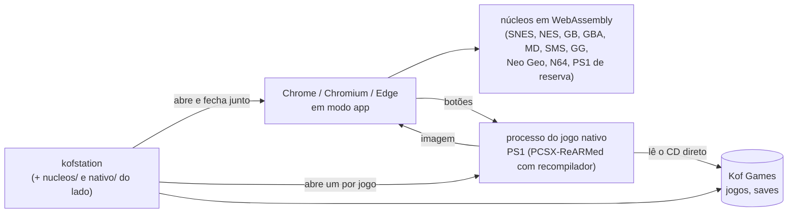

# Onde está o KOFstation novo (07/11/2026)

Um retrato, pra gente ler: o que já funciona, como o app funciona por dentro, como o trabalho anda, o que está
esperando teste e o que falta, na ordem combinada. O detalhe técnico de cada coisa está nos outros documentos (lista no
fim). Este aqui é atualizado quando a situação muda de verdade (etapa aprovada, ordem nova).

---

## Em uma frase

O KOFstation novo já roda **todos os consoles do antigo menos o PS2**, com biblioteca, saves, rebobinar, filtros,
controles, jukebox e estatísticas, e agora o **PlayStation roda nativo** (bem mais leve). Falta você testar o pacote
atual; depois vêm distribuição, celular e, por último, o PS2.

> **Atualização de 14/11:** feitos **M16.4** (opções de emulação por console), **T.1** (paridade com testes contra o antigo)
> e **M14.1–M14.2** (APK com o app novo e controle de toque). O que depende de você está na lista **"Pra você testar"** logo
> abaixo. Otimização do PS2 (M16.5) **pausada** por decisão sua. T.2 fica pra você decidir. M14.3–M14.5 (pasta de ROMs no
> celular, PS1/N64 nativos, atualizador do APK) não foram feitos: precisam de aparelho e do Android NDK (ver `docs/ANDROID.md`).

## Os números

| | Passos | O que quer dizer |
|---|---|---|
| ✅ Pronto | **70** | Você aprovou, ou o checkpoint era teste automático e passou |
| ⏸ Esperando você | **9** | Feito e testado por mim; falta você jogar e dizer "ok" |
| ⬜ Por fazer | **12** | Celular (M14), PS2, a troca |

Na lista de paridade com o antigo ([PARIDADE.md](PARIDADE.md)): 28 itens ✅ conferidos, 17 🟨 feitos com alguma
diferença anotada, 15 ⬜ que dependem das etapas que faltam.

---

## Como o app funciona hoje



- **Uma pasta, como no antigo** (D33): o executável (~8 MB, o app e o Rust), `nucleos/`, `nativo/` e `versao.txt`. Ele sobe um servidor só dentro do computador (127.0.0.1, com senha
  aleatória) e abre o app numa janela do navegador. Fechou a janela, ele fecha.
- **A maioria dos consoles** roda em WebAssembly dentro do navegador, com os **mesmos núcleos do antigo** (conferidos
  por SHA-256). O som dita o ritmo, como no antigo depois da otimização.
- **O PlayStation** agora roda **nativo**: o executável abre um processo só pro jogo, com o PCSX-ReARMed de verdade
  (com recompilador, o mesmo commit que o antigo usa). O som sai direto pela placa; a imagem vai pra página, então os
  filtros e as molduras continuam iguais. Se o núcleo quebrar, só esse processo cai: o app fica de pé. Se o nativo não
  abrir, um jogo pequeno roda no WebAssembly sozinho; um CD grande (acima de 100 MB) mostra o erro com o log, em vez de
  estourar a memória. CD zipado (`.zip` com `.cue`+`.bin`, `.iso`, `.chd`...) também vai pro nativo: o CD é extraído
  numa pasta de cache (um por vez) e a página nunca lê o zip inteiro.
- **Núcleos que a gente compila** (o PCSX nativo e o Snes9x com a "sonda" da jukebox) ficam como anexo de Release no
  GitHub, com o SHA-256 no manifesto. Nada de binário no histórico do git, nada de ROM nem BIOS em lugar nenhum.
- O desenho completo (camadas, quem fala com quem, por que não é Tauri): [README](../README.md) e
  [ARCHITECTURE.md](ARCHITECTURE.md).

---

## Como o trabalho anda

- **Etapas e passos.** O plano é o [ROADMAP.md](ROADMAP.md): cada etapa (M1, M2…) tem passos, e cada passo termina num
  **checkpoint**: eu paro, mostro (print, números, teste) e você diz "segue" ou pede mudança. Quando você diz "segue
  até…", eu faço várias de uma vez.
- **Paridade total.** O comportamento do antigo é a especificação. Sempre que dá, comparo automático: pixels, som byte a
  byte, arquivos (`.kofsave`, estados, `.wav`). O que não dá pra comparar fica anotado no [PARIDADE.md](PARIDADE.md).
- **Uma etapa por sessão** (economia de token), salvo quando você pede pra seguir direto.
- **Diário.** Toda sessão termina com uma entrada no [JORNAL.md](JORNAL.md): pedido, o que foi feito, o que decidi,
  o que medi, o que deu errado e **onde parou**. É por ali que qualquer agente (ou pessoa) retoma.
- **Decisões** com número e motivo no [DECISIONS.md](DECISIONS.md) (33 até agora; a última, D32, é o núcleo nativo).
- **Testes** a cada envio no GitHub (Linux e Windows): formato, lint, tipos, testes de TypeScript e Rust, testes de
  tela no Chromium e, desde o M11b, o PS1 nativo de ponta a ponta com o app de verdade.
- **Pacote pra você testar**: a branch `teste-binarios` (um commit só, trocado a cada versão), com o Linux e o Windows.

---

## O que já está pronto ✅

| Etapa | O que você tem |
|---|---|
| **M1 Casca** | 126 temas, Início, menus, Voltar, atalhos, navegação por controle, Guia |
| **M2 Rodar jogo** | Núcleo num Worker, som sem engasgo, imagem com escala/proporção, pausa, turbo, volume, menu rápido, painel F3 |
| **M3 Biblioteca** | Pasta Kof Games, organizar (mostra antes), busca com facetas, base de jogos, capas oficiais, modo sofá |
| **M4 Dados** | Configurações em arquivo (geral → console → jogo), backup `.kofsave` que abre nos dois apps |
| **M5 Saves** | Bateria, estados (abrem nos dois apps), salvar automático, Continuar, modos alegria/normal/raiz/hardcore |
| **M6 Rebobinar** | Igual ao antigo (preto e branco, ampulheta) |
| **M7 Imagem** | Painel de filtros (os mesmos pixels do antigo), NTSC, Scale4x, bloom, molduras, paletas |
| **M8 Controles** | Teclas e botões por console e por jogo, analógico no teclado, jogadores 2 a 4 |
| **M13.1 Rede** | O protocolo de rede do antigo (o mesmo do APK), provado contra os testes do antigo |
| **M15.1 Atualizador** | Manifesto assinado, baixa só o que mudou, troca na próxima abertura (liga quando a chave existir) |
| **M11b (parte)** | O núcleo nativo, o PCSX compilado, o Snes9x com sonda, PS1 wasm conferido pela imagem, cartão de BIOS e abertura |

## Pra você fazer (só você pode) 🔑

**A chave do atualizador** (uma vez só). Sem ela o app novo não se atualiza sozinho (o menu "🔄 Procurar atualização"
diz "compilada sem a chave"). No teu Linux, na pasta do KOFStation (o repositório):

```bash
git pull && node tools/manifesto.mjs chave ~/kofstation-chave.pem
```

Isso cria a chave **privada** em `~/kofstation-chave.pem` (guarde; não mande pra ninguém, nem pra mim) e grava a
**pública** em `crates/kof-app/chave-atualizacao.txt`. Depois:

1. No GitHub: KOFStation → Settings → Secrets and variables → Actions → **New repository secret**. Nome
   `KOF_CHAVE_ATUALIZACAO`; valor: tudo que sai de `cat ~/kofstation-chave.pem` (com as linhas BEGIN/END).
2. Mande a pública pro repositório: `git add crates/kof-app/chave-atualizacao.txt && git commit -m "Chave pública do atualizador" && git push`
   (ou cole na conversa a linha que o comando mostrou como "chave pública": ela pode ser vista por todo mundo).

A partir daí, cada envio na `main` publica uma versão (workflow "Versão") e o app instalado se atualiza sozinho.

## Pra você testar 🧪 (a lista única, 14/11)

> Tudo que depende de você, num lugar só, cada teste com o passo a passo. Eu vou marcando ⏸ no ROADMAP e botando aqui.
> A seção "Esperando você testar" mais abaixo é o histórico das etapas antigas (M9–M13, M15, PS2); os passos delas
> também estão resumidos aqui.

### T-M16.4 · Opções de emulação por console (perfis, Avançado, por jogo)

Precisa: o pacote novo da `teste-binarios` (ver o JORNAL de 14/11 pro hash) ou `pnpm dev`.

1. Abra qualquer jogo (PS1 ou PS2 pra ver o efeito de verdade). F6 (Estados salvos) → aba **⚙ Opções de emulação**.
2. Role até **Opções do console**. Em **Console**, escolha PlayStation 2. Em **Perfil do PlayStation 2**, troque
   entre ⚡ Rápido, ⚖ Equilibrado e 🎯 Fiel: as opções abaixo mudam sozinhas.
3. Com o jogo do PS2 aberto, troque "Pular ciclos do processador" (diz **⚡ vale na hora**): aperte **F3** e veja se
   o núcleo ficou mais rápido/lento sem reabrir o jogo.
4. Troque "Resolução interna" (diz **↻ vale ao reabrir o jogo**): aparece o aviso; feche e abra o jogo de novo.
5. Em **Valer para**, escolha **só este jogo**, mude uma opção e abra outro jogo do mesmo console: o outro não muda.
6. Abra o **Avançado** e confira que as opções de especialista estão lá. **Apagar os ajustes** volta ao perfil.
7. O 🩺 Modo diagnóstico passa a gravar as opções usadas (veja o `sessao.json`), então antes × depois vira número.

O que eu não consegui conferir sem você: se as opções do PS2 que marquei "vale na hora" realmente mudam o jogo ao
vivo (só dá pra ver com o jogo rodando na tua placa), e se os valores dos perfis ⚡ Rápido e 🎯 Fiel agradam
(só o ⚖ Equilibrado é o que o app sempre usou). Os consoles em WebAssembly (N64, SNES, GB, NES, Mega Drive, GBA)
dizem sempre "vale ao reabrir": ninguém mediu quais núcleos releem na hora.

### T-JOGO · Jogar de verdade no PS1, N64 e com o analógico (M8, M11, N.6)

1. Abra um jogo de PS1 (Biblioteca ou arrastando o `.cue`) e jogue uns 5 minutos: o som, o controle (teclado e, se tiver, um
   controle), o analógico (setas/IJKL/TFGH, ou o analógico do controle), salvar com F5 e carregar com F8.
2. Abra um jogo de N64 (`.z64`): mesma coisa. O analógico do N64 é só o esquerdo.
3. Me diga o que ficou diferente do KOFstation antigo (imagem, som, resposta do controle). Um print do F3 ajuda.

### T-OUVIR · Música do Início e jukebox (M9)

1. Abra o app sem jogo, clique em qualquer lugar (a música só toca depois do primeiro gesto): toca a trilha FM ou o violino?
   Troque pela escolha do Início, sorteie, desligue.
2. Abra um jogo de SNES e outro de Mega Drive, aperte **F7** em cada um, abra a Jukebox (F7 no jogo ou pelo menu): vistas
   Capa, Ondas e Notas, Mudo/Solo, exportar `.wav`, importar um `.spc` seu. Compare com o antigo se puder.

### T-EXTRAS · Estatísticas, tradução e o caçador de bugs (M10)

1. Jogue uns minutos e abra 📊 Estatísticas: o tempo, as sessões e o jogo aparecem? "Espaço usado" lista as lojas?
2. Com uma tradução `.ips`/`.bps`/`.ups` sua: Arquivo → aplicar tradução → escolha o patch e depois a ROM: abre o jogo traduzido,
   com o selo 🇧🇷 na Biblioteca e o save separado do original?
3. **F9** com um jogo aberto: o Reportar bug abre com o pacote marcado; Esc fecha e o jogo volta.

### T-NEOGEO · Neo Geo de verdade (M11)

Com o seu `neogeo.zip` guardado em 🔑 BIOS e um jogo (ex.: `mslug.zip`) na Biblioteca: abra, jogue, salve estado. Se o jogo
for um clone, o zip do pai tem que estar na mesma pasta.

### T-PS2 · PS2 (M12; a otimização está pausada)

1. Guarde a BIOS do PS2 em 🔑 BIOS → PS2, ponha o jogo em `Kof Games/Games/ps2` e abra pela Biblioteca.
2. Aperte **F3** numa cena pesada e me mande o print (fps, núcleo, leitura da placa). Se quiser medir de verdade:
   Ajuda → 🩺 Modo diagnóstico, jogue 5–10 min, **Exportar relatório (.zip)** e me mande (vale o Shadow of the Colossus
   e o Zone of the Enders 2 com o erro de memória: mande também o texto do aviso e quanto de RAM o PC tem).
3. Não vou mexer em desempenho do PS2 até você reabrir o assunto.

### T-REDE · Celular pela rede e controle (M13)

Com o **KOFstation antigo fechado** (os dois usam a porta 8650) e o APK atual no celular, na mesma Wi-Fi:
1. PC: 📡 Aparelhos → ➕ Parear um celular. Celular: 📡 Aparelhos → Ler o QR do PC (ou escolha o PC e digite o código).
   O celular tem que aparecer 🟢 conectado no PC.
2. Abra um jogo no PC; no celular, Controles → "Usar este celular como controle do PC": ele vira um jogador.
3. No celular, 🎮 Jogar no PC: o jogo roda no PC e aparece no celular, com som. No PC: menu rápido → 📱 Levar pro celular /
   📺 Voltar pra TV.
4. O jeito antigo também: Arquivo → 📱 Celular como controle… com o endereço e a senha que o celular mostra.

### T-INSTALAR · Instalar no Linux e no Windows (M15)

Linux (comando único, o pacote da `teste-binarios`):

```bash
mkdir -p ~/Programas/"Kof Games" && curl -fL https://raw.githubusercontent.com/Marcelao98/KOFstation/teste-binarios/KOFstation-linux.tar.gz | tar -xz -C ~/Programas/"Kof Games" && ~/Programas/"Kof Games"/KOFstation/kofstation --instalar && ~/Programas/"Kof Games"/KOFstation/kofstation
```

Confira: aparece **KOFstation novo** no menu de aplicativos (com a xícara), abre por ali, e o antigo continua do jeito que
estava, com os saves dele. Windows: `KOFstation-instalar.exe` (sem administrador) ou o `.zip` da mesma branch (você não
tem Windows: peça pra alguém abrir e dizer se instala, abre e acha os núcleos).

### T-CELULAR · O APK novo no celular (M14.1 e M14.2)

O APK está em `KOFstation-novo.apk` na `teste-binarios` (mesma branch dos outros pacotes). Ele **convive** com o APK antigo
(outro `applicationId`): não apaga nada do antigo.
1. No celular: baixe o arquivo, abra e instale (se o Android reclamar, libere "instalar apps desconhecidos" pro navegador ou
   gerenciador de arquivos). Com cabo: `adb install -r KOFstation-novo.apk`.
2. Abra **KOFstation novo**: o Início do app novo aparece (xícara, atalhos, cores do tema Café)?
3. Toque em ☰ → Controles (ou 🎮 na barra de baixo): os 6 modelos do controle aparecem, mudam na hora e mudar o tamanho e a
   transparência funciona?
4. **PS1 e N64 (o mais importante):** Biblioteca → Adicionar arquivo e escolha um CD de PS1 (`.cue` com os `.bin`: marque o
   `.cue` **e** os `.bin` juntos no seletor; ou `.chd`/`.iso`) ou uma ROM de N64 (`.z64`). Deve aparecer "preparando o CD…",
   a tela nativa do jogo no lugar do canvas, som e botões respondendo; abrir o ☰ some a tela nativa e volta ao fechar.
   Se não abrir, me mande o texto do aviso. Depois um jogo de GB, NES, SNES, Mega Drive ou GBA: joga? o som sai? o controle de toque responde (dois dedos ao mesmo tempo, deslizar entre botões)? Vire o
   celular deitado: o controle flutua nos cantos?
5. Salve um estado (💾 no ☰), feche o app e abra de novo: o jogo e o estado continuam lá?
6. O botão **Voltar** do Android: no jogo abre o ☰; numa tela volta; no Início sai do app.
7. **Pasta de ROMs:** Biblioteca → Escolher a pasta: abre o seletor de pastas do Android. Escolha a pasta onde estão os seus jogos
   (pode ter subpastas até 2 níveis): os jogos aparecem; um GB/SNES/etc. abre; um CD de PS1 (`.cue` + `.bin`, `.chd`, `.iso`)
   abre no núcleo nativo e reabre pela Biblioteca. Se o seletor não abrir ou a lista vier vazia, me diga o modelo do celular.
8. **Rede e controle no celular:** com o PC aberto na mesma Wi-Fi: 📡 Aparelhos → 📷 Ler o QR do PC (ou escolha o PC e digite o
   código) → o PC aparece 🟢. Depois 🎮 Jogar no PC (a imagem do jogo do PC aparece no celular, com som) e Controles → 📱 Usar
   este celular como controle do PC (o celular vira o controle do PC). Detalhes no teste T-REDE.
9. **Atualização:** 🔄 Procurar atualização (menu): diz "versão mais nova" ou oferece "Baixar" quando houver Release nova. Detalhes em `docs/ANDROID.md`.
Se algo quebrar, me mande o texto do erro (a tela mostra com código) e o modelo do celular; o log fica em `files/logs/` do app.

### T-DIAG · Gravar o diagnóstico (M16.3)

Ajuda → 🩺 Modo diagnóstico → marque "gravar cada jogo que eu abrir" → jogue → **Exportar relatório (.zip)**. O **F3** agora
mostra p50/p99, engasgos por minuto e quem causou, a CPU de cada linha e o gráfico dos últimos 10 s.

### Pra você decidir

- *(resolvido)* A abertura da 1ª vez já mostra o ícone da xícara, como o antigo.
- **T.2** (a última versão do antigo que leva pro novo): fica pra você decidir; não mexi.

## Esperando você testar ⏸

**Novo (M16.3, 08/11): gravar o Shadow of the Colossus.** Pacote Linux atualizado na `teste-binarios` (`65bdcf0`). Em **Ajuda → 🩺 Modo
diagnóstico**, marque "gravar cada jogo que eu abrir", jogue uns 5–10 minutos e depois clique em **Exportar
relatório (.zip)** e me mande. Faça o mesmo com o **Zone of the Enders 2** até o erro de memória (manda também o texto
do aviso e quanto de RAM o PC tem). O **F3** agora mostra p50/p99, engasgos por minuto e quem causou, a CPU de cada
linha e o gráfico dos últimos 10 s.

**Ritmo nativo (09/11):** integrado envio de cada quadro do PS2/PS1 e apresentação por vsync. A medição foi 0/284
quadros sem envio; o PS2 sintético também passou no pacote. O Marcelo confirma no SotC real e envia o `.zip` do ZoE2
para investigar a memória. Os pacotes Windows permanecem na versão anterior (`4058e25`), sem a correção C.

**Novo (PS2):** no pacote da `teste-binarios`: guarde a BIOS do PS2 (🔑 BIOS → PS2), ponha o jogo em
`Kof Games/Games/ps2`, abra pela Biblioteca e aperte **F3** numa cena pesada: me mande o print (fps, núcleo, leitura da
placa, imagem pra página). Se der, rode o mesmo jogo no PCSX2 sozinho pra comparar.

**Novo (M13, rede):** com o pacote abaixo instalado e o **KOFstation antigo fechado** (os dois usam a porta 8650):
1. PC: 📡 Aparelhos → ➕ Parear um celular. Celular (APK atual): 📡 Aparelhos → Ler o QR do PC (ou escolha o PC na
   lista e digite o código). O celular tem que aparecer 🟢 conectado no PC.
2. Abra um jogo no PC; no celular, Controles → "Usar este celular como controle do PC": ele vira um jogador.
3. No celular, 🎮 Jogar no PC (na tela Aparelhos ou na ficha do jogo): o jogo roda no PC e aparece no celular, com som.
   No PC, menu rápido → 📱 Levar pro celular / 📺 Voltar pra TV.
4. O jeito antigo também: Arquivo → 📱 Celular como controle… com o endereço e a senha que o celular mostra.

**Novo (M15):** o pacote da `teste-binarios` agora instala. No Linux:

```bash
mkdir -p ~/Programas/"Kof Games" && curl -fL https://raw.githubusercontent.com/Marcelao98/KOFstation/teste-binarios/KOFstation-linux.tar.gz | tar -xz -C ~/Programas/"Kof Games" && ~/Programas/"Kof Games"/KOFstation/kofstation --instalar && ~/Programas/"Kof Games"/KOFstation/kofstation
```

Confira: aparece **KOFstation novo** no menu de aplicativos (com a xícara), abre por ali, e o antigo continua lá, do
jeito que estava, com os saves dele. Os arquivos Windows (`KOFstation-instalar.exe` e `.zip`) ainda são da versão
anterior (`4058e25`) e não contêm a correção do ritmo nativo.

**De antes:**

O pacote está na branch `teste-binarios`: é a pasta `KOFstation/` (o executável, `nucleos/`, `nativo/`,
`versao.txt`, igual ao antigo), que vai dentro da sua Kof Games. No Linux:

```bash
mkdir -p ~/Programas/"Kof Games" && curl -fL https://raw.githubusercontent.com/Marcelao98/KOFstation/teste-binarios/KOFstation-linux.tar.gz | tar -xz -C ~/Programas/"Kof Games" && ~/Programas/"Kof Games"/KOFstation/kofstation
```

No Windows: o `KOFstation-windows.zip` da mesma branch, descompactado dentro da Kof Games.

O que conferir, do mais importante pro menos:

1. **PS1 nativo** (N.3): o "sem memória" de 07/11 foi corrigido de novo: era o **jogo zipado** (o FF9 `.zip`), que a
   página ainda lia inteiro. Agora ele abre no nativo, pela Biblioteca e arrastado, e o estado carrega certo (antes
   ficava a tela preta). ✅ Você testou o FF9 no Linux: liso, 60 fps, sem engasgo, e o save no cartão funciona. Falta
   o **Windows** (você não tem; vê depois como conferir) e um `.chd` quando tiver.
2. **N64** (N.6): um jogo de verdade. O "não roda" de antes era a ROM de teste, não o núcleo.
3. **Jukebox** (M9, N.5): F7 num jogo de SNES e num de Mega Drive; na jukebox, as vistas Capa, Ondas e Notas; um `.spc`
   de fora; exportar `.wav`.
4. **Neo Geo** (M11) com o seu `neogeo.zip`.
5. **Extras** (M10): Estatísticas depois de jogar, espaço usado, uma tradução (IPS/BPS/UPS), o F9 do caçador de bugs.

Bug que aparecer: eu corrijo, troco o pacote e seguimos.

---

## O que falta ⬜, na ordem combinada (03/11)

O PS2 ficou pro fim porque é o mais caro em token. Os custos são estimativa (tokens que eu escrevo).

| # | Etapa | Custo | O que é |
|---|---|---|---|
| 1 | Seu teste + correções | baixo | Aprova os 19 passos ⏸ |
| 2 | **M15 Distribuição** | ~150–250 mil | Atualizador com manifesto assinado, pacotes Linux e Windows, rodar lado a lado com o antigo. Você passa a usar o novo no dia a dia sem compilar nada |
| 3 | **M13 Rede e celular como controle** | ~250–400 mil | Parear celular e PC (código e QR), celular como controle, Jogar no PC, Modo Switch. Reaproveita o núcleo de rede do antigo; continua pareando com o APK atual |
| 4 | **M14 Celular** | ~300–450 mil | O APK servindo o app novo: controle de toque, pasta de ROMs, PS1 e N64 nativos no celular, atualização |
| 5 | **PS2 nativo** (N.9 / M12) | ~400–700 mil | Dar OpenGL ao processo do jogo, compilar o LRPS2, criar o sistema PS2. O N64 nativo sai junto |
| 6 | **Troca** | baixo–médio | Conferir a paridade 100% e o app antigo publicar a última versão, que leva pro novo |

**Agora (14/11):** M16.4, T.1, M14.1 e M14.2 feitos; faltam M14.3–M14.5 e os teus testes (lista "Pra você testar").
**Antes:** M15, M13 e o **PS2** feitos (faltam a chave e os teus testes). Entrou o **M16** (desempenho, antes do M14):
M16.1–M16.3 feitos, ⏸ você grava o SotC e o ZoE2; depois M16.4 (opções de emulação) e M16.5 (otimizar), ~300–550
mil tokens, 2–3 sessões. Em paralelo, dois agentes com tarefa (`docs/agentes/`): **A** ritmo dos quadros no
WebAssembly (o "antigo mais liso") e **B** o catálogo das opções de emulação.

---

## O que você precisa saber (limites e pendências)

- **Nada de ROM nem BIOS** no repositório, nos testes ou nos documentos. Os testes geram os próprios "jogos" (programas
  mínimos que pintam a tela ou tocam uma nota).
- **Neo Geo com imagem** só dá pra conferir com a BIOS (que não pode entrar em teste): esse é teste seu.
- **Núcleo Kof (SNES)** é da Mel: fica fora até ela definir a licença. A escolha de núcleo do SNES já está pronta pra
  quando ele chegar. O som da jukebox do SNES hoje vem do Snes9x (idêntico ao do jogo no antigo).
- **Licenças**: Snes9x, Genesis Plus GX e FBNeo são "só uso não comercial". Pra vender (a ideia da TV box), troca por
  alternativas livres. Lista completa no [THIRD_PARTY.md](../THIRD_PARTY.md).
- **Compilar no Linux** agora pede os cabeçalhos do som (`alsa-lib-devel` no Fedora); o `rodar.sh` avisa. Quem só usa o
  executável pronto não precisa de nada.

---

## Onde está cada coisa

| Documento | Pra quê |
|---|---|
| [ROADMAP.md](ROADMAP.md) | O plano inteiro, passo a passo, com estado e a ordem combinada |
| [JORNAL.md](JORNAL.md) | O diário: a primeira entrada diz onde parou |
| [PARIDADE.md](PARIDADE.md) | Cada funcionalidade do antigo e se já está igual no novo |
| [DECISIONS.md](DECISIONS.md) | As decisões de arquitetura e por quê |
| [README](../README.md) | A arquitetura com diagramas e a tabela "o que já existe" |
| [ARCHITECTURE.md](ARCHITECTURE.md) e [FRONTEND.md](FRONTEND.md) | Como o código é organizado |
| [API_CONTRACTS.md](API_CONTRACTS.md) | Os comandos entre a página e o Rust (e o protocolo do núcleo nativo) |
| [INSTALAR.md](INSTALAR.md) | Como montar o ambiente no Fedora, Ubuntu e Windows |
| [auditoria/](auditoria/) | O levantamento do app antigo (onde está cada funcionalidade lá) |
| [AGENTS.md](../AGENTS.md) | As regras pra qualquer agente que for mexer |
