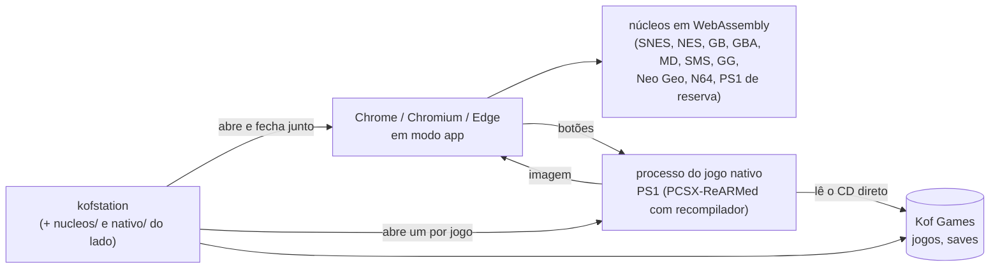

# Onde está o KOFstation novo (07/11/2026)

Um retrato, pra gente ler: o que já funciona, como o app funciona por dentro, como o trabalho anda, o que está
esperando teste e o que falta, na ordem combinada. O detalhe técnico de cada coisa está nos outros documentos (lista no
fim). Este aqui é atualizado quando a situação muda de verdade (etapa aprovada, ordem nova).

---

## Em uma frase

O KOFstation novo já roda **todos os consoles do antigo menos o PS2**, com biblioteca, saves, rebobinar, filtros,
controles, jukebox e estatísticas, e agora o **PlayStation roda nativo** (bem mais leve). Falta você testar o pacote
atual; depois vêm distribuição, celular e, por último, o PS2.

## Os números

| | Passos | O que quer dizer |
|---|---|---|
| ✅ Pronto | **69** | Você aprovou, ou o checkpoint era teste automático e passou |
| ⏸ Esperando você | **6** | Feito e testado por mim; falta você jogar e dizer "ok" |
| ⬜ Por fazer | **16** | Rede/celular como controle, celular, PS2, a troca |

Na lista de paridade com o antigo ([PARIDADE.md](PARIDADE.md)): 28 itens ✅ conferidos, 17 🟨 feitos com alguma
diferença anotada, 15 ⬜ que dependem das etapas que faltam.

---

## Como o app funciona hoje



- **Uma pasta, como no antigo** (D33): o executável (~8 MB, o app e o Rust), `nucleos/`, `nativo/` e `versao.txt`. Ele sobe um servidor só dentro do computador (127.0.0.1, com senha
  aleatória) e abre o app numa janela do navegador. Fechou a janela, ele fecha.
- **A maioria dos consoles** roda em WebAssembly dentro do navegador, com os **mesmos núcleos do antigo** (conferidos
  por SHA-256). O som dita o ritmo, como no antigo depois da otimização.
- **O PlayStation** agora roda **nativo**: o executável abre um processo só pro jogo, com o PCSX-ReARMed de verdade
  (com recompilador, o mesmo commit que o antigo usa). O som sai direto pela placa; a imagem vai pra página, então os
  filtros e as molduras continuam iguais. Se o núcleo quebrar, só esse processo cai: o app fica de pé. Se o nativo não
  abrir, um jogo pequeno roda no WebAssembly sozinho; um CD grande (acima de 100 MB) mostra o erro com o log, em vez de
  estourar a memória. CD zipado (`.zip` com `.cue`+`.bin`, `.iso`, `.chd`...) também vai pro nativo: o CD é extraído
  numa pasta de cache (um por vez) e a página nunca lê o zip inteiro.
- **Núcleos que a gente compila** (o PCSX nativo e o Snes9x com a "sonda" da jukebox) ficam como anexo de Release no
  GitHub, com o SHA-256 no manifesto. Nada de binário no histórico do git, nada de ROM nem BIOS em lugar nenhum.
- O desenho completo (camadas, quem fala com quem, por que não é Tauri): [README](../README.md) e
  [ARCHITECTURE.md](ARCHITECTURE.md).

---

## Como o trabalho anda

- **Etapas e passos.** O plano é o [ROADMAP.md](ROADMAP.md): cada etapa (M1, M2…) tem passos, e cada passo termina num
  **checkpoint**: eu paro, mostro (print, números, teste) e você diz "segue" ou pede mudança. Quando você diz "segue
  até…", eu faço várias de uma vez.
- **Paridade total.** O comportamento do antigo é a especificação. Sempre que dá, comparo automático: pixels, som byte a
  byte, arquivos (`.kofsave`, estados, `.wav`). O que não dá pra comparar fica anotado no [PARIDADE.md](PARIDADE.md).
- **Uma etapa por sessão** (economia de token), salvo quando você pede pra seguir direto.
- **Diário.** Toda sessão termina com uma entrada no [JORNAL.md](JORNAL.md): pedido, o que foi feito, o que decidi,
  o que medi, o que deu errado e **onde parou**. É por ali que qualquer agente (ou pessoa) retoma.
- **Decisões** com número e motivo no [DECISIONS.md](DECISIONS.md) (33 até agora; a última, D32, é o núcleo nativo).
- **Testes** a cada envio no GitHub (Linux e Windows): formato, lint, tipos, testes de TypeScript e Rust, testes de
  tela no Chromium e, desde o M11b, o PS1 nativo de ponta a ponta com o app de verdade.
- **Pacote pra você testar**: a branch `teste-binarios` (um commit só, trocado a cada versão), com o Linux e o Windows.

---

## O que já está pronto ✅

| Etapa | O que você tem |
|---|---|
| **M1 Casca** | 126 temas, Início, menus, Voltar, atalhos, navegação por controle, Guia |
| **M2 Rodar jogo** | Núcleo num Worker, som sem engasgo, imagem com escala/proporção, pausa, turbo, volume, menu rápido, painel F3 |
| **M3 Biblioteca** | Pasta Kof Games, organizar (mostra antes), busca com facetas, base de jogos, capas oficiais, modo sofá |
| **M4 Dados** | Configurações em arquivo (geral → console → jogo), backup `.kofsave` que abre nos dois apps |
| **M5 Saves** | Bateria, estados (abrem nos dois apps), salvar automático, Continuar, modos alegria/normal/raiz/hardcore |
| **M6 Rebobinar** | Igual ao antigo (preto e branco, ampulheta) |
| **M7 Imagem** | Painel de filtros (os mesmos pixels do antigo), NTSC, Scale4x, bloom, molduras, paletas |
| **M8 Controles** | Teclas e botões por console e por jogo, analógico no teclado, jogadores 2 a 4 |
| **M15.1 Atualizador** | Manifesto assinado, baixa só o que mudou, troca na próxima abertura (liga quando a chave existir) |
| **M11b (parte)** | O núcleo nativo, o PCSX compilado, o Snes9x com sonda, PS1 wasm conferido pela imagem, cartão de BIOS e abertura |

## Pra você fazer (só você pode) 🔑

**A chave do atualizador** (uma vez só). Sem ela o app novo não se atualiza sozinho (o menu "🔄 Procurar atualização"
diz "compilada sem a chave"). No teu Linux, na pasta do KOFStation (o repositório):

```bash
git pull && node tools/manifesto.mjs chave ~/kofstation-chave.pem
```

Isso cria a chave **privada** em `~/kofstation-chave.pem` (guarde; não mande pra ninguém, nem pra mim) e grava a
**pública** em `crates/kof-app/chave-atualizacao.txt`. Depois:

1. No GitHub: KOFStation → Settings → Secrets and variables → Actions → **New repository secret**. Nome
   `KOF_CHAVE_ATUALIZACAO`; valor: tudo que sai de `cat ~/kofstation-chave.pem` (com as linhas BEGIN/END).
2. Mande a pública pro repositório: `git add crates/kof-app/chave-atualizacao.txt && git commit -m "Chave pública do atualizador" && git push`
   (ou cole na conversa a linha que o comando mostrou como "chave pública": ela pode ser vista por todo mundo).

A partir daí, cada envio na `main` publica uma versão (workflow "Versão") e o app instalado se atualiza sozinho.

## Esperando você testar ⏸

**Novo (M15):** o pacote da `teste-binarios` agora instala. No Linux:

```bash
mkdir -p ~/Programas/"Kof Games" && curl -fL https://raw.githubusercontent.com/Marcelao98/KOFstation/teste-binarios/KOFstation-linux.tar.gz | tar -xz -C ~/Programas/"Kof Games" && ~/Programas/"Kof Games"/KOFstation/kofstation --instalar && ~/Programas/"Kof Games"/KOFstation/kofstation
```

Confira: aparece **KOFstation novo** no menu de aplicativos (com a xícara), abre por ali, e o antigo continua lá, do
jeito que estava, com os saves dele. No Windows: o `KOFstation-instalar.exe` da mesma branch (instala sem pedir
administrador, atalho na área de trabalho) ou o `.zip`.

**De antes:**

O pacote está na branch `teste-binarios`: é a pasta `KOFstation/` (o executável, `nucleos/`, `nativo/`,
`versao.txt`, igual ao antigo), que vai dentro da sua Kof Games. No Linux:

```bash
mkdir -p ~/Programas/"Kof Games" && curl -fL https://raw.githubusercontent.com/Marcelao98/KOFstation/teste-binarios/KOFstation-linux.tar.gz | tar -xz -C ~/Programas/"Kof Games" && ~/Programas/"Kof Games"/KOFstation/kofstation
```

No Windows: o `KOFstation-windows.zip` da mesma branch, descompactado dentro da Kof Games.

O que conferir, do mais importante pro menos:

1. **PS1 nativo** (N.3): o "sem memória" de 07/11 foi corrigido de novo: era o **jogo zipado** (o FF9 `.zip`), que a
   página ainda lia inteiro. Agora ele abre no nativo, pela Biblioteca e arrastado, e o estado carrega certo (antes
   ficava a tela preta). ✅ Você testou o FF9 no Linux: liso, 60 fps, sem engasgo, e o save no cartão funciona. Falta
   o **Windows** (você não tem; vê depois como conferir) e um `.chd` quando tiver.
2. **N64** (N.6): um jogo de verdade. O "não roda" de antes era a ROM de teste, não o núcleo.
3. **Jukebox** (M9, N.5): F7 num jogo de SNES e num de Mega Drive; na jukebox, as vistas Capa, Ondas e Notas; um `.spc`
   de fora; exportar `.wav`.
4. **Neo Geo** (M11) com o seu `neogeo.zip`.
5. **Extras** (M10): Estatísticas depois de jogar, espaço usado, uma tradução (IPS/BPS/UPS), o F9 do caçador de bugs.

Bug que aparecer: eu corrijo, troco o pacote e seguimos.

---

## O que falta ⬜, na ordem combinada (03/11)

O PS2 ficou pro fim porque é o mais caro em token. Os custos são estimativa (tokens que eu escrevo).

| # | Etapa | Custo | O que é |
|---|---|---|---|
| 1 | Seu teste + correções | baixo | Aprova os 19 passos ⏸ |
| 2 | **M15 Distribuição** | ~150–250 mil | Atualizador com manifesto assinado, pacotes Linux e Windows, rodar lado a lado com o antigo. Você passa a usar o novo no dia a dia sem compilar nada |
| 3 | **M13 Rede e celular como controle** | ~250–400 mil | Parear celular e PC (código e QR), celular como controle, Jogar no PC, Modo Switch. Reaproveita o núcleo de rede do antigo; continua pareando com o APK atual |
| 4 | **M14 Celular** | ~300–450 mil | O APK servindo o app novo: controle de toque, pasta de ROMs, PS1 e N64 nativos no celular, atualização |
| 5 | **PS2 nativo** (N.9 / M12) | ~400–700 mil | Dar OpenGL ao processo do jogo, compilar o LRPS2, criar o sistema PS2. O N64 nativo sai junto |
| 6 | **Troca** | baixo–médio | Conferir a paridade 100% e o app antigo publicar a última versão, que leva pro novo |

**Agora:** M15 feito (falta a chave e o teu teste); seguindo pro M13 (rede e celular como controle).

---

## O que você precisa saber (limites e pendências)

- **Nada de ROM nem BIOS** no repositório, nos testes ou nos documentos. Os testes geram os próprios "jogos" (programas
  mínimos que pintam a tela ou tocam uma nota).
- **Neo Geo com imagem** só dá pra conferir com a BIOS (que não pode entrar em teste): esse é teste seu.
- **Núcleo Kof (SNES)** é da Mel: fica fora até ela definir a licença. A escolha de núcleo do SNES já está pronta pra
  quando ele chegar. O som da jukebox do SNES hoje vem do Snes9x (idêntico ao do jogo no antigo).
- **Licenças**: Snes9x, Genesis Plus GX e FBNeo são "só uso não comercial". Pra vender (a ideia da TV box), troca por
  alternativas livres. Lista completa no [THIRD_PARTY.md](../THIRD_PARTY.md).
- **Compilar no Linux** agora pede os cabeçalhos do som (`alsa-lib-devel` no Fedora); o `rodar.sh` avisa. Quem só usa o
  executável pronto não precisa de nada.

---

## Onde está cada coisa

| Documento | Pra quê |
|---|---|
| [ROADMAP.md](ROADMAP.md) | O plano inteiro, passo a passo, com estado e a ordem combinada |
| [JORNAL.md](JORNAL.md) | O diário: a primeira entrada diz onde parou |
| [PARIDADE.md](PARIDADE.md) | Cada funcionalidade do antigo e se já está igual no novo |
| [DECISIONS.md](DECISIONS.md) | As decisões de arquitetura e por quê |
| [README](../README.md) | A arquitetura com diagramas e a tabela "o que já existe" |
| [ARCHITECTURE.md](ARCHITECTURE.md) e [FRONTEND.md](FRONTEND.md) | Como o código é organizado |
| [API_CONTRACTS.md](API_CONTRACTS.md) | Os comandos entre a página e o Rust (e o protocolo do núcleo nativo) |
| [INSTALAR.md](INSTALAR.md) | Como montar o ambiente no Fedora, Ubuntu e Windows |
| [auditoria/](auditoria/) | O levantamento do app antigo (onde está cada funcionalidade lá) |
| [AGENTS.md](../AGENTS.md) | As regras pra qualquer agente que for mexer |
