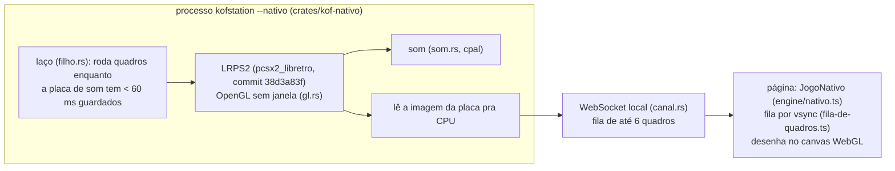

# Tarefa D · PS2 liso como o PCSX2 (M16.5, reaberto pelo Marcelo em 17/11)

**Quem faz:** um agente rodando **no computador do Marcelo** (Linux), porque só lá existem a placa de vídeo, a BIOS e os
jogos. **Branch:** `agente-d/ps2-liso`, a partir da `claude/busy-ritchie-wrvk8h`. Leia antes o [AGENTS.md](../../AGENTS.md)
e o [LEIA-ME](LEIA-ME.md) desta pasta.

**Objetivo, nas palavras dele:** "deixar rodar tão liso quanto o PCSX2. Primeiro a gente vê o que fazemos diferente do
PCSX2 e gradativamente chega mais perto, documentando tudo." Você **abre os jogos e testa sozinho**, sem esperar o
Marcelo jogar: mede, muda uma coisa, mede de novo.

## Regras desta tarefa (além das do AGENTS.md)

- **Nome de jogo nunca vai pro repositório**: nem em commit, doc, código, teste, nome de arquivo, log ou print colado.
  Use sempre **jogo pesado A** (o que "rodava relativamente bem, com engasgadas") e **jogo pesado B** (o que dava erro
  de memória). Qual arquivo é qual, o Marcelo te diz na conversa; guarde isso só em variável de ambiente
  (`KOF_JOGO_A`, `KOF_JOGO_B`, `KOF_BIOS_PS2`), nunca em arquivo versionado.
- **Nada de ROM, ISO, BIOS, save, estado ou caminho pessoal no repositório.** Os relatórios do 🩺 (`.zip`, `sessao.json`,
  CSV) **têm o nome do jogo dentro**: ficam fora do repositório (ex.: `~/kof-medidas/`). Pro doc vão só os números, com
  "jogo pesado A/B". Antes de cada commit: `git status` e `git diff --cached | grep -i` pelos nomes dos arquivos dos jogos.
- **Não indicar onde baixar** jogo ou BIOS, em lugar nenhum.
- **Uma mudança por vez, com número antes e depois.** Mudança que não melhora o número (ou piora outro jogo) é desfeita
  e anotada como "tentado, não ajudou". Nada de empilhar três ajustes e medir no fim.
- **A branch `rascunho/ps2-liso` não é pra juntar.** Ela tem três tentativas sem medição (laço pelo relógio como o
  PCSX2, medição de CPU fora do laço, MTVU ligado). Pode ler pra ter ideia; se alguma se provar com número, refaça na
  sua branch, uma por vez.
- Só o PS2. Não mexa em celular, rede, telas, nem no PS1 além do que o código comum obrigar (`kof-nativo` é dos dois:
  rode o teste do PS1 depois de cada mudança no laço).
- Não edite `JORNAL.md`, `ROADMAP.md`, `SITUACAO.md`, `README.md`: o seu diário é `docs/PS2-LISO.md` (abaixo) e o
  Relatório no fim deste arquivo.

## O que existe hoje

- Decisão **D36** (`docs/DECISIONS.md`): núcleo pronto do antigo, OpenGL sem janela, imagem pela página.
- Opções padrão: `packages/engine/src/nucleos.ts` e o catálogo em `packages/domain/src/opcoes-nucleo.ts` (perfis ⚡ ⚖ 🎯;
  a tela é F6 → ⚙ Opções de emulação). `pcsx2_ee_cycle_skip = Mild Underclock` é herança do antigo.
- Medição pronta (M16.1–M16.3): **F3** (p50/p99, engasgos por minuto e quem causou, CPU por linha) e o **🩺 Modo
  diagnóstico** (Ajuda → 🩺; grava CSV por quadro e `sessao.json`). Desenho em `docs/DIAGNOSTICO.md`.
- Ferramentas: `tools/testar-ps2.mjs` (abre o app de verdade com um DVD e confere que o núcleo vive),
  `tools/medir-ritmo.mjs`, `crates/kof-nativo/tests/` (`lrps2.rs`, `ritmo.rs`, `jogo_de_verdade.rs`, `opengl.rs`).
- O que já se sabe: a tarefa C zerou os quadros perdidos na origem (60% → 0 no teste) e **o olho do Marcelo não viu
  diferença**; o antigo (janela SDL própria, sem passar pela página) é mais liso que o novo. O jogo pesado B morria por
  memória (nunca investigado: faltou a saída do `journalctl`).
- `docs/NATIVO-LISO.md`: as regras que deixaram o PS1/N64 lisos no celular e a lista de conferência pro PS2.

## O plano, em fases (pare e escreva ao fim de cada uma)

### Fase 0 · Banco de medição que roda sozinho

Sem isso o resto é achismo. Um comando só (ex.: `node tools/medir-ps2.mjs`) que:

1. abre o app de verdade com `KOF_JOGO_A` (e depois `KOF_JOGO_B`), com a BIOS de `KOF_BIOS_PS2`;
2. chega num trecho **repetível** sem ninguém jogar: carregue um **estado salvo** (feito uma vez pelo Marcelo ou por
   você, guardado fora do repositório) e solte uma sequência fixa de botões por N segundos; se o estado não for
   determinístico o bastante, use a abertura/demonstração do jogo;
3. grava o diagnóstico e imprime uma linha: fps médio, tempo de quadro p50/p95/p99, engasgos por minuto (quadro > 1,5×
   o alvo), quadros repetidos/pulados na página, CPU por linha (EE, VU, GS, som, laço, leitura, envio), buracos de som
   (underrun), memória do filho e da página;
4. roda 3 vezes e mostra a variação (se a variação entre rodadas iguais for maior que o ganho, o ganho não existe).

Confira que o banco **enxerga** o que o Marcelo sente: grave também um vídeo curto da janela (ex.: `ffmpeg` com
`x11grab`/`kmsgrab` ou PipeWire) e conte quadros repetidos nele, porque "número bom e imagem engasgando" já aconteceu.

### Fase 1 · A régua: o PCSX2 de verdade na mesma máquina

Instale o PCSX2 oficial (pacote da distribuição, Flatpak ou AppImage do site do projeto) e meça **os mesmos trechos**,
com as mesmas configurações que o nosso perfil ⚖ usa (resolução interna, renderer, filtros). Use o OSD dele (tempo de
quadro, EE/GS/VU %) e, pra comparar igual com igual, o mesmo vídeo da janela + contagem de quadros repetidos. Meça
também o **KOFstation antigo** no mesmo trecho (ele é "mais liso que o novo" e usa o mesmo núcleo: é a prova de que dá).

Saída: a primeira tabela de `docs/PS2-LISO.md` com três colunas (PCSX2 · antigo · novo) e as mesmas linhas da Fase 0.

### Fase 2 · O que fazemos diferente do PCSX2 (e do antigo)

Uma tabela "PCSX2 faz assim / antigo faz assim / novo faz assim / custo medido", lendo código e medindo. Pontos de
partida (confirme cada um, não assuma):

| Assunto | Perguntas |
|---|---|
| **Caminho da imagem** | PCSX2 e o antigo apresentam direto na placa (janela própria, swap). O novo lê a imagem pra CPU, manda por WebSocket e a página sobe de novo pra placa. Quanto custa cada pedaço por quadro na resolução usada? É onde nasce o engasgo? |
| **Quem marca o ritmo** | PCSX2: limitador pelo relógio + vsync, som com esticamento (time-stretch) pra absorver variação. Novo: o som guardado (60 ms) decide quantos quadros rodar. Antigo: ? (ver `nucleo.js`/o hospedeiro nativo do antigo). |
| **Linhas (threads)** | PCSX2: EE, MTGS (GS em linha própria), MTVU opcional. O núcleo libretro tem o quê ligado? As linhas têm nome/prioridade? O laço disputa núcleo de CPU com a leitura/envio? |
| **Renderer** | PCSX2 hoje usa Vulkan por padrão no Linux; o nosso é OpenGL sem janela. O núcleo aceita Vulkan? Vale o custo? |
| **Opções** | Diferenças entre o padrão do PCSX2 e o nosso ⚖: EE cycle rate/skip, MTVU, blending accuracy, mipmapping, pré-carga de texturas, hardware download mode, cache de shaders em disco. |
| **Versão do núcleo** | O `38d3a83f` é de quando? O que o PCSX2 atual ganhou desde então (só anote; trocar de núcleo é decisão do Marcelo). |
| **Memória (jogo B)** | Quanto o PCSX2 usa no mesmo jogo? Onde o nosso cresce: no filho, na fila de quadros, na página? Pegue o motivo da morte (`journalctl -k`, `dmesg`, código de saída do filho). |

### Fase 3 · Chegar perto, um passo por vez

Na ordem do **maior custo medido** na Fase 2. Pra cada passo: hipótese → mudança mínima → os mesmos números → fica ou
sai. Candidatos prováveis (a medição é que decide a ordem):

1. **Modo janela própria** pro PS2 (o filho apresenta direto na placa, a página não desenha por baixo; a página manda
   só a posição da área do jogo e os botões, como a `SurfaceView` do celular e a janela SDL do antigo). Se a Fase 2
   mostrar que o caminho pela página é o culpado, este é o passo grande; precisa funcionar em Wayland e X11 e não pode
   quebrar F3, menu rápido, estados, print e moldura. Antes de fazer, escreva o desenho e deixe o Marcelo ver.
2. **Ritmo**: laço pelo relógio com o som se ajustando (como o PCSX2), em vez do som mandar no laço.
3. **Linhas**: MTVU, prioridade e nome das linhas, tirar medição/leitura/envio do laço.
4. **Opções padrão por perfil** (e por jogo, pelas camadas que já existem) quando uma opção resolver um jogo.
5. **Memória do jogo B.**

Critério de "liso": no trecho de teste, engasgos por minuto e p99 do tempo de quadro **iguais aos do PCSX2 dentro da
variação entre rodadas**, sem buraco de som, nos dois jogos; e o Marcelo joga 10 minutos e concorda.

## O diário: `docs/PS2-LISO.md`

Crie e mantenha (é o entregável que ele mais quer). Estrutura:

1. **A máquina** (CPU, placa, driver, sessão Wayland/X11, versão do PCSX2 usada como régua).
2. **Como medir** (o comando, o trecho, como ler os números).
3. **A régua** (tabela PCSX2 · antigo · novo).
4. **Diferenças do PCSX2** (a tabela da Fase 2).
5. **Histórico das tentativas**, uma linha cada: data · o que mudou · commit · antes → depois · ficou ou saiu · por quê.
6. **Como está agora e o que falta.**

## Arquivos que você pode mexer

`crates/kof-nativo/**`, `packages/engine/src/nativo.ts`, `packages/engine/src/fila-de-quadros.ts`,
`packages/engine/src/nucleos.ts` (só as opções do PS2), `packages/domain/src/opcoes-nucleo.ts` (só PS2),
`apps/desktop/src/hooks/useTelaDoJogo.ts` (só o ramo do nativo do PC), `tools/medir-ps2.mjs` (novo),
`docs/PS2-LISO.md` (novo) e este arquivo (Relatório). Precisou de outro: o mínimo, e diga no relatório.

Antes de cada push: `pnpm check`, `pnpm check:rust`, `pnpm e2e` se tocou na página, e
`cargo test --workspace --no-fail-fast`. Commits em português, sem nome de modelo de IA e **sem nome de jogo**.

## Pra começar (o Marcelo cola isto no Claude Code local, na pasta do repositório)

> Leia `AGENTS.md`, `docs/agentes/LEIA-ME.md` e `docs/agentes/D-ps2-liso.md` e faça a tarefa D, começando pela Fase 0.
> `git fetch && git checkout claude/busy-ritchie-wrvk8h && git pull && git checkout -b agente-d/ps2-liso`.
> Os jogos e a BIOS estão em: (ele diz os caminhos aqui, na conversa). Nunca escreva o nome deles no repositório.

## Relatório

*(o agente preenche: o que fez, a tabela final, o que ficou de fora, comandos pra conferir)*
