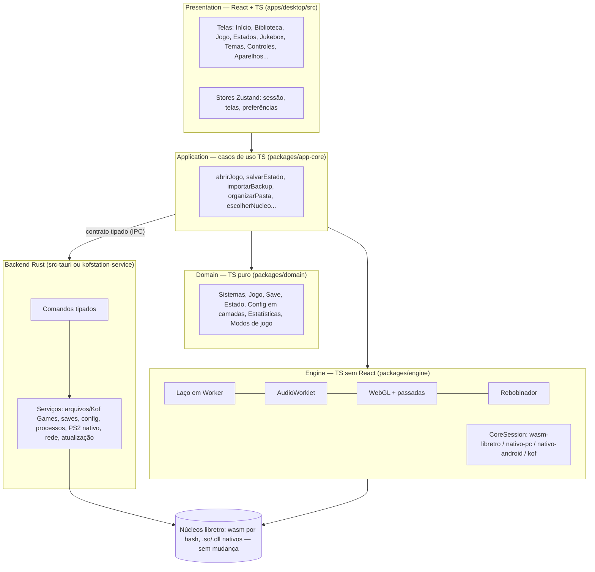

# KOFstation — Auditoria de arquitetura (Fase 1)

> Base auditada: `main` no commit `ceba493` (versão publicada **202610262214**), em 31/10/2026.
> Nenhum arquivo do projeto foi alterado: esta pasta (`auditoria/`) é nova e serve só pra revisão. Quando o repositório
> novo existir, ela vai pra lá (`docs/`).
>
> Documentos irmãos: [DEPENDENCY_AUDIT](DEPENDENCY_AUDIT.md) · [FEATURE_INVENTORY](FEATURE_INVENTORY.md) ·
> [CURRENT_SYSTEM_MAP](CURRENT_SYSTEM_MAP.md) · [MIGRATION_PLAN](MIGRATION_PLAN.md)

---

## 0. Uma correção ao plano antes de tudo: **não existe RetroArch no KOFstation**

O plano fala em "preservar RetroArch", "integração com RetroArch", "como o RetroArch é inicializado". Depois de ler o
código, **o KOFstation não usa o RetroArch em lugar nenhum**. Ele usa os **núcleos libretro** (os mesmos que o RetroArch
usa), mas o *frontend* libretro (o programa que carrega o núcleo, entrega a ROM, recebe imagem/som e manda os botões) é
**escrito pelo próprio projeto**, em três versões:

| Frontend libretro próprio | Onde | Roda em | Núcleos |
|---|---|---|---|
| `nucleo-libretro/ponte.cpp` (391 linhas) | compilado junto com cada núcleo pra **WebAssembly** (emscripten) | navegador do PC e WebView do Android | Snes9x, Gambatte, FCEUmm, Genesis Plus GX, mGBA, FBNeo, PCSX-ReARMed, Mupen64Plus-Next |
| `pc-nativo/kofnativo.c` (839 linhas) | executável nativo C + SDL2 + OpenGL 3.3 | PC Linux/Windows | LRPS2 (PCSX2 libretro) |
| `android/nativo/kofnativo.c` (357 linhas) | `.so` JNI no APK | Android ARM64 | PCSX-ReARMed (ARM64, dynarec), Mupen64Plus-Next GLES3 |

Consequência pro plano: a regra "não reescrever emuladores/cores" continua valendo e é seguida hoje (os núcleos vêm
dos repositórios do libretro em commits fixos, só com o remendo da "sonda" de áudio). Mas **"preservar o RetroArch"
não se aplica**, e **introduzir o RetroArch seria uma mudança grande**, não uma preservação: perderíamos coisas que só
existem porque o frontend é nosso (sonda por canal da jukebox, rebobinar por diferenças na memória do núcleo, imagem
na página com os filtros do app, PS2 em "modo página", disco lido aos pedaços pela página, savestate no banco). A
recomendação (detalhada no [MIGRATION_PLAN](MIGRATION_PLAN.md), decisão D1) é **manter os frontends libretro próprios**
e tratá-los como uma camada de infraestrutura com contrato explícito.

---

## 1. Diagnóstico em uma página

O KOFstation é, hoje, **uma aplicação web de arquivo único (`file://`) aberta num navegador Chromium em modo app**,
cercada por processos nativos auxiliares. Não há backend no sentido clássico: quase toda a regra de negócio, a
persistência e a emulação rodam **no navegador, na linha principal**, dentro de um único `app.js` de 4.540 linhas.

```
Lançador (C/sh/Java) ── atualiza arquivos pelo GitHub raw e abre o navegador
   │
   ├─ Navegador (Edge/Chrome --app=file://.../KOFstation.html)   ← a "aplicação"
   │     app.js + rede.js + jogarpc.js + jogadores.js (+ android.js | ps2.js) = UMA closure
   │     nucleo.js (adaptador) → nucleos/<núcleo>-<hash>.js (wasm em base64 via <script>)
   │     IndexedDB "kofnes" v8 + localStorage "kofnes.*" + File System Access (pasta Kof Games)
   │
   ├─ kofnativo (C)     WebSocket 127.0.0.1:8643  ← PS2 nativo
   └─ kofservico (C)    WebSocket 127.0.0.1:8644 + TCP/UDP 8650  ← rede entre aparelhos
Android: MainActivity (Java) + WebView + ponte JS `KOFnesApk` (32 métodos) + .so nativos (PS1/N64/rede)
```

**Pontos fortes reais (preservar):**
1. **Independência de plataforma pela web**: um código de interface serve PC (Windows/Linux) e Android.
2. **Núcleos versionados por hash** (`nucleos/<núcleo>-<sha256[:8]>.js`): html e núcleo nunca se misturam.
3. **Determinismo** aproveitado de verdade: savestate, rebobinar, caçador de bugs com replay.
4. **Protocolos documentados nos lugares críticos**: `rede/PROTOCOLO.md` (com criptografia sólida: CPace + 3DH +
   XChaCha20-Poly1305 via Monocypher) e o cabeçalho do `kofnativo.c`.
5. **Dados do usuário fora da pasta do programa** (atualizar não apaga nada) e backup `.kofsave` já existente.
6. **Muitos testes de ponta a ponta** (≈85 scripts) usando a interface real.
7. **Disciplina de licenças e ROMs** (nenhuma ROM no git; ROMs de teste geradas ou livres).

**Problemas estruturais (resumo; detalhes na seção 4):**
1. Monólito de interface: `app.js` com ~286 funções, 49 variáveis mutáveis de topo e 6 arquivos *injetados por
   concatenação de texto dentro da mesma closure*.
2. Build por substituição de texto (`juntar.py`) — sem módulos, sem tipos, sem árvore de dependências.
3. A restrição `file://` dita a arquitetura (núcleos em base64 dentro de `<script>`, `SharedArrayBuffer` por flag do
   navegador, sem `fetch`).
4. Emulação, áudio (`ScriptProcessorNode`, obsoleto) e interface na mesma thread.
5. Contrato do núcleo é "imitar o núcleo Kof" (`pad`, `runFrame`, `ppu.frame`, `apu.dsp`) + "fachadas" duck-typed pros
   nativos.
6. Três servidores WebSocket escritos à mão (C, C, Java), três protocolos diferentes, sem esquema compartilhado; o
   `kofnativo` **não confere a origem** da conexão.
7. Atualizador baixa e executa binários conferindo só tamanho e cabeçalho (sem assinatura nem hash).
8. Configuração espalhada em dezenas de chaves `kofnes.*` com camadas (geral → console → jogo) reimplementadas em cada
   recurso.
9. Testes sem *runner*, sem CI, com caminhos fixos do container e dependentes de ROMs passadas na mão.
10. Build não reproduzível fora de um container preparado à mão (Kof com patch, dois emscripten diferentes, saídas
    fora do git, binários publicados dentro do git: `publicado/` = 55 MB).

---

## 2. Linguagens e tamanho

| Linguagem | Onde | Linhas (aprox.) | Papel |
|---|---|---|---|
| JavaScript | `web/*.js` | ~8.900 | Toda a aplicação (interface, regras, persistência, laço de emulação, vídeo, áudio) |
| CSS / HTML | `web/estilo.css`, `android.css`, `pagina.html` | ~2.600 | 126 temas por variáveis CSS, todas as telas no mesmo HTML |
| C | `pc-nativo/`, `rede/`, `android/nativo/`, `web/lancador_win.c`, `nucleo-libretro/*.c` | ~3.200 (sem terceiros) | Frontends libretro nativos, serviço de rede, lançador do Windows |
| C++ | `nucleo-libretro/ponte.cpp` | 391 | Frontend libretro em WebAssembly |
| Java (Android) | `android/src/` | ~2.200 | Casca do APK, ponte JS, servidores, núcleos nativos |
| Kof | `snes/*.kf` | 5.695 | Emulador de SNES próprio (hoje **opcional** no PC; o padrão é Snes9x) |
| Shell (POSIX/Bash) | `web/*.sh`, `*/construir*.sh`, `web/lancador_linux.sh` | ~800 | Build, publicação, lançador Linux |
| Python 3 | `web/juntar.py`, `web/jogos/*.py`, `web/musicas/**`, `nucleo-libretro/lista-neogeo.py`, `testes/**/*.py` | ~900 | Montagem do HTML, base de jogos, trilha FM, geradores de teste |
| Node (CommonJS) | `testes/**/*.cjs`, `bugs/reproduzir.cjs` | ~85 arquivos | Testes Playwright e Node |

Pastas legadas que **não recebem mais funcionalidade**: `app/`, `empacotar/` (exceto `icone.py`/`kofnes.rc`, usados no
build), `nativo/`, `tools/`, `KOFnes.kf`, `kofnes.bat`. A pasta `undefined/` (prints PNG) parece ter sido criada por
engano por um script (`saida/` virou `undefined`).

---

## 3. Pontos de entrada

| Entrada | Arquivo | O que faz |
|---|---|---|
| Lançador Windows | `web/lancador_win.c` → `KOFstation.exe` (LANCADOR 13) | Atualiza (versao.txt), baixa núcleos e nativos, abre `kofservico` e `kofnativo` (job object), abre o Edge `--app=file://...` com perfil `%LOCALAPPDATA%\KOFnes` |
| Lançador Linux | `web/lancador_linux.sh` → `kofnes.sh` (LANCADOR=10) | Mesmo fluxo com curl/wget; procura Chromium (normal/Snap/Flatpak); mata processos ao fechar |
| Página PC | `dist/web/KOFnes.html` (= `publicado/KOFstation.html`) | `pagina.html` com `{{CSS}}`, `{{NUCLEO}}` (Kof), `{{APP}}` (todos os JS) |
| Página celular | `KOFnes-android.html` | Mesmo app + `android.js`/`android.css` dentro da closure, `<html class="celular">` |
| APK | `android/src/dev/kofnes/android/MainActivity.java` (CASCA 14) | WebView em `https://appassets.androidplatform.net/`, ponte `KOFnesApk`, atualizador próprio |
| PWA | `dist/web/android/` (index.html + sw.js + manifest) | Versão instalável por navegador (pouco usada) |
| PS2 nativo | `pc-nativo/kofnativo.c` | Processo separado; a página conversa por WS 8643 |
| Rede | `rede/kofservico.c` | Processo separado; a página conversa por WS 8644 |
| Build | `web/compilar.sh` → `web/juntar.py`; `web/publicar.sh`; `nucleo-libretro/construir.sh`; `pc-nativo/construir*.sh`; `rede/construir.sh`; `android/construir-apk.sh`; `nucleo-ps2/construir.sh` | Ver [CURRENT_SYSTEM_MAP §2](CURRENT_SYSTEM_MAP.md) |

---

## 4. Problemas arquiteturais (problema → onde → consequência → alternativas → recomendação)

### P1. Monólito de interface numa closure só
- **Onde:** `web/app.js` (4.540 linhas, ~286 funções nomeadas, 368 `const` e 49 `let` no topo da closure, 270 acessos
  diretos ao DOM). `juntar.py` injeta `rede.js`, `jogarpc.js`, `jogadores.js` e (`android.js` **ou** `ps2.js`) **antes
  do `})();` final**, por busca de texto (`app_js.rstrip().rfind("})();")`).
- **Consequência:** qualquer arquivo injetado lê e escreve variáveis do `app.js` sem contrato (ex.: `snes`, `remoto`,
  `pausado`, `estado()`). Não dá pra testar um recurso isolado, não dá pra saber quem depende de quem, e uma mudança
  num nome quebra outro arquivo sem aviso. O PC e o celular são **builds diferentes do mesmo código** escolhidos por
  concatenação, então a matriz de combinações (PC com/sem PS2, celular) só aparece em tempo de execução.
- **Alternativas:** (a) dividir em módulos ES dentro do repositório atual; (b) reescrever a interface em React+TS com
  módulos e contratos (o plano).
- **Recomendação:** (b) no repositório novo, com uma camada **framework-agnóstica** (`engine`, ver MIGRATION_PLAN) que
  recebe o laço, o vídeo, o áudio e os núcleos, e o React por cima só para telas. Usar os testes antigos como
  especificação de comportamento.

### P2. Lógica de negócio misturada com DOM e com o laço de emulação
- **Onde:** por exemplo `abrirBytes` (`app.js:2456`) decide sistema, núcleo, BIOS, modo de jogo, controles, saves,
  estatísticas, capa e ainda mexe na tela; `rodarQuadro` (`app.js:1708`) lê teclado/controle/celular/rede e chama o
  núcleo; o menu rápido monta HTML com `innerHTML` (40 ocorrências).
- **Consequência:** regras (qual núcleo usar, quando salvar, limite de estados) não são testáveis sem um navegador e
  uma ROM. Isso explica por que todos os testes são de ponta a ponta.
- **Recomendação:** casos de uso puros em TS (`application/`), sem DOM; React só chama casos de uso e lê estado.

### P3. Build por substituição de texto
- **Onde:** `web/juntar.py` troca `{{CSS}}`, `{{NUCLEO}}`, `{{APP}}`, `/*{{NUCLEOS}}*/ {}`, `/*{{AIR}}*/ null`;
  troca `</script` por `<\/script`; remove `export`/`import` do runtime Kof por regex; injeta código "modo rápido"
  dentro de `kofArrayGet/Set` do runtime Kof por índice de string.
- **Consequência:** sem tipos, sem *tree-shaking*, sem *source maps* úteis, erros só aparecem no navegador; um
  `</script>` dentro de string ou uma mudança de formatação no runtime do Kof quebra o build silenciosamente.
- **Recomendação:** Vite + TypeScript no repositório novo; núcleos tratados como artefatos binários versionados
  (manifesto com hash), não como texto colado.

### P4. A restrição `file://` dita decisões técnicas
- **Onde:** `docs/arquitetura.md §6` e `nucleo.js` (`buscar` com `<script src>` porque `fetch` de `file://` é
  bloqueado); wasm em **base64 dentro de .js** (`SINGLE_FILE=1`, ~33% maior e decodificado na linha principal);
  `SharedArrayBuffer` só com `--enable-features=SharedArrayBuffer` (PS2/Play!); `--disable-features=LocalNetworkAccessChecks`
  pra falar com o celular; origem `null` usada como "credencial" pelo `kofservico`.
- **Consequência:** dependência de *flags* do Chromium que podem sumir em qualquer versão; impossível usar Worker de
  módulo, AudioWorklet com arquivo, COOP/COEP, Service Worker no PC. O próprio "motor novo" (Worker + AudioWorklet),
  combinado como próximo passo de desempenho, esbarra nisso.
- **Recomendação:** a aplicação nova deve ser servida por uma **origem própria** (protocolo customizado do Tauri, ou
  servidor local do backend Rust) com COOP/COEP, liberando `fetch` de `.wasm`, Workers, AudioWorklet e
  `SharedArrayBuffer` sem flags. Essa é a maior vitória técnica da migração.

### P5. Emulação, áudio e interface na mesma thread
- **Onde:** `laco()` (`app.js:1141`) com `requestAnimationFrame`; `ligarSom()` (`app.js:698`) com
  `createScriptProcessor(2048, 0, 2)` (API **obsoleta** no Web Audio).
- **Consequência:** qualquer trabalho da interface (montar biblioteca, `innerHTML`, GC) vira engasgo de quadro/som; foi
  o motivo principal das queixas de lentidão (CLAUDE.md, item "Lentidão").
- **Recomendação:** no `engine` novo, núcleo em **Web Worker** + áudio por **AudioWorklet** com `SharedArrayBuffer`
  (anel de amostras) ditando o ritmo; a interface React fica livre. Depende de P4 resolvido.

### P6. Contrato do núcleo implícito ("imitar o Kof") e fachadas duck-typed
- **Onde:** `nucleo.js` classe `Consolinho` expõe `pad`, `runFrame()`, `ppu.frame`, `apu.dsp`, `cart.sram`, `reset()`
  porque o `app.js` nasceu falando com o núcleo Kof; `ps2.js` (`fachadaNativa`) e `android.js` (`fachada(c, r)`,
  `ps1Fachada`) imitam o mesmo formato com `nativo: true`, `capturarEstado/restaurarEstado` assíncronos, etc.
- **Consequência:** o "contrato" só existe na cabeça de quem leu os três arquivos; recursos são ligados/desligados por
  `if (snes.nativo)`, `if (snes.lr)`, `if (sistema === 'ps1')` espalhados.
- **Recomendação:** interface TS explícita `CoreSession` (carregar, rodar quadro, entrada por porta, vídeo, áudio,
  estado síncrono/assíncrono, memória de save, capacidades declaradas: `canRewind`, `hasPerChannelAudio`,
  `rendersToPage`...). Um adaptador por tipo de frontend (wasm libretro, nativo PC, nativo Android, Kof).

### P7. Três servidores WebSocket à mão, protocolos diferentes, um sem conferência de origem
- **Onde:** `pc-nativo/kofnativo.c` (WS 8643, texto + binário próprio 'Q'/'E'/'M'/'D'), `rede/kofservico.c` (WS 8644,
  JSON), `android/.../ControleServidor.java` (WS 8642, texto + 6 bytes). Cada um implementa handshake, SHA-1 e base64
  sozinho.
- **Consequência / risco de segurança:** o `kofnativo` **não confere o cabeçalho `Origin`** (`kofnativo.c:368-380`)
  e responde `Access-Control-Allow-Origin: *`. WebSocket não é bloqueado por CORS: **qualquer site aberto no navegador
  do usuário pode conectar em `ws://127.0.0.1:8643`** enquanto o kofnativo está rodando e mandar `cartao` (substitui
  a pasta de saves do PS2), `carregar`, `fechar` etc. O `kofservico` bloqueia origens `http*`, o que é bom, mas aceita
  qualquer página `file://`/`null` e **derruba a conexão anterior** quando chega outra (`atenderPagina`, troca de
  `pagina`). Nenhum dos dois tem token de sessão.
- **Recomendação:** no backend Rust, **um** canal de comunicação com a interface (IPC do Tauri, ou um WebSocket local
  com token aleatório gerado na abertura + conferência de `Origin`); protocolos descritos por tipos (serde) com testes de
  contrato. **Correção pontual no repositório antigo** (fora do escopo desta fase, só aviso): conferir `Origin` no
  kofnativo do mesmo jeito que o kofservico.

### P8. Atualizador sem verificação criptográfica
- **Onde:** `web/lancador_win.c` e `web/lancador_linux.sh` baixam `versao.txt`, html, exe, `.so/.dll` e
  `kofservico/kofnativo` de `raw.githubusercontent.com` (ou de `fonte.txt`), conferem **tamanho** e cabeçalho
  (`<!doctype html`) e executam. O APK (`Atualizador.java`) faz o mesmo com a página.
- **Consequência:** quem controlar a origem (conta do GitHub comprometida, `fonte.txt` trocado, proxy na rede) entrega
  executável arbitrário a todos os usuários. É um risco de cadeia de suprimentos.
- **Recomendação:** manifesto assinado (Ed25519/minisign) com SHA-256 de cada arquivo; no app novo, o *updater* do
  Tauri (assinado) ou um módulo Rust equivalente. O nome por hash que já existe ajuda, mas o hash precisa ser
  conferido, não só o tamanho.

### P9. Configuração espalhada e camadas reimplementadas
- **Onde:** chaves `kofnes.*` lidas/gravadas por `ler()/guardar()` no `app.js`; camadas Geral → console → jogo
  reimplementadas separadamente para teclas (`kofnes.teclas.<sis>`, `kofnes.teclas.jogo.<id>`), botões do controle,
  visual (`kofnes.visualPorSis`, `visual.jogo.<id>`), molduras (`kofnes.moldPorSis`), modo de jogo, núcleo do SNES.
- **Consequência:** sem esquema nem versão das configurações; difícil exportar/importar com segurança (o "Perfil" foi
  retirado da main justamente porque copiou `mudo=1` junto); sem validação.
- **Recomendação:** um serviço de configurações único, com esquema tipado e versionado, resolução de camadas genérica
  (`resolve(key, {system, game})`) e lista explícita do que é exportável.

### P10. Persistência presa ao perfil do navegador
- **Onde:** IndexedDB `kofnes` v8 (lojas `c`, `jogos`, `roms`, `autos`, `estados`, `capas`, `stats`, `musicas`,
  `bios`, `saves`) e `localStorage`, na origem `file://` do perfil do Edge `%LOCALAPPDATA%\KOFnes` (ou do Chromium no
  Linux). Pasta "Kof Games" via File System Access (handle guardado no IndexedDB).
- **Consequência (crítica pra migração):** **uma aplicação nova com outra origem não enxerga esses dados**. Sem um
  caminho de migração, o usuário perde biblioteca, saves, estados, estatísticas e músicas.
- **Alternativas:** (a) importar o `.kofsave` que já existe (já cobre saves, estatísticas, configs e, opcionalmente,
  estados); (b) o backend Rust ler os arquivos do IndexedDB do perfil Chromium (formato LevelDB interno, frágil);
  (c) etapa 2 da rede já planejada: Saves/Config como **arquivos** na Kof Games.
- **Recomendação:** (a) + (c). O app novo guarda dados do usuário em **arquivos** (Kof Games/Saves, Config) geridos
  pelo Rust, e importa `.kofsave` no primeiro uso. Ampliar o `.kofsave` no app antigo pra incluir biblioteca e
  músicas é uma melhoria pequena que talvez valha a pena (a decidir; não faz parte desta fase).

### P11. Duplicação PC × Android
- **Onde:** dois frontends libretro nativos C quase iguais (`pc-nativo/kofnativo.c`, `android/nativo/kofnativo.c`);
  dois clientes de rede (`kofservico.c` e `Rede.java` + `rede/jni.c`); `android.js` dentro da mesma closure, com
  `CELULAR` e classes `.so-pc/.so-cel` decidindo o comportamento.
- **Recomendação:** contratos iguais e implementação compartilhada onde der: o núcleo de rede já é C sem E/S
  (`kofrede.c`), reaproveitável; no futuro, Rust compila pra Android também (JNI), o que permitiria um único serviço.

### P12. Testes
- **Onde:** `testes/` (~85 scripts: `navegador/` 50, `android/`, `libretro/`, `node/`, `neogeo/`, `ps2/`). Cada um
  é um programa avulso que imprime JSON; `require('/opt/node22/lib/node_modules/playwright')` fixo; ROMs passadas por
  argumento; sem `package.json`, sem *runner*, sem CI. Ganchos de teste via `window.KOFnes` expõem o interior do app.
- **Consequência:** ótimos como especificação, ruins como rede de segurança automática.
- **Recomendação:** no repositório novo, Vitest (unidades, contratos) + Playwright Test (fluxos), CI no GitHub
  Actions, ROMs **geradas** pelos próprios testes (o projeto já sabe gerar ROMs de MD/NES/GB/GBA/PS1/PS2).

### P13. Build não reproduzível e binários no git
- **Onde:** compilador Kof 0.6.3 com `web/kof-js-correcoes.patch` montado à mão; emscripten **3.1.6** (Ubuntu) para os
  núcleos e **4.0.1** (emsdk) para o Play!; `llvm-mingw 20241030`; `nucleo-libretro/saida/`, `pc-nativo/saida/`,
  `android/nativo/lib/` fora do git; `publicado/` (55 MB) e `android/apk/*.apk` **dentro** do git.
- **Consequência:** o histórico do git cresce a cada publicação; recompilar um núcleo exige recriar o ambiente.
- **Recomendação:** no repositório novo, núcleos como **artefatos de release** (GitHub Releases) com manifesto de
  hashes; toolchains fixadas (container de build ou `emsdk` com versão), CI gerando os artefatos.

### P14. Nomes legados
- `KOFnes`/`KOFstation` coexistem por compatibilidade (banco `kofnes`, pacote `dev.kofnes.android`, `window.KOFnes`,
  publicação com os dois nomes). O repositório novo pode nascer só com `KOFstation`, desde que a **ponte de migração de
  dados** (P10) e o **pacote Android** (trocar = app novo, sem dados) sejam tratados conscientemente.

### P15. Licenças
- Três núcleos são **só não comerciais** (Snes9x, Genesis Plus GX, FBNeo); outros são GPL-2/GPL-3 (Gambatte, FCEUmm,
  PCSX-ReARMed, Mupen64Plus-Next, LRPS2), MPL-2.0 (mGBA), BSD-2 (Play!). **O projeto não tem arquivo LICENSE.**
  Distribuir binários GPL junto exige oferecer o código e uma licença compatível do conjunto. As ideias de negócio
  (TV box, fliperama, loja) dependem de resolver isso. O repositório novo deve nascer com LICENSE (provável GPL-3) e um
  `THIRD_PARTY.md`.

---

## 5. Riscos principais da migração (ordenados)

| # | Risco | Impacto | Mitigação |
|---|---|---|---|
| R1 | Perder dados do usuário ao trocar de origem/app (P10) | Alto | Importação `.kofsave` + dados em arquivos na Kof Games; app antigo continua instalado até a paridade |
| R2 | WebView do Linux no Tauri (WebKitGTK) não aguentar o que o Chromium aguenta: wasm pesado, WebGL com passadas, Gamepad, **WebRTC** (Jogar no PC) | Alto | *Spike* medido na Fase 4 antes de decidir (D2); alternativa sem Tauri pronta |
| R3 | Escopo: ~40 funcionalidades, ~13 mil linhas de JS + nativos; migração longa | Alto | Migração por fatias verticais, o app antigo segue sendo o produto até cada fatia ter paridade testada |
| R4 | Regressões de comportamento sutis (rebobinar, determinismo, sonda, camadas de config) | Médio | Testes antigos como especificação; comparar quadro a quadro com o app antigo (determinismo permite) |
| R5 | Android: casca Java com núcleos nativos (SurfaceView/GLSurfaceView) não encaixa direto no Tauri mobile | Médio | Manter a casca Java atual servindo o frontend novo; Tauri mobile só depois, se valer |
| R6 | Segurança (P7, P8) herdada se os protocolos forem copiados como estão | Médio | Contratos novos com token/Origin e manifesto assinado desde o início |
| R7 | Licenças (P15) bloqueando distribuição comercial | Médio | LICENSE + inventário de terceiros no repositório novo |

---

## 6. Proposta de arquitetura futura (resumo; o detalhe é a Fase 2)



Regras que essa proposta garante:
- O React **nunca** fala com núcleo, processo ou arquivo direto: só com casos de uso.
- O Rust expõe **comandos nomeados e tipados**, nunca "execute este comando do sistema".
- Os núcleos e os frontends libretro existentes continuam sendo os mesmos binários (wasm por hash; LRPS2 via kofnativo
  no começo, como *sidecar* supervisionado pelo Rust).
- O laço de emulação é imperativo e fora do ciclo de render do React (React a 60 fps re-renderizando seria um erro).

A decisão Tauri × alternativas, a divisão React/Rust e o plano em etapas estão no [MIGRATION_PLAN](MIGRATION_PLAN.md).
