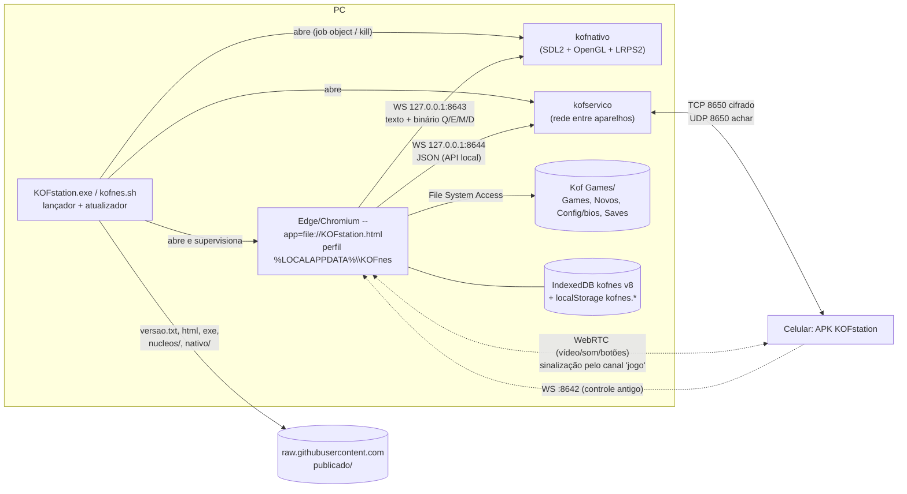
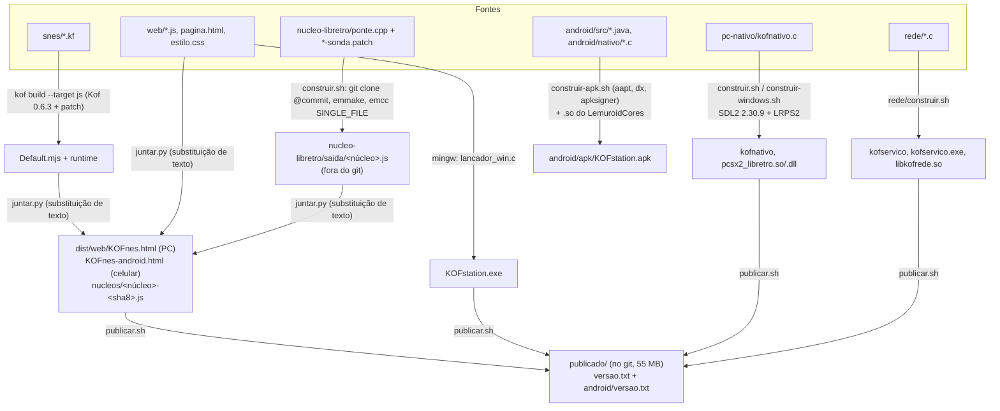
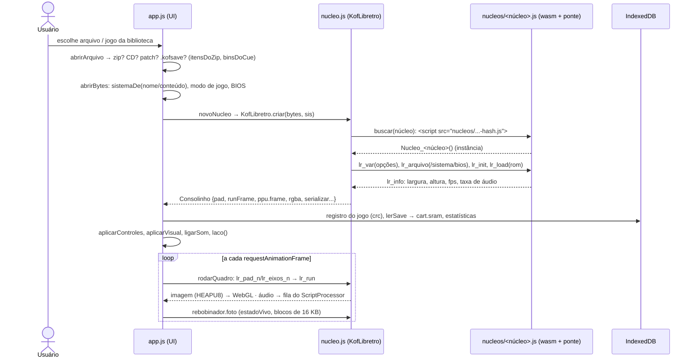
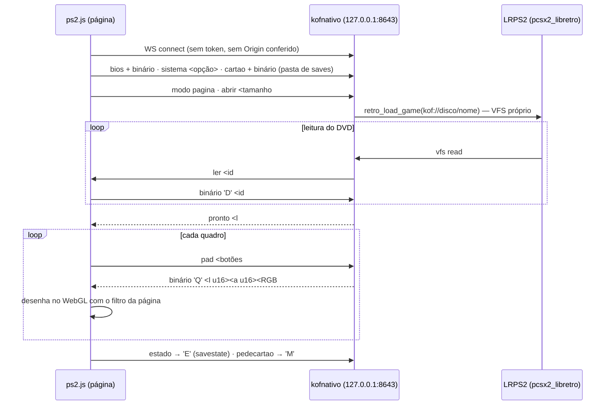
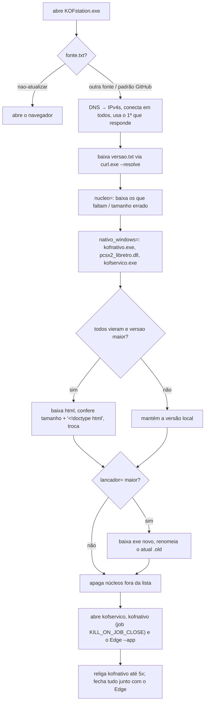
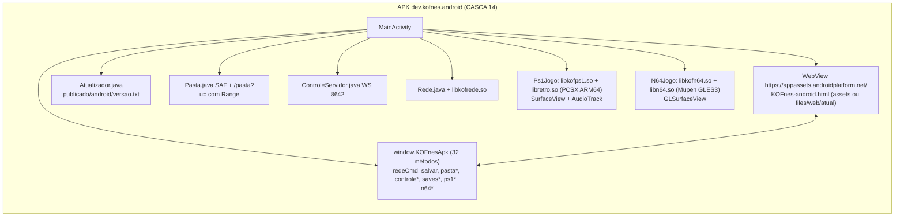
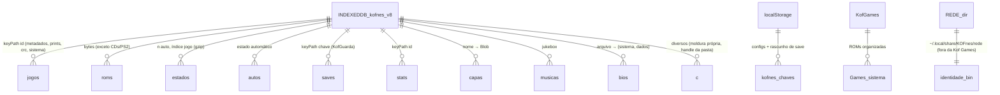

# KOFstation — Mapa do sistema atual (Fase 1)

> Base: `main` `ceba493` (202610262214). Diagramas em Mermaid. Complementa o `docs/arquitetura.md` (que continua válido
> e explica os conceitos: libretro, wasm, sonda, determinismo).

## 1. Processos e portas em execução (PC)

## 2. Build e publicação

Observação: `web/compilar-sem-kof.sh` + `testes/montar-sem-kof.sh` montam o html reaproveitando o núcleo Kof e os
núcleos já publicados (sem compilador Kof nem emscripten) — é o caminho usado na prática nas últimas publicações.

## 3. Como um jogo abre (PC, núcleo wasm)

## 4. PS2 nativo em "modo página"

## 5. Atualização (lançador do Windows)

Nenhum passo confere assinatura ou SHA-256 (só tamanho e cabeçalho).

## 6. Android

## 7. Dados do usuário (onde mora cada coisa)

## 8. Fronteiras e contratos que existem hoje

| Fronteira | Contrato | Documentado? | Tipado? |
|---|---|---|---|
| app.js ↔ núcleo | "cara do núcleo Kof" (`pad`, `runFrame`, `ppu.frame`, `rgba`, `serializar`, `nativo`...) | parcialmente (`docs/arquitetura.md §5`) | não |
| JS ↔ wasm | funções `lr_*` da `ponte.cpp` | comentários no .cpp | C |
| página ↔ kofnativo | linhas de texto + binários 'Q','E','M','D' | cabeçalho do `kofnativo.c` | não |
| página ↔ kofservico | JSON da API local | `rede/PROTOCOLO.md` | não |
| aparelho ↔ aparelho | protocolo kofrede v1 | `rede/PROTOCOLO.md` (completo) | binário especificado |
| página ↔ APK | `window.KOFnesApk.*` + callbacks `window.__*` | não | não |
| lançador ↔ GitHub | `versao.txt` chave=valor | `docs/arquitetura.md §7` | não |
| app ↔ dados | IndexedDB v8 + `kofnes.*` | parcial (CLAUDE.md) | não |
| jogarpc (PC ↔ celular) | mensagens `pedir/oferta/resposta/fim/acao/menu/levar` + 6 bytes | CLAUDE.md | não |
