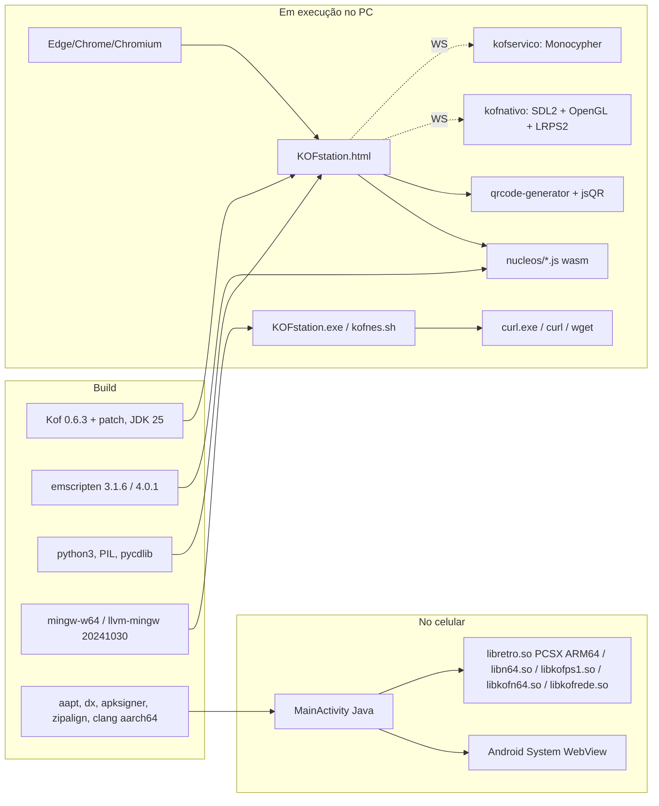

# KOFstation — Auditoria de dependências (Fase 1)

> Base: `main` `ceba493` (202610262214). Versões lidas dos scripts de build, cabeçalhos e CLAUDE.md.
> "Situação": ✅ ok · ⚠️ atenção · ❌ problema.

## 1. Visão geral

O projeto **não tem gerenciador de pacotes** (sem `package.json`, `Cargo.toml`, `requirements.txt`, Gradle). Toda
dependência é: (a) clonada por `git` num commit fixo dentro de um script `construir*.sh`, (b) copiada para
`web/terceiros/` ou `rede/terceiros/`, ou (c) instalada à mão no sistema (apt, emsdk, JDK). Isso dá controle total e
zero *bloat*, mas nenhuma reprodutibilidade automática nem auditoria de segurança.

## 2. Núcleos de emulação (preservar — regra do plano)

| Núcleo | Sistema(s) | Origem / commit | Forma | Licença | Situação |
|---|---|---|---|---|---|
| Snes9x | SNES (PC padrão; celular) | libretro/snes9x `fae2fea0` | wasm (emscripten 3.1.6) | **Só não comercial** | ⚠️ licença |
| Gambatte | GB/GBC | libretro/gambatte-libretro `d9d6cd06` + `gambatte-sonda.patch` | wasm | GPL-2 | ✅ |
| FCEUmm | NES | libretro/libretro-fceumm `ac0d00a7` + sonda | wasm | GPL-2 | ✅ |
| Genesis Plus GX | MD/SMS/GG (+ núcleo só de som `somfm`) | libretro/Genesis-Plus-GX `aa74d796` + sonda (CRLF no `ym2612.c`) | wasm, `HAVE_CHD=0` | **Só não comercial** | ⚠️ licença |
| mGBA | GBA | libretro/mgba `7a12d6d4` + sonda | wasm (CMake; sondagens forçadas à mão) | MPL-2.0 | ✅ |
| FBNeo (`SUBSET=neogeo`) | Neo Geo | libretro/FBNeo `2dbbac76` + sonda | wasm (~8 MB) | **Só não comercial** | ⚠️ licença |
| PCSX-ReARMed | PS1 (PC) | libretro/pcsx_rearmed `c8816799` | wasm interpretador (miniz no lugar da zlib) | GPL-2 | ✅ |
| PCSX-ReARMed ARM64 | PS1 (celular) | Swordfish90/LemuroidCores `fee2e824` (binário pronto) | `.so` | GPL-2 | ⚠️ binário de terceiro, sem build próprio |
| Mupen64Plus-Next | N64 (PC) | libretro/mupen64plus-libretro-nx `15bada85` + libco por fibers + ASYNCIFY | wasm + WebGL2 | GPL-2 | ✅ (pouco testado com jogo real) |
| Mupen64Plus-Next GLES3 | N64 (celular) | LemuroidCores (SONAME trocado com patchelf) | `.so` | GPL-2 | ⚠️ binário de terceiro |
| LRPS2 (PCSX2 libretro) | PS2 (PC) | libretro/ps2 `38d3a83f` + `lrps2-windows.patch` | `.so` / `.dll` nativos | GPL-3 | ⚠️ Windows sem teste real (Wine cai no VirtualAlloc2) |
| Play! | PS2 (reserva, wasm) | jpd002/Play- `505dac73` + `play-kof.patch` | wasm com threads (emsdk 4.0.1) | BSD-2 | ⚠️ falha no SotC; precisa SharedArrayBuffer |
| Núcleo Kof | SNES (opção) | `snes/*.kf` (próprio) | JS gerado pelo Kof 0.6.3 com patch | do projeto | ⚠️ opcional; build depende do compilador com patch |

**Frontends libretro próprios** (não são dependências externas, mas são o que "integra os emuladores"):
`nucleo-libretro/ponte.cpp`, `pc-nativo/kofnativo.c`, `android/nativo/kofnativo.c`, `nucleo-libretro/libco-emscripten.c`,
`nucleo-libretro/somfm.c`. **RetroArch: não é usado.**

## 3. Bibliotecas de terceiros embutidas

| Biblioteca | Onde | Versão | Licença | Uso | Situação |
|---|---|---|---|---|---|
| qrcode-generator (Kazuhiko Arase) | `web/terceiros/qrcode.js` | sem versão marcada | MIT | Desenhar QR do pareamento | ⚠️ versão não registrada |
| jsQR | `web/terceiros/jsQR.js` → `nucleos/qr-<hash>.js` | sem versão marcada | Apache-2.0 | Ler QR pela câmera | ⚠️ versão não registrada |
| Monocypher | `rede/terceiros/monocypher.{c,h}` | "`__git__`" (sem versão) | CC0 / BSD-2 | X25519, Elligator2, BLAKE2b, XChaCha20-Poly1305 | ⚠️ registrar versão; manter |
| SDL2 | clonado em `pc-nativo/construir.sh` | **2.30.9** (estático) | zlib | Janela/entrada/som do kofnativo | ✅ (SDL3 existe; não há motivo pra trocar agora) |
| glad | vem do LRPS2 | — | MIT | GL 3.3 no Windows | ✅ |
| miniz | dentro do PCSX-ReARMed | — | MIT | zlib no wasm | ✅ |
| libretro.h | dos repositórios dos núcleos | — | MIT | API libretro | ✅ |

## 4. Dados e mídia de terceiros

| Item | Origem | Licença | Uso | Situação |
|---|---|---|---|---|
| Base de jogos | libretro-database `rdb/*.rdb` → `web/jogos/jogos.json.gz` | CC BY-SA 4.0 | Busca por gênero/empresa/ano | ✅ crédito no Guia; ⚠️ SA obriga a mesma licença no derivado |
| Capas | `raw.githubusercontent.com/libretro-thumbnails/...` (baixadas em execução) | variadas (arte comercial) | Capas da biblioteca | ⚠️ não podem ir em print/README (regra já seguida) |
| Air (violino) | Wikimedia, USAF Band | Domínio público | Abertura/Início | ✅ |
| Air (partitura) | Mutopia `.ly` | Domínio público | Versão 8 bits | ✅ |
| "Se Essa Rua Fosse Minha" | MuseScore, arranjo Daniel Pynkus | ⚠️ conferir licença do arranjo | Início | ⚠️ |
| Lista Neo Geo | `gamelist.txt` do FBNeo → `web/neogeo-jogos.js` | não comercial (FBNeo) | Reconhecer zip | ⚠️ |

## 5. APIs da plataforma em uso (dependências "invisíveis")

| API | Onde | Por quê | Observação |
|---|---|---|---|
| WebAssembly | núcleos | emulação | ✅ |
| WebGL / WebGL2 | `app.js` (`gl*`), `visual.js`, Mupen64 | vídeo, filtros com passadas | ✅ |
| Web Audio `ScriptProcessorNode` | `ligarSom()` | som do jogo | ❌ **obsoleta**; trocar por AudioWorklet |
| IndexedDB / localStorage | `abrirBanco()` v8, `ler/guardar` | toda a persistência | ⚠️ preso à origem `file://` |
| File System Access (`showDirectoryPicker`) | `lerPasta`, `organizar`, Kof Games | pasta de ROMs | ⚠️ só Chromium |
| Gamepad API | `estado()`, `jogadores.js` | controles 1–4 | ✅ |
| WebSocket | `ps2.js`, `rede.js`, `conectarControle` | nativos e celular | ⚠️ ver segurança |
| WebRTC | `jogarpc.js`, `android.js` | Jogar no PC | ⚠️ crítico na escolha da WebView |
| `SharedArrayBuffer` | Play! | threads | ❌ só com flag `--enable-features=SharedArrayBuffer` |
| `navigator.storage.persist` | `app.js` | não perder dados | ✅ |
| CompressionStream/DecompressionStream | `comprimir/descomprimir` | gzip de estados/saves | ✅ |
| Flags do Chromium | lançadores | `--app`, `--disable-features=LocalNetworkAccessChecks,BlockInsecurePrivateNetworkRequests`, `--enable-features=SharedArrayBuffer`, `--disable-background-timer-throttling` | ❌ frágeis: podem sumir em qualquer versão |

## 6. Ferramentas de build

| Ferramenta | Versão | Usada em | Situação |
|---|---|---|---|
| Compilador Kof | 0.6.3 + `web/kof-js-correcoes.patch` (5 arquivos do alvo JS) | `web/compilar.sh` | ⚠️ montado à mão; `compilar-sem-kof.sh` contorna |
| JDK | 25 (Kof); `javac --release 8` (APK) | Kof, APK | ⚠️ |
| emscripten | **3.1.6** (Ubuntu, núcleos) e **4.0.1** (emsdk, Play!) | `nucleo-libretro/construir.sh`, `nucleo-ps2/construir.sh` | ❌ 3.1.6 é de 2022; duas versões diferentes |
| Python 3 + Pillow + pycdlib | sistema | `juntar.py`, ícones, testes PS2 | ✅ |
| mingw-w64 (Ubuntu) | sistema | `KOFstation.exe`, `kofservico.exe` | ✅ |
| llvm-mingw | 20241030 | `kofnativo.exe` + `pcsx2_libretro.dll` (DX12 exige mingw novo) | ✅ |
| gcc, cmake, ninja | sistema | kofnativo Linux, LRPS2, mGBA | ✅ |
| clang `--target=aarch64-linux-android24 -nostdlib` + stubs | sistema | `.so` do APK sem NDK | ⚠️ contorno (NDK estava bloqueado na rede do container) |
| aapt, **dx**, apksigner, zipalign, android.jar API 23 | apt | `android/construir-apk.sh` sem Gradle | ❌ `dx` é obsoleto (substituído pelo `d8`); targetSdk 34 (a Play Store exige 35 desde ago/2025) |
| patchelf | sistema | SONAME do N64 | ✅ |
| Chave de assinatura Android | `android/kofnes-teste.keystore` (pública) | APK | ❌ pra distribuição pública/Play precisa de chave privada |

## 7. Testes

| Ferramenta | Versão | Situação |
|---|---|---|
| Node | 22 (container) | ✅ |
| Playwright + Chromium | o do container (`/opt/node22/lib/node_modules/playwright`, `/opt/pw-browsers`) | ⚠️ caminho fixo no `require`, sem versão travada |
| Wine | 9 (`/usr/lib/wine/wine64`) | testes dos lançadores e do PS2 Windows | ✅ |
| xvfb-run | sistema | PS2 nativo | ✅ |

## 8. Serviços externos em tempo de execução

| Serviço | Uso | Risco |
|---|---|---|
| `raw.githubusercontent.com/Marcelao98/...` | atualizador (página, exe, núcleos, nativos, APK) | ❌ sem assinatura (ver ARCHITECTURE_AUDIT P8) |
| `raw.githubusercontent.com/libretro-thumbnails` | capas | ✅ só imagem |
| `github.com/.../issues/new` | relatório de bug preenchido | ✅ |
| WebRTC | `iceServers: []` em `jogarpc.js`/`android.js` (sem STUN/TURN: só rede de casa) | ✅ nada sai pra internet |

## 9. Diagnóstico

- **Desatualizadas:** emscripten 3.1.6; `ScriptProcessorNode`; `dx`; targetSdk 34; `javac --release 8` sem lambdas.
- **Redundantes:** dois emscripten; dois WS próprios em C + um em Java (handshake/SHA-1/base64 repetidos 3x); Play! e
  LRPS2 pro mesmo console (o Play! é reserva).
- **Substituíveis com ganho:** `juntar.py` → Vite; WebSocket feito à mão → IPC do Tauri ou crate testada; atualizador
  em C/sh → updater assinado; scripts de teste avulsos → Vitest/Playwright Test.
- **Preservar:** todos os núcleos e remendos de sonda; `ponte.cpp`; `kofnativo` (como *sidecar* no começo); Monocypher
  e o protocolo kofrede (já pensado pra ter outra implementação, inclusive Rust); SDL2; base de jogos; músicas.
- **Requisitos do SO hoje:** Windows 10/11 com Edge (ou Chrome) e `curl.exe` (vem no Windows 10 1803+); Linux com
  qualquer Chromium (normal/Snap/Flatpak) e curl ou wget; Android 7+ (API 24) ARM64 para PS1/N64 nativos.

## 10. Dependências recomendadas para o repositório novo (proposta — nada instalado)

Tabela completa (versão, finalidade, camada, justificativa, alternativas) no [MIGRATION_PLAN §6](MIGRATION_PLAN.md#6-dependências-recomendadas).
Resumo: **pnpm, TypeScript, Vite, React, Zustand, Vitest, Testing Library, Playwright, ESLint, Prettier** no front;
**Rust stable, serde/serde_json, thiserror, tracing, tracing-subscriber** no back; **Tauri 2 e Tokio condicionados** ao
resultado do *spike* da Fase 4; **React Router adiado** (uma pilha de telas em store basta pro que existe hoje).
