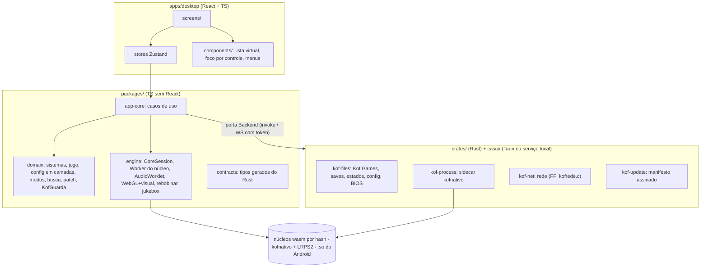

# KOFstation — Plano de migração detalhado + estimativa de tokens

> Versão 2 do plano, com as respostas do Marcelo (31/10/2026). Complementa o [MIGRATION_PLAN](MIGRATION_PLAN.md) (as
> decisões D1–D15 continuam valendo, com os ajustes abaixo).

## 0. Decisões fechadas pelo Marcelo

| Pergunta | Resposta | Efeito no plano |
|---|---|---|
| Nome dos repositórios | antigo = `Marcelao98/kofstation-old`; novo = `Marcelao98/kofstation` | ver §1 (cuidado com os links) |
| Linux × Windows | **mesma prioridade** (o Marcelo usa Linux) | o *spike* do Tauri no Linux (WebKitGTK) vira **porteira**: sem passar, vai a opção B |
| Licença | **GPL-3.0** | LICENSE + THIRD_PARTY.md no dia 1 |
| Núcleo Kof | **é da Mel** | não entra no repositório novo; vira artefato opcional, só com a licença/autorização dela |
| Celular | **entra depois** | M14 fica no fim; até lá o celular continua no app antigo |
| O que é intocável | **todas as funcionalidades** | regra de **paridade total** (§2): nada é "simplificado" na migração |
| Correção de segurança no antigo | não agora (ninguém joga PS2) | fica anotado; o app novo já nasce corrigido (M12) |

## 1. ⚠️ Antes de criar o repositório novo: os links

- **Atualizadores: estão seguros.** `lancador_win.c:53`, `lancador_linux.sh:14` e `MainActivity.java:46-47` baixam de
  `raw.githubusercontent.com/Marcelao98/KOFSnes/main/...` (o nome mais antigo). Depois de renomear pra `kofstation-old`,
  o GitHub continua redirecionando `KOFSnes` → `kofstation-old`. **Nunca crie um repositório chamado `KOFSnes`**: isso
  quebraria a atualização de todo mundo.
- **README, `docs/index.html` (página de download) e o comando `curl ... kofnes.sh` usam `KOFStation`.** O GitHub não
  diferencia maiúscula de minúscula: quando o repositório novo `kofstation` existir, esses links passam a apontar pro
  **novo** (que não tem `publicado/`) e quebram. Conserto (uma troca de texto no repositório antigo, depois da troca de
  nome): `KOFStation` → `kofstation-old` nesses três lugares. Faço quando você mandar.
- O GitHub Pages do antigo (se estiver ligado) muda de endereço com o nome novo.
- Esta sessão envia pra `Marcelao98/KOFStation`; depois que o novo existir, eu troco o `origin` desta cópia pra
  `kofstation-old` antes de qualquer envio.

## 2. Regra de paridade total ("todas as funcionalidades são intocáveis")

Uma funcionalidade só é considerada migrada quando, comparada com o app antigo:

1. **faz a mesma coisa** (cada item da ficha do FEATURE_INVENTORY);
2. **tem os mesmos atalhos e gestos** (F2, F3, F4, M, Esc, Backspace/Select+Y, botão direito = Voltar, toque longo...);
3. **lê e grava os mesmos formatos**, nos dois sentidos: `.kofsave`, `.kofvisual`, `.spc`, `kofbug-*.json.gz`, savestates
   (um estado salvo no antigo abre no novo e vice-versa), saves de bateria, `.mcd`;
4. **desenha a mesma imagem** (mesma ROM + estado + botões → mesmos pixels, inclusive com filtros e molduras);
5. **toca o mesmo som** (mesmas amostras do núcleo; jukebox com os mesmos canais);
6. **tem teste** reproduzindo o teste antigo equivalente.

Ferramenta pra isso: `docs/PARIDADE.md` no repositório novo, uma linha por comportamento (tirada das 42 fichas e dos
~85 testes antigos), com status `pendente / migrado / verificado`. Sem linha verificada, a etapa não fecha.

## 3. Arquitetura-alvo (resumo do que vai ser construído)



Contrato central da engine (rascunho; vira `packages/engine/src/core.ts`):

```ts
interface CoreSession {
  readonly system: SystemId;              // 'snes' | 'gb' | 'nes' | 'md' | ... | 'ps2'
  readonly caps: { rewind: boolean; perChannelAudio: boolean; asyncState: boolean; rendersToPage: boolean; ports: 1 | 2 | 4 };
  readonly video: { width: number; height: number; aspect: number; fps: number };
  readonly audioRate: number;
  runFrame(): void;                       // dentro do Worker
  setInput(port: number, buttons: number, axes: Int8Array): void;
  frame(): Uint8Array;                    // RGBA (memória do wasm, sem cópia)
  saveState(): Promise<Uint8Array>;  loadState(s: Uint8Array): Promise<void>;
  batteryRam(): Uint8Array | null;
  dispose(): void;
}
// adaptadores: WasmLibretroCore (ponte.cpp, mesmos nucleos/*.js), NativePcCore (kofnativo via Rust),
//              NativeAndroidCore (KOFnesApk), KofCore (opcional, artefato da Mel)
```

## 4. Etapas (o que cada uma reaproveita, o que é novo, quando fecha)

Legenda de reaproveitamento: **C** = copiar quase igual (só tipos/módulos) · **A** = adaptar (lógica igual, estrutura
nova) · **R** = reescrever (mesmo comportamento, código novo) · **N** = novo.

| Etapa | Entrega | Vem do antigo | Tipo | Fecha quando |
|---|---|---|---|---|
| **F2** Arquitetura | `ARCHITECTURE.md`, `DECISIONS.md` (D1–D15), `API_CONTRACTS.md` v0, `PARIDADE.md`, LICENSE GPL-3, `THIRD_PARTY.md`, `CLAUDE.md` do novo | auditoria/ | N | você aprova |
| **F3** Ambiente | pnpm workspace, Cargo workspace, `rust-toolchain.toml`, lockfiles, CI (Linux + Windows), guia de instalação Linux (Fedora e Ubuntu) | — | N | instalação limpa no container e no teu Linux |
| **F4a** Esqueleto | React → Rust → React (`app.info`), erro de comunicação tratado, `tracing` em arquivo, testes Vitest/cargo/Playwright | — | N | CI verde |
| **F4b** Spike D2 | Tauri (WebKitGTK/WebView2) × Rust + Chromium: Snes9x, Genesis, PCSX, Mupen64 e FBNeo wasm **atuais** num Worker + AudioWorklet + WebGL com uma passada do visual + Gamepad + WebRTC loopback | `nucleos/*.js`, `ponte.cpp`, trecho do `visual.js` | A | relatório com números; D2 decidida (§5) |
| **M1** Casca | pilha de telas + Voltar, 126 temas (tokens do `estilo.css`), Início, menu lateral, guia, foco por controle | `estilo.css`, `pagina.html`, `app.js` 3612–4350 | C (CSS) + R (telas) | e2e: telas, Voltar, temas, contraste WCAG |
| **M2** Engine mínima | `CoreSession` + `WasmLibretroCore` no Worker, vídeo WebGL, som AudioWorklet, teclado/controle J1, abrir arquivo | `nucleo.js` (C/A), `app.js` 198–260, 698–797, 1141–1225, 1708 | A | MD/NES/GB/SNES gerados rodam; pixels = antigo |
| **M3** Biblioteca | `kof-files` (varrer/organizar Kof Games, ler arquivo aos pedaços), registro de jogos, zip/CD/.cue, detecção de sistema, busca/filtros/base de jogos, capas | `app.js` 1875–2319, 2968–3612; `jogos.js` (C) | A + R | 3.000 jogos falsos; árvore igual ao `pastas.cjs` |
| **M4** Config + dados | esquema de configurações em camadas (geral/console/jogo) em arquivo; **importar/exportar `.kofsave` compatível** | `guarda.js` (C), `app.js` 2512–2704 | C + A | backup do antigo abre no novo e vice-versa |
| **M5** Saves e estados | bateria, savestates (compatíveis com os do antigo), automático, modos de jogo, limite de estados, "Continuar" | `app.js` 1831–1848, 2756–2968; `estado.js` | A | `saves`/`estados`/`auto`/`modos` equivalentes |
| **M6** Rebobinar | `Rebobinador` + `estadoVivo` no Worker, ampulheta | `estado.js` 102+ (C), `nucleo.js` | C | bit a bit igual |
| **M7** Visual e molduras | painel Simples/Avançado, 61 ajustes, 42 predefinições, passadas, prévias, por console/jogo, `.kofvisual`, molduras SVG/PNG, paletas GB/NES, proporção | `visual.js` (C), `molduras.js` (C), `app.js` 50–698 | C + R (painel) | pixel a pixel em todas as predefinições |
| **M8** Controles | camadas de teclas/botões, analógico no teclado, jogadores 2–4, tela de mapeamento, navegação por controle completa | `app.js` 797–964, 3618–3736; `jogadores.js` (A) | A | `controles`/`jogadores` equivalentes |
| **M9** Jukebox e música | 2ª instância do núcleo, sonda, Ondas, Solo/Mudo, notas, .spc, .wav, trilha FM, 8 bits, violino, música do Início, abertura | `app.js` 1225–1700, 2026–2204; `spc.js`, `musica.js`, `somfm.js` (C) | C + R (telas) | `juke`/`jukebox`/`trilha`/`abertura` equivalentes |
| **M10** Estatísticas + extras | estatísticas por aparelho, espaço usado, patches IPS/BPS/UPS, caçador de bugs + replay, painel de desempenho, aviso de mudo, aviso de atualização | `guarda.js`, `patch.js` (C), `app.js` 1719–1831, 2560–2623 | C + A | `guarda`/`bug`/`atualiza` equivalentes |
| **M11** Sistemas com BIOS | BIOS (tela e por conteúdo), GBA, Neo Geo (zip inteiro + pai), PS1 wasm (CD no MEMFS), N64 wasm, núcleo do SNES escolhível | `app.js` 2341–2456; `nucleo.js` | A | `gba`/`neogeo` (zips falsos)/`ps1`/`n64` |
| **M12** PS2 nativo | `kof-process` supervisiona o **mesmo** kofnativo; canal com token; modo página; Play! de reserva | `pc-nativo/` (sem mudar o C), `ps2.js` (A) | A | `ps2-pagina`/`ps2-nativo` equivalentes |
| **M13** Rede | `kof-net` (FFI `kofrede.c`, mesmo PROTOCOLO.md: pareia com o celular atual), Aparelhos/QR, celular como controle (antigo e pela rede), Jogar no PC, Controle total, Modo Switch, Levar pro celular | `rede/` (C), `rede.js`, `jogarpc.js` (A) | A + R | `aparelhos`/`jogar-no-pc` + celular antigo conectando no PC novo |
| **M14** Celular | a casca Java atual serve o html novo (adaptador `KOFnesApk`), controle de toque (6 modelos), biblioteca do celular, PS1/N64 nativos | `android.js` (A), `android.css` (C), `android/` (sem mudar o Java no começo) | A | `celular`/`apk-simulado`/`pasta-apk`/`controle` |
| **M15** Distribuição | pacotes Linux (AppImage/.deb/.rpm ou tar) e Windows, atualizador **assinado** em canal próprio, beta lado a lado com o antigo | lançadores (R em Rust) | R | você instala no teu Linux e num Windows |
| **Troca** | quando o `PARIDADE.md` estiver 100% verificado: o antigo publica uma última versão que avisa e leva pro novo | — | N | você decide |

Ordem com dependências: F2 → F3 → F4a → F4b → M1 → M2 → (M3, M4) → M5 → M6 → M7 → M8 → M9 → M10 → M11 → M12 → M13 → M15 →
M14 → Troca. M3/M4 podem andar em paralelo; o resto depende da engine (M2).

## 5. Spike do Tauri no Linux (F4b): critérios objetivos

Rodando nas duas opções, no Linux e no Windows, com os núcleos e ROMs de teste geradas:

| Critério | Passa se |
|---|---|
| Quadros | 60 fps estáveis em SNES, MD, PS1, N64 e Neo Geo de teste, com a CPU limitada a 4x (celular médio), ≤ 1 engasgo por minuto |
| Som | AudioWorklet sem falta de amostra em 2 minutos; latência ≤ 60 ms |
| Vídeo | as passadas NTSC/Scale4x/bloom compilam e dão os mesmos pixels do Chromium |
| Controle | Gamepad API vê controle USB e Bluetooth com os mesmos índices |
| WebRTC | vídeo H.264 + canal de dados loopback funcionando (Jogar no PC) |
| Threads | `SharedArrayBuffer` sem flag (Play!) |
| Instalação | instala no Fedora e no Ubuntu sem passo manual além do pacote |

Se o Tauri falhar em qualquer item no Linux, vai a **opção B** (o backend Rust serve o app num endereço local com token
e abre o Chromium em modo app, como hoje, mas sem `file://`). Os crates de backend são os mesmos nas duas opções; só a
"casca" muda.

## 6. Estimativa de tokens

### 6.1 Como medi
- Código antigo a ler: interface ≈ **840 KB** (`web/`, o `app.js` sozinho tem 308 KB ≈ 95 mil tokens) + nativos ≈ 145 KB.
  Cada etapa lê só os trechos dela (as fichas dão as linhas), não o arquivo inteiro.
- Código novo a escrever: ≈ 30 mil linhas (TS/TSX ~17 mil, testes ~7 mil, Rust ~6 mil) ≈ **350–450 mil tokens de
  código final**. Escrever, errar, testar e corrigir multiplica isso por 4 a 8 em tokens de saída (inclui raciocínio).
- Trabalho com ferramentas relê a conversa a cada passo: a maior parte do total é **contexto relido (em cache)**, que
  custa bem menos que token novo. Por isso dou três números.

### 6.2 Por etapa

| Etapa | Sessões | Saída (escrita) | Entrada nova | Total processado (com cache) |
|---|---|---|---|---|
| F2 Arquitetura | 1 | 40–60 mil | 0,3 M | 3–5 M |
| F3 Ambiente | 1 | 30–50 mil | 0,4 M | 4–8 M |
| F4a Esqueleto | 1–2 | 60–100 mil | 0,5 M | 6–12 M |
| F4b Spike | 2–3 | 100–180 mil | 1 M | 15–30 M |
| M1 Casca | 2–3 | 150–250 mil | 1 M | 15–30 M |
| M2 Engine | 3–4 | 200–350 mil | 1,5 M | 25–45 M |
| M3 Biblioteca | 3–4 | 200–350 mil | 1,5 M | 25–45 M |
| M4 Config + dados | 2 | 100–180 mil | 0,8 M | 12–22 M |
| M5 Saves/estados | 2 | 100–180 mil | 0,8 M | 12–22 M |
| M6 Rebobinar | 1 | 40–80 mil | 0,4 M | 5–10 M |
| M7 Visual/molduras | 3 | 200–300 mil | 1,2 M | 20–35 M |
| M8 Controles | 2–3 | 150–250 mil | 1 M | 15–30 M |
| M9 Jukebox/música | 3 | 200–300 mil | 1,2 M | 20–35 M |
| M10 Estatísticas/extras | 2 | 100–180 mil | 0,8 M | 12–22 M |
| M11 BIOS/sistemas | 2–3 | 120–220 mil | 1 M | 15–30 M |
| M12 PS2 nativo | 2 | 100–180 mil | 0,8 M | 12–22 M |
| M13 Rede | 3–4 | 200–350 mil | 1,5 M | 25–45 M |
| M14 Celular | 2–3 | 150–250 mil | 1 M | 15–30 M |
| M15 Distribuição | 2–3 | 120–220 mil | 1 M | 15–30 M |
| **Total** | **~40–50 sessões** | **≈ 2,5–4,5 milhões** | **≈ 17–20 milhões** | **≈ 270–530 milhões** |

Incerteza honesta: **±50%**. O que mais pode estourar: o spike (se o WebKitGTK der trabalho), a engine (Worker +
AudioWorklet é o "motor novo" que nunca foi feito) e a rede/Jogar no PC (WebRTC é chato de depurar).

### 6.3 Comparado com fazer do zero
Você está certo, mas com uma nuance:
- **A economia é grande nas partes difíceis**: núcleos e sondas, `ponte.cpp`, kofnativo/PS2, criptografia da rede,
  shaders do visual, formatos de arquivo, lógica de saves/rebobinar/modos. Isso é **copiado ou adaptado**, e essas
  foram justamente as partes que custaram mais rodadas de depuração (FCEUmm travando, PS2 lendo só o 1º bloco, sondas,
  N64 com ASYNCIFY...). Muitas vezes a resposta já está escrita num comentário do código antigo.
- **A interface (o `app.js`) é a maior parte e é reescrita** em React: a lógica é copiada, mas o código é novo.
- Minha estimativa pra chegar na mesma paridade **do zero**: **2,5 a 4 vezes mais** (≈ 8–15 milhões de tokens de saída),
  porque teria que redescobrir cada problema de emulação, de plataforma e de rede que já foi resolvido.

### 6.4 Como gastar menos (vou seguir isto)
1. **Uma etapa por sessão** (ou duas sessões pras grandes); sessão curta relê menos contexto.
2. **`CLAUDE.md` do repositório novo enxuto**, com "onde parou" no topo (o atual tem ~60 KB e é relido em toda sessão:
   no novo, o histórico vai pra `docs/`).
3. **Ler o antigo por trecho** (as linhas estão nas fichas), nunca o `app.js` inteiro.
4. **Não recompilar núcleos**: usar os `nucleos/*.js` publicados pelo hash.
5. **Rodar só os testes da etapa**, a suíte inteira só no CI.
6. **ROMs geradas pelos testes** (o projeto já sabe gerar de MD, NES, GB, GBA, PS1 e PS2).

## 7. O que preciso de você pra começar a F2

1. Terminar a troca de nome (`KOFStation` → `kofstation-old`) e criar o `kofstation` vazio (ou me autorizar a criar
   pelo GitHub, público ou privado?).
2. Adicionar o `kofstation` novo nesta sessão (ou abrir uma sessão nova nele) pra eu poder enviar.
3. Dizer se eu já conserto os links do README/página de download do antigo (§1).
4. Perguntar à Mel se o núcleo Kof pode entrar no projeto GPL-3 como opção (e com qual licença). Não bloqueia nada: ele
   fica de fora até ela responder.
